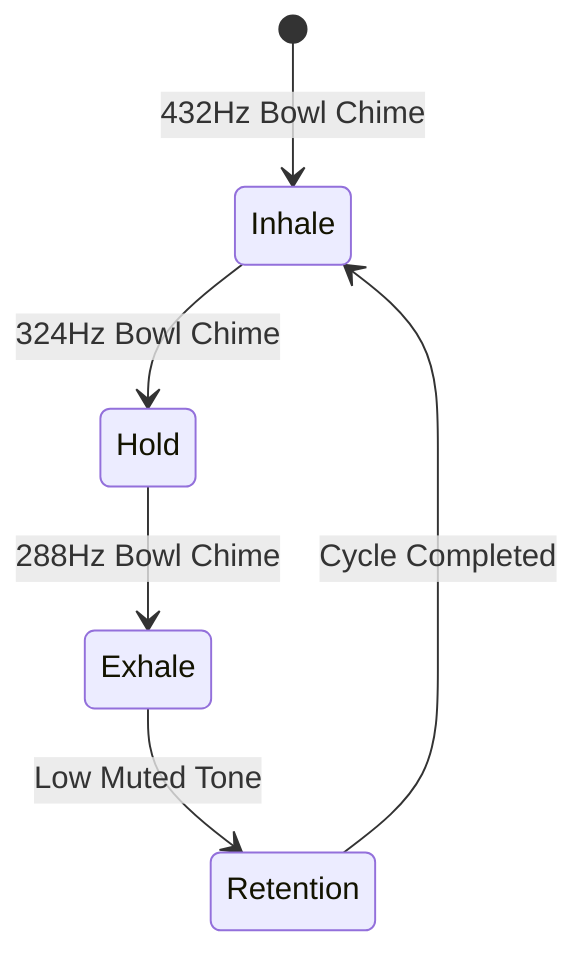

# SDLC Documentation & Wiki Synchronization Skill (`sdlc-docs-wiki`)

Use this skill whenever features, techniques, data models, or architectural patterns are added, modified, or deprecated. This skill enforces continuous documentation hygiene.

---

## 📚 Documentation Ecosystem

The Project maintains two synchronized documentation layers:

1. **Root Readme & Guides (`README.md`)**: User-facing onboarding, feature list, quickstart commands, keyboard shortcuts table, and tech stack overview.
2. **Product & Architecture Wiki (`wiki/`)**: Deep-dive technical specifications, scientific foundations, design system tokens, monetization, roadmap, and ADRs.

---

## 🗂️ Wiki Structure Standard

When updating or adding documentation to `wiki/`:

```
wiki/
├── Home.md                          # Product vision, core value proposition & quick links
├── Somatic-Science.md               # Physiological foundations, HRV, vagal brake, RSA
├── Architecture-and-Tech-Stack.md   # Svelte 5, Runes, Tailwind v4, modern web APIs, SVG Math
├── Design-System.md                 # Editorial zen philosophy, typography, colors, tokens
├── Roadmap.md                       # Phased development plans & milestones
├── Legal-and-IP.md                  # 17 U.S.C. § 102(b) clean-room provenance & disclaimers
├── Technique-[Name].md              # Deep dive per breathing technique
├── _Sidebar.md                      # Navigation hierarchy for GitHub Wiki
└── _Footer.md                       # Universal footer branding
```

---

## 🛠️ Step-by-Step Documentation Workflow

### Step 1: Detect Code Changes & Impact
Identify what changed in the codebase:
- New breathing technique added $\rightarrow$ Create `wiki/Technique-[Name].md` and update `wiki/Somatic-Science.md`, `wiki/_Sidebar.md`, and `README.md`.
- New UI state or audio engine feature $\rightarrow$ Update `wiki/Feature-[Name].md` and `wiki/Architecture-and-Tech-Stack.md`.
- New keyboard shortcut or configuration option $\rightarrow$ Update the shortcuts table in `README.md`.

### Step 2: Write Technical & Scientific Prose
- **Tone**: Zen editorial, scientifically rigorous, concise, and elegant.
- **Formulas**: Render LaTeX math expressions for frequencies ($432\text{Hz}$), ratios ($4:7:8$), and baroreceptor resonance ($0.1\text{Hz}$).
- **Mermaid Diagrams**: Include clear Mermaid class, state, or flow diagrams for data flows and state machines.



### Step 3: Update `_Sidebar.md`
Ensure any new wiki article is indexed in `wiki/_Sidebar.md` with appropriate emoji prefixes and hierarchical grouping.

### Step 4: Validate Cross-Links
Verify that all markdown relative links (e.g. `[Somatic Science](./wiki/Somatic-Science.md)`) resolve correctly without dead anchors.

---

## ⏭️ Next Recommended Step

Once documentation and `/wiki` synchronization is complete:
👉 **Transition to [`sdlc-quality-gate`](../sdlc-quality-gate/SKILL.md)** to run full static analysis, a11y checks, and production build verification.
