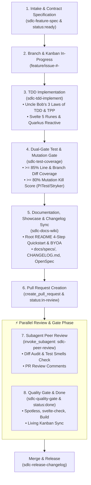

# SDLC Master Lifecycle Orchestrator (`sdlc-flow`)

Use this skill to execute end-to-end software development workflows for GitHub Issues or direct feature requests. `sdlc-flow` coordinates an 8-stage lifecycle enforcing strict contract specification, Robert C. Martin TDD and mutation testing defense, developer onboarding/showcase hygiene, Kanban state tracking (`sdlc-kanban`), and parallel subagent peer review.

---

## ⚡ 8-Stage Lifecycle Architecture



---

## 🛠️ Step-by-Step Lifecycle Execution

### Stage 1: Intake & Contract Specification (`sdlc-feature-spec`)
- Ensure project stack is detected and `.agent/sdlc-config.json` is initialized: `node .agent/scripts/sdlc-engine.mjs detect`.
- Fetch issue requirements using `issue_read` via `github-mcp-server`.
- Post initial progress comment: `"🚀 Starting automated execution for ticket #<id>..."`
- Formulate RFC / PRD, architecture schema, and Gherkin acceptance criteria.
- **Kanban Transition (`sdlc-kanban`)**: Tag ticket with `status:ready`.

### Stage 2: Branch & Kanban Automation (`sdlc-kanban`)
- **Kanban Transition (`sdlc-kanban`)**: Tag ticket with `status:in-progress`, assign to active Milestone, and sync board (`kanban-sync.sh`).
- Verify clean git status (`git status --porcelain`).
- Create and checkout branch: `git checkout -b feature/issue-#<id>-<kebab-case-title>`.

### Stage 3: Clean-Room TDD Implementation (`sdlc-tdd-implement`)
- Strictly apply **Uncle Bob's Three Laws of TDD** and the **Transformation Priority Premise (TPP)**.
- If modifying legacy code with $<40\%$ baseline coverage, write characterization tests first.
- Write failing unit tests first for degenerate cases before writing production code.
- Implement business logic adhering to Svelte 5 Runes (`$state`, `$derived`, `$props`) for UI, and Quarkus reactive standards (Mutiny `Uni`/`Multi`, Panache) for backend (or the stack detected in `.agent/sdlc-config.json`).
- Reject test smells (no testing trivial getters/setters, no testing framework plumbing, no mock-heavy interaction verification).

### Stage 4: Dual-Gate Test & Mutation Enforcement (`sdlc-test-coverage`)
- Run directory-scoped tests and Dual-Gate checks via the universal engine:
  ```bash
  node .agent/scripts/sdlc-engine.mjs coverage
  node .agent/scripts/sdlc-engine.mjs mutation
  ```
- Or run stack-specific commands: backend (`./mvnw clean test jacoco:report`, `./mvnw test-compile org.pitest:pitest-maven:mutationCoverage`) and frontend (`npm run test:coverage`, `npx stryker run`).
- Target modified lines: `git diff --name-only main`.
- **Enforce Dual-Gate Threshold**:
  1. $\ge 85\%$ line and branch coverage on diff.
  2. $\ge 80\%$ mutation kill score on modified classes/components.
- Automatically author missing boundary tests or strengthen assertions if mutants survive.

### Stage 5: Documentation, Showcase & Changelog Sync (`sdlc-docs-wiki`)
- **Developer Showcase Invariant**:
  - Keep root `README.md` updated with an immediate, copy-pasteable **5-Minute Developer Quickstart**:
    1. *CLI Installation*
    2. *Local Cluster / Environment Bootstrap*
    3. *Exploring Pre-built Showcase Examples* with source code
    4. *Bring Your Own App (BYOA)* workflow (scaffold, deploy, and evaluate).
  - Include polyglot benchmark comparisons (latency, memory, container size) when new archetypes or templates are introduced.
- **Contract & Spec Sync**: Update functional specs in `docs/specs/` and `/wiki`.
- **Changelog Sync**: Append conventional commit entry to `CHANGELOG.md` under `[Unreleased]` with ticket URL link.
- Update OpenSpec delta specs if active.

### Stage 6: Pull Request Opening (`sdlc-kanban`)
- Commit changes and push branch to remote.
- Call `create_pull_request` linking `Fixes #<id>` with summary of changes, diff coverage, and mutation kill score.
- **Kanban Transition (`sdlc-kanban`)**: Tag ticket with `status:in-review`.

### Stage 7: Parallel Subagent Peer Review (`sdlc-peer-review`)
- Call `invoke_subagent` launching a subagent with role `"Peer Reviewer"`, loading [`sdlc-peer-review/SKILL.md`](../sdlc-peer-review/SKILL.md).
- Subagent audits the PR diff, verifies conventions, detects test smells (mock abuse, tautological tests), verifies quickstart validity and mutation defense scores, and posts comments directly to the PR via `pull_request_review_write`.

### Stage 8: Quality Gate & Release (`sdlc-quality-gate` & `sdlc-kanban`)
- Execute universal quality gate across all active modules:
  ```bash
  node .agent/scripts/sdlc-engine.mjs gate
  ```
- Validate Spotless formatting, static typing, and security scanning.
- Hand off to `sdlc-release-changelog` for version tagging, containerization, and deployment.
- **Kanban Transition (`sdlc-kanban`)**: Tag ticket with `status:done`, close issue, and execute `kanban-sync.sh` to refresh `docs/KANBAN.md`.

---

## ⏭️ Next Recommended Step

- When starting an issue, run **`sdlc-feature-spec`** to draft the contract.
- When implementation is complete, run **`sdlc-test-coverage`** to enforce the Dual-Gate coverage and mutation score.
- When opening the PR, spawn **`sdlc-peer-review`** via `invoke_subagent`.
