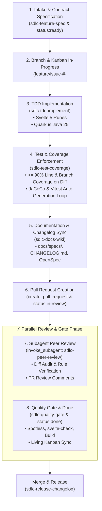

# SDLC Master Lifecycle Orchestrator (`sdlc-flow`)

Use this skill to execute end-to-end software development workflows for GitHub Issues or direct feature requests. `sdlc-flow` coordinates an 8-stage lifecycle enforcing strict contract specification, continuous test coverage validation, Kanban state tracking (`sdlc-kanban`), and parallel subagent peer review.

---

## ⚡ 8-Stage Lifecycle Architecture

---

## 🛠️ Step-by-Step Lifecycle Execution

### Stage 1: Intake & Contract Specification (`sdlc-feature-spec`)
- Fetch issue requirements using `issue_read` via `github-mcp-server`.
- Post initial progress comment: `"🚀 Starting automated execution for ticket #<id>..."`
- Formulate RFC / PRD, architecture schema, and Gherkin acceptance criteria.
- **Kanban Transition (`sdlc-kanban`)**: Tag ticket with `status:ready`.

### Stage 2: Branch & Kanban Automation (`sdlc-kanban`)
- **Kanban Transition (`sdlc-kanban`)**: Tag ticket with `status:in-progress`, assign to active Milestone, and sync board (`kanban-sync.sh`).
- Verify clean git status (`git status --porcelain`).
- Create and checkout branch: `git checkout -b feature/issue-#<id>-<kebab-case-title>`.

### Stage 3: Clean-Room TDD Implementation (`sdlc-tdd-implement`)
- Write failing unit tests first.
- Implement business logic adhering to Svelte 5 Runes (`$state`, `$derived`, `$props`) for UI, and Quarkus reactive standards (Mutiny `Uni`/`Multi`, Panache) for backend.

### Stage 4: Test Coverage Enforcement (`sdlc-test-coverage`)
- Run backend (`./mvnw clean test jacoco:report`) and frontend (`npm run test:coverage`).
- Target modified lines: `git diff --name-only main`.
- **Enforce $\ge$ 90% line and branch coverage**. Auto-write tests if coverage is below threshold.

### Stage 5: Documentation & Changelog Sync (`sdlc-docs-wiki`)
- Update functional specs in `docs/specs/`.
- Append conventional commit entry to `CHANGELOG.md` under `[Unreleased]` with ticket URL link.
- Update OpenSpec delta specs if active.

### Stage 6: Pull Request Opening (`sdlc-kanban`)
- Commit changes and push branch to remote.
- Call `create_pull_request` linking `Fixes #<id>` with summary of changes and coverage metrics.
- **Kanban Transition (`sdlc-kanban`)**: Tag ticket with `status:in-review`.

### Stage 7: Parallel Subagent Peer Review (`sdlc-peer-review`)
- Call `invoke_subagent` launching a subagent with role `"Peer Reviewer"`, loading [`sdlc-peer-review/SKILL.md`](../sdlc-peer-review/SKILL.md).
- Subagent audits the PR diff, verifies conventions and coverage, and posts comments directly to the PR via `pull_request_review_write`.

### Stage 8: Quality Gate & Release (`sdlc-quality-gate` & `sdlc-kanban`)
- Validate full build (`./mvnw clean package`, `npm run build`), Spotless formatting (`./mvnw spotless:check`), type checking (`npx svelte-check`), and security scanning.
- Hand off to `sdlc-release-changelog` for version tagging, containerization, and deployment.
- **Kanban Transition (`sdlc-kanban`)**: Tag ticket with `status:done`, close issue, and execute `kanban-sync.sh` to refresh `docs/KANBAN.md`.

---

## ⏭️ Next Recommended Step

- When starting an issue, run **`sdlc-feature-spec`** to draft the contract.
- When implementation is complete, run **`sdlc-test-coverage`** to enforce the $\ge$ 90% test coverage gate.
- When opening the PR, spawn **`sdlc-peer-review`** via `invoke_subagent`.
