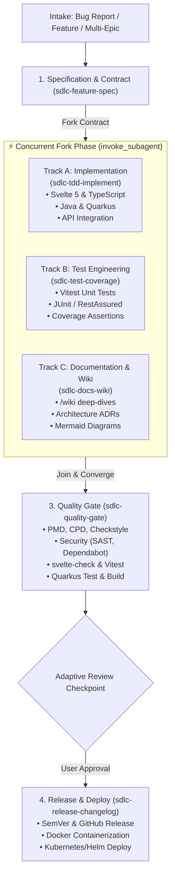

# SDLC Master Lifecycle Orchestrator (`sdlc-flow`)

Use this skill to execute end-to-end software development lifecycle workflows. `sdlc-flow` leverages **Parallel Fork-Join Execution** and concurrent subagent pipelines to maximize development velocity while maintaining strict quality gates.

---

## ⚡ Parallel Fork-Join Lifecycle Architecture

Rather than executing every stage sequentially, `sdlc-flow` establishes the **Interface & Specification Contract** first, and then **forks concurrent workstreams** before joining at the **Quality Gate**:



---

## 🎛️ Parallel Workstream Strategies

### 1. The Single Feature / Bug Fork-Join Pattern
When a single feature or bug is initiated:
1. **Contract Phase (`sdlc-feature-spec`)**: Define types, API contracts, and acceptance criteria by scaffolding PRD, SRS, C4 Architecture, and ADR documents.
2. **Concurrent Fork**: Call `invoke_subagent` with 3 parallel workers:
   - **Worker 1 (Dev)**: Implements UI components and backend business logic.
   - **Worker 2 (QA)**: Implements Vitest and JUnit test suites verifying the schema contract and edge cases.
   - **Worker 3 (Tech Writer)**: Writes documentation in `wiki/` and generates Mermaid diagrams.
3. **Join & Audit (`sdlc-quality-gate`)**: Execute backend analysis (PMD, CPD, Checkstyle), run `npx svelte-check`, verify the Quarkus build, run Lighthouse CI, and execute all test suites together.

---

### 2. Multi-Feature / Batch Parallelism
When multiple independent features or modules are added at once (e.g., *User Auth* + *Payment Gateway* + *Analytics Dashboard*):
1. **Intake & Multi-Spec**: Generate separate sub-issues via `sdlc-feature-spec`.
2. **Concurrent Feature Workers**: Launch independent subagents in parallel using `invoke_subagent` with `Workspace: "branch"` or isolated files:
   ```json
   {
     "Subagents": [
       { "Role": "Auth Engineer", "Prompt": "Implement Keycloak integration and JWT logic" },
       { "Role": "Payment Engineer", "Prompt": "Implement Stripe webhook and entity models" },
       { "Role": "Analytics Engineer", "Prompt": "Implement Svelte 5 charts and metrics API" }
     ]
   }
   ```
3. **Collective Convergence**: Consolidate branches -> run full test suite -> execute collective quality audit.

---

## 🛠️ Step-by-Step Flow Execution Checklist

- [ ] **Step 1: Triage & Contract**: Formulate RFC / Issue on GitHub (`sdlc-feature-spec`).
- [ ] **Step 2: Fork Concurrent Tracks**: Launch parallel tasks for Implementation, Tests, and Documentation.
- [ ] **Step 3: Join & Quality Gate**: Run backend checks (PMD, CPD, Checkstyle, Quarkus tests) and frontend checks (svelte-check, Vitest, Lighthouse, a11y) (`sdlc-quality-gate`).
- [ ] **Step 4: Review Checkpoint**: Present completed walkthrough artifact to the user.
- [ ] **Step 5: Release & Deploy (Optional)**: Trigger `sdlc-release-changelog` to publish version, build Docker image, and deploy via Helm.

---

## ⏭️ Next Recommended Step

- To monitor running background tasks or parallel workers, use the `manage_task` or `manage_subagents` tools.
- When all parallel tracks report complete, invoke **`sdlc-quality-gate`** to validate collective health.
