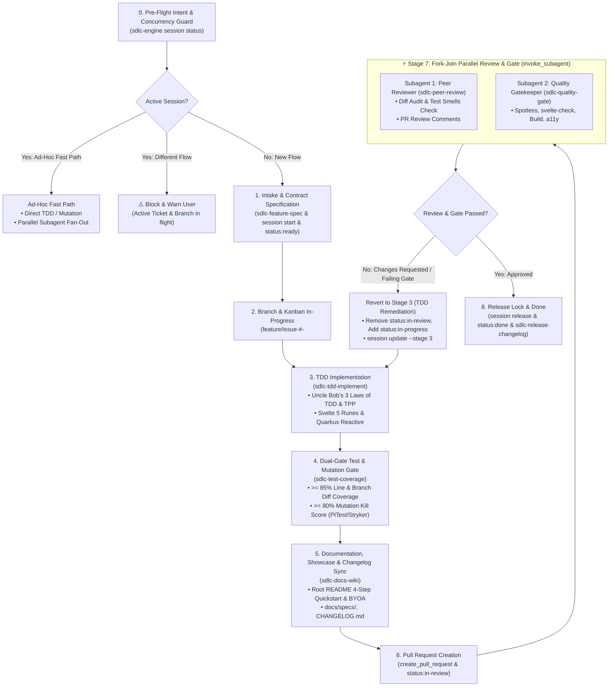

# SDLC Master Lifecycle Orchestrator (`sdlc-flow`)

Use this skill to execute end-to-end software development workflows for GitHub Issues or direct feature requests. `sdlc-flow` coordinates an 8-stage lifecycle enforcing strict session concurrency locks, ad-hoc fast-path routing, contract specification, Robert C. Martin TDD and mutation testing defense, developer onboarding/showcase hygiene, Kanban state tracking (`sdlc-kanban`), and parallel fork-join subagent peer review.

---

## ⚡ 8-Stage Lifecycle & Supervisor Fork-Join Architecture



---

## 🚦 Pre-Flight Concurrency & Intent Routing

Before executing any stage, evaluate the active session status:
```bash
node .agent/scripts/sdlc-engine.mjs session status
```

1. **Active Session Exists & Request is an Ad-Hoc Task on Active Branch**:
   - **Fast-Path**: Bypass intake (Stage 1), branching (Stage 2), docs sync (Stage 5), and PR (Stage 6).
   - Resolve targets using `node .agent/scripts/sdlc-engine.mjs resolve-targets <files...>`.
   - If targets span independent modules, dispatch parallel subagents via `invoke_subagent`.
   - Execute TDD implementation or test coverage fixes directly within the active stage.
2. **Active Session Exists & Request is a NEW Full Workflow**:
   - **Block & Warn**: Alert user with the active issue number, branch, and stage.
   - Prompt the user to finalize the active issue or force-release via `node .agent/scripts/sdlc-engine.mjs session release`.
3. **Active Session Exists & Request is an UNRELATED Ad-Hoc Task**:
   - Dispatch subagent with **`Workspace: 'branch'`** to isolate from the parent workspace and prevent clobbering active uncommitted work.
   - The branched subagent pushes its own branch to remote and does not mutate the parent `.agent/.sdlc-session.json`.
4. **No Active Session**:
   - Acquire session lock: `node .agent/scripts/sdlc-engine.mjs session start --issue <id> --branch feature/issue-#<id>-<title> --stage 1` and proceed to Stage 1.

---

## 🛠️ Step-by-Step Lifecycle Execution

### Stage 1: Intake & Contract Specification (`sdlc-feature-spec`)
- Ensure project stack is detected and `.agent/sdlc-config.json` is initialized: `node .agent/scripts/sdlc-engine.mjs detect`.
- Fetch issue requirements using `issue_read` via `call_mcp_tool` (or native tool).
- Post initial progress comment: `"🚀 Starting automated execution for ticket #<id>..."`
- Formulate RFC / PRD, architecture schema, and Gherkin acceptance criteria.
- **Kanban Transition (`sdlc-kanban`)**: Tag ticket with `status:ready`.

### Stage 2: Branch & Kanban Automation (`sdlc-kanban`)
- **Session Update**: `node .agent/scripts/sdlc-engine.mjs session update --stage 2 --name "Branch & Kanban Automation"`.
- **Kanban Transition (`sdlc-kanban`)**: Tag ticket with `status:in-progress`, assign to active Milestone, and sync board (`kanban-sync.sh`).
- Verify clean git status (`git status --porcelain`).
- Create and checkout branch: `git checkout -b feature/issue-#<id>-<kebab-case-title>`.

### Stage 3: Clean-Room TDD Implementation (`sdlc-tdd-implement`)
- **Session Update**: `node .agent/scripts/sdlc-engine.mjs session update --stage 3 --name "Clean-Room TDD Implementation"`.
- Strictly apply **Uncle Bob's Three Laws of TDD** and the **Transformation Priority Premise (TPP)**.
- If modifying legacy code with $<40\%$ baseline coverage, write characterization tests first.
- Write failing unit tests first for degenerate cases before writing production code.
- Implement business logic adhering to Svelte 5 Runes (`$state`, `$derived`, `$props`) for UI, and Quarkus reactive standards (Mutiny `Uni`/`Multi`, Panache) for backend.
- Reject test smells (no testing trivial getters/setters, no testing framework plumbing, no mock-heavy interaction verification).

### Stage 4: Dual-Gate Test & Mutation Enforcement (`sdlc-test-coverage`)
- **Session Update**: `node .agent/scripts/sdlc-engine.mjs session update --stage 4 --name "Dual-Gate Test & Mutation Enforcement"`.
- Run directory-scoped tests and Dual-Gate checks via the universal engine:
  ```bash
  node .agent/scripts/sdlc-engine.mjs coverage
  node .agent/scripts/sdlc-engine.mjs mutation
  ```
- Target modified lines: `git diff --name-only main`.
- **Enforce Dual-Gate Threshold**:
  1. $\ge 85\%$ line and branch coverage on diff.
  2. $\ge 80\%$ mutation kill score on modified classes/components.
- Automatically author missing boundary tests or strengthen assertions if mutants survive.

### Stage 5: Documentation, Showcase & Changelog Sync (`sdlc-docs-wiki`)
- **Session Update**: `node .agent/scripts/sdlc-engine.mjs session update --stage 5 --name "Documentation & Showcase Sync"`.
- Synchronize all documentation before opening the PR to guarantee 100% diff traceability:
  - **Developer Showcase Invariant**: Update root `README.md` with runnable **5-Minute Developer Quickstart** (install, bootstrap, explore examples, BYOA workflow).
  - **Specs**: Update functional architecture specs in `docs/specs/` and `wiki/`.
  - **Changelog**: Append entry to `CHANGELOG.md` under `[Unreleased]` with ticket URL link.
- Commit documentation updates to the feature branch:
  ```bash
  git add README.md CHANGELOG.md docs/ specs/ wiki/
  git commit -m "docs: sync showcase, specs, and changelog for #${id}"
  ```

### Stage 6: Pull Request Opening (`sdlc-kanban`)
- **Session Update**: `node .agent/scripts/sdlc-engine.mjs session update --stage 6 --name "Pull Request Opening"`.
- Push feature branch to remote origin: `git push -u origin HEAD`.
- Call `create_pull_request` linking `Fixes #<id>` with summary of changes, diff coverage ($\ge 85\%$), and mutation kill score ($\ge 80\%$).
- **Kanban Transition (`sdlc-kanban`)**: Tag ticket with `status:in-review`.

### Stage 7: Fork-Join Parallel Review & Quality Gate (`invoke_subagent`)
- **Session Update**:
  ```bash
  node .agent/scripts/sdlc-engine.mjs session update --stage 7 --name "Parallel Review & Quality Gate" --subagents "peer-reviewer,quality-gatekeeper"
  ```
- Launch parallel read-only auditor subagents concurrently using a single `invoke_subagent` call:
```json
{
  "Subagents": [
    {
      "TypeName": "self",
      "Role": "PR Peer Reviewer",
      "Prompt": "Load sdlc-peer-review/SKILL.md. Audit git diff against main, detect Uncle Bob test smells (no trivial getter tests, no mock abuse), verify Dual-Gate metrics, verify developer showcase quickstart completeness in README.md and CHANGELOG.md, and post formal review comments via pull_request_review_write."
    },
    {
      "TypeName": "self",
      "Role": "Quality Gatekeeper",
      "Prompt": "Load sdlc-quality-gate/SKILL.md. Execute universal quality gate (node .agent/scripts/sdlc-engine.mjs gate), Spotless formatting, svelte-check, build validation, and WCAG a11y audit."
    }
  ]
}
```
- Wait for subagents to report results:
  - **Review Rejection / Gate Failure Protocol**:
    If any subagent requests changes or reports a gate failure:
    1. Revert Kanban label: `gh issue edit <id> --remove-label "status:in-review" --add-label "status:in-progress"`.
    2. Roll back session: `node .agent/scripts/sdlc-engine.mjs session update --stage 3 --name "Remediating Peer Review Feedback"`.
    3. Remediate issues using TDD, re-verify tests, commit, push, and re-trigger review.
  - **Review Approved & Gate Passed**:
    Proceed to Stage 8.

### Stage 8: Quality Gate Passed, Release & Lock Release (`sdlc-release-changelog`)
- **Session Update**: `node .agent/scripts/sdlc-engine.mjs session update --stage 8 --name "Release & Teardown"`.
- Merge pull request (squash & merge or rebase).
- Hand off to `sdlc-release-changelog` for version tagging, containerization, and deployment.
- **Kanban Transition (`sdlc-kanban`)**: Tag ticket with `status:done`, close issue, and execute `kanban-sync.sh` to refresh `docs/KANBAN.md`.
- **Release Session Lock**:
  ```bash
  node .agent/scripts/sdlc-engine.mjs session release
  ```

---

## 🛑 Workflow Abort & Rollback Procedure

If an in-flight workflow must be aborted due to unrecoverable errors, invalid requirements, or user cancellation:
1. **Clean Workspace Changes**: `git checkout -- . && git clean -fd`.
2. **Switch to Main**: `git checkout main`.
3. **Revert Issue Kanban State**:
   ```bash
   gh issue edit <id> --remove-label "status:in-progress,status:in-review" --add-label "status:backlog"
   ```
4. **Post Issue Notice**: Post GitHub issue comment documenting the cancellation reason.
5. **Release Session Lock**:
   ```bash
   node .agent/scripts/sdlc-engine.mjs session release
   ```

---

## ⏭️ Next Recommended Step

- When starting an issue, run **`sdlc-flow`** to check concurrency and initiate Stage 1.
- For ad-hoc requests, verify session status and use **`sdlc-tdd-implement`** or **`sdlc-test-coverage`** on the fast-path.
