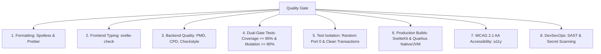

# SDLC Quality Gate & Audit Skill (`sdlc-quality-gate`)

Use this skill before opening or merging pull requests, cutting releases, or completing major feature implementations to ensure zero regressions, clean formatting, strict typing, defect defense via mutation testing, and security compliance.

---

## 🛡️ The 8 Pillars of Software Quality & Defect Defense



---

## 🛠️ Step-by-Step Quality Gate Checklist

### 0. Universal Turnkey Gate (Polyglot / Multi-Module)
Run the universal quality gate to execute linting, builds, and Dual-Gate tests across all modules:
```bash
node .agent/scripts/sdlc-engine.mjs gate
```

### 1. Code Formatting & Style Checks
- [ ] **Backend Spotless**: Run `./mvnw spotless:check` (or `./mvnw spotless:apply` to automatically resolve formatting).
- [ ] **Frontend Formatting**: Run `npm run format:check` (Prettier / ESLint).

### 2. Frontend Static Typing & Verification
```bash
npx svelte-check --tsconfig ./tsconfig.json
```
- [ ] Zero TypeScript errors.
- [ ] Zero Svelte 5 rune warnings or invalid state bindings.
- [ ] Clean tsconfig path alias resolution (`$lib/*`).

### 3. Backend Static Analysis & Code Hygiene
- [ ] **PMD**: Ensure no rule violations (unused variables, empty blocks, concurrency antipatterns).
- [ ] **CPD (Copy/Paste Detector)**: Fail on code duplication above the project threshold.
- [ ] **Checkstyle**: Enforce naming conventions and Java style rules.

### 4. Dual-Gate Testing & Mutation Defense (Uncle Bob Standard)
- [ ] **Backend Tests & Coverage**: Run `./mvnw clean test jacoco:report` verifying $\ge 85\%$ line and branch coverage on modified code.
- [ ] **Backend Mutation Defense (PITest)**:
  ```bash
  ./mvnw test-compile org.pitest:pitest-maven:mutationCoverage -DmutationThreshold=80
  ```
  Verify that the mutation kill score reaches $\ge 80\%$ on changed classes.
- [ ] **Frontend Tests & Coverage**: Run `npm run test:coverage` verifying $\ge 85\%$ line and branch coverage on changed runes/components.
- [ ] **Frontend Mutation Defense (Stryker)**:
  ```bash
  npx stryker run
  ```
  Verify that the Stryker mutation score reaches $\ge 80\%$.

### 5. Test Suite Execution & Parallel Port Isolation
- [ ] **Test Port Isolation**: Ensure `quarkus.http.test-port=0` is configured in `application.properties` (or test profile) to prevent port collisions during parallel builds.
- [ ] **Transactional Rollback**: Ensure backend integration tests use `@TestTransaction` to guarantee zero state leakage across test cases.

### 6. Production Build Validation
- [ ] **Frontend Bundle**: Run `npm run build` with zero chunk warnings or circular dependencies.
- [ ] **Backend Package**: Run `./mvnw clean package -DskipTests=true` guaranteeing error-free compilation and artifact packaging.

### 7. Accessibility (a11y) Audit
- [ ] **Contrast Ratios**: Check contrast in Light and Dark modes (min 4.5:1 for body, 3:1 for large text).
- [ ] **Keyboard Navigation**: Verify interactive controls respond to `Space`, `Enter`, `Esc`, `Tab`.
- [ ] **ARIA & Screen Readers**: Ensure dynamic state updates announce through `aria-live` regions.

### 8. Security & DevSecOps Scanning
- [ ] **Secret Scanning**: Verify zero plaintext secrets, tokens, or private keys in git status/diff.
- [ ] **Dependency Audits**: Run `npm audit` and `./mvnw dependency-check:check` with zero Critical/High vulnerabilities.

---

## ⏭️ Next Recommended Step

- If all quality checks pass and release is planned:
  👉 **Transition to [`sdlc-release-changelog`](../sdlc-release-changelog/SKILL.md)** to bump SemVer, update `CHANGELOG.md`, and publish a release.
- If invoked during a Pull Request:
  👉 Present the quality audit report and proceed to merge.
