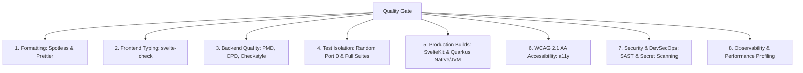

# SDLC Quality Gate & Audit Skill (`sdlc-quality-gate`)

Use this skill before opening or merging pull requests, cutting releases, or completing major feature implementations to ensure zero regressions, clean formatting, strict typing, and security compliance.

---

## 🛡️ The 8 Pillars of Software Quality



---

## 🛠️ Step-by-Step Quality Gate Checklist

### 1. Code Formatting & Style Checks
- [ ] **Backend Spotless**: Run `./mvnw spotless:check` (or `./mvnw spotless:apply` to automatically resolve formatting).
- [ ] **Frontend Formatting**: Run `npm run format:check` (Prettier / ESLint).

### 2. Frontend Static Typing & Verification
```bash
npx svelte-check --tsconfig ./tsconfig.json
```
- [ ] Zero TypeScript errors.
- [ ] Zero Svelte 5 rune warnings or invalid state bindings.
- [ ] Clean tsconfig path alias resolution (`$lib/*`).

### 3. Backend Static Analysis & Code Hygiene
- [ ] **PMD**: Ensure no rule violations (unused variables, empty blocks, concurrency antipatterns).
- [ ] **CPD (Copy/Paste Detector)**: Fail on code duplication above the project threshold.
- [ ] **Checkstyle**: Enforce naming conventions and Java style rules.

### 4. Test Suite Execution & Parallel Port Isolation
- [ ] **Test Port Isolation**: Ensure `quarkus.http.test-port=0` is configured in `application.properties` (or test profile) to prevent port collisions during parallel builds.
- [ ] **Backend Tests**: Run `./mvnw clean test jacoco:report` ensuring all unit/integration tests pass.
- [ ] **Frontend Tests**: Run `npm run test:coverage` verifying all Vitest test suites pass.

### 5. Production Build Validation
- [ ] **Frontend Bundle**: Run `npm run build` with zero chunk warnings or circular dependencies.
- [ ] **Backend Package**: Run `./mvnw clean package -DskipTests=true` guaranteeing error-free compilation and artifact packaging.

### 6. Accessibility (a11y) Audit
- [ ] **Contrast Ratios**: Check contrast in Light and Dark modes (min 4.5:1 for body, 3:1 for large text).
- [ ] **Keyboard Navigation**: Verify interactive controls respond to `Space`, `Enter`, `Esc`, `Tab`.
- [ ] **ARIA & Screen Readers**: Ensure dynamic state updates announce through `aria-live` regions.

### 7. Security & DevSecOps Scanning
- [ ] **Secret Scanning**: Verify zero plaintext secrets, tokens, or private keys in git status/diff.
- [ ] **Dependency Audits**: Run `npm audit` and `./mvnw dependency-check:check` with zero Critical/High vulnerabilities.

### 8. Observability & Performance
- [ ] Check API response latency within SLOs.
- [ ] Verify metrics exposure (Micrometer / Prometheus) and error logging sanitization.

---

## ⏭️ Next Recommended Step

- If all quality checks pass and release is planned:
  👉 **Transition to [`sdlc-release-changelog`](../sdlc-release-changelog/SKILL.md)** to bump SemVer, update `CHANGELOG.md`, and publish a release.
- If invoked during a Pull Request:
  👉 Present the quality audit report and proceed to merge.
