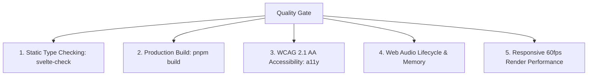

# SDLC Quality Gate & Audit Skill (`sdlc-quality-gate`)

Use this skill before merging pull requests, cutting releases, or completing major feature implementations to ensure zero regressions, clean static typing, and accessibility compliance.

---

## 🛡️ The 5 Pillars of NoteZen Quality



---

## 🛠️ Step-by-Step Quality Gate Checklist

### 1. Static Typing & Svelte 5 Verification
Run the type-checker across all `.svelte` and `.ts` files:
```bash
npx svelte-check --tsconfig ./tsconfig.json
```
- [ ] Zero TypeScript errors.
- [ ] Zero Svelte 5 rune warnings or invalid state bindings.
- [ ] Clean tsconfig path alias resolution (`$lib/*`).

### 2. Production Build Validation
Verify that Vite/SvelteKit can bundle the client and SSR output without errors:
```bash
pnpm build
```
- [ ] Zero build-time bundle errors.
- [ ] No circular dependencies or oversized chunk warnings.

### 3. Accessibility (a11y) Audit
- [ ] **Contrast Ratios**: Check contrast of text and geometric strokes in both Paper Light Mode (min 4.5:1 for body, 3:1 for large text/icons) and Obsidian Dark Mode.
- [ ] **Keyboard Navigation**: Verify all interactive controls (play/pause, reset, zen mode, modals) can be triggered entirely via keyboard (`Space`, `R`, `Z`, `M`, `1-4`, `Esc`, `Tab`).
- [ ] **ARIA & Screen Readers**: Ensure phase changes (Inhale, Hold, Exhale) provide updates via `aria-live="polite"` regions or voice guidance.

### 4. Audio Lifecycle & Clean Teardown
- [ ] Verify `AudioContext` initializes only upon first user interaction (browser autoplay policy compliance).
- [ ] Verify gain nodes ramp down gracefully without clipping or speaker pops on rapid pause/reset.
- [ ] Verify oscillators are stopped and gain nodes disconnected when leaving the page or changing techniques.

### 5. Performance & Mobile Responsive Check
- [ ] Canvas SVG rendering maintains smooth 60fps on mobile viewports (iOS Safari, Android Chrome).
- [ ] Zen Mode fills 100% of viewport without unwanted horizontal/vertical scrolling or layout shift.

---

## ⏭️ Next Recommended Step

- If preparing a release or tagging a milestone:
  👉 **Transition to [`sdlc-release-changelog`](../sdlc-release-changelog/SKILL.md)** to bump SemVer, update `CHANGELOG.md`, and publish a GitHub Release.
- If completing a pull request or task:
  👉 Present the quality audit report and link the resolved GitHub issue.
