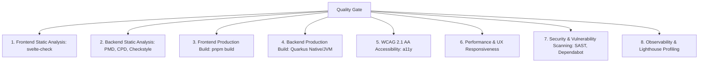

# SDLC Quality Gate & Audit Skill (`sdlc-quality-gate`)

Use this skill before merging pull requests, cutting releases, or completing major feature implementations to ensure zero regressions, clean static typing, strict backend quality, and accessibility compliance.

---

## 🛡️ The 8 Pillars of The Project Quality



---

## 🛠️ Step-by-Step Quality Gate Checklist

### 1. Frontend Static Typing & Verification
Run the type-checker across all `.svelte` and `.ts` files:
```bash
npx svelte-check --tsconfig ./tsconfig.json
```
- [ ] Zero TypeScript errors.
- [ ] Zero Svelte 5 rune warnings or invalid state bindings.
- [ ] Clean tsconfig path alias resolution (`$lib/*`).

### 2. Backend Static Analysis & Code Quality
Run strict code quality plugins on the Java/Quarkus backend:
- [ ] **PMD**: Ensure no critical rule violations (e.g., unused variables, empty catch blocks, suboptimal code).
- [ ] **CPD (Copy/Paste Detector)**: Detect and fail on code duplication above the defined threshold.
- [ ] **Checkstyle**: Enforce formatting, naming conventions, and style rules.
- [ ] **SpotBugs/SonarQube (Optional)**: Scan for potential bugs.

### 3. Frontend Production Build Validation
Verify that Vite/SvelteKit can bundle the client and SSR output without errors:
```bash
pnpm build
```
- [ ] Zero build-time bundle errors.
- [ ] No circular dependencies or oversized chunk warnings.

### 4. Backend Production Build Validation
Verify the Quarkus application compiles and tests pass:
```bash
./mvnw clean package -DskipTests=false
```
- [ ] Zero compilation errors.
- [ ] All unit and integration tests pass successfully.
- [ ] Quarkus Native build completes without reflection or AOT errors (if applicable).

### 5. Accessibility (a11y) Audit
- [ ] **Contrast Ratios**: Check contrast of text and structural UI elements in both Light Mode (min 4.5:1 for body, 3:1 for large text) and Dark Mode.
- [ ] **Keyboard Navigation**: Verify all interactive controls can be triggered entirely via keyboard (`Space`, `Enter`, `Esc`, `Tab`).
- [ ] **ARIA & Screen Readers**: Ensure state changes provide updates via `aria-live="polite"` regions or proper ARIA roles.

### 6. Performance & Mobile Responsive Check
- [ ] UI maintains smooth 60fps on mobile viewports (iOS Safari, Android Chrome).
- [ ] Full-screen views and modals fill the viewport without unwanted horizontal/vertical scrolling or layout shift.
- [ ] Backend API latency is within acceptable SLAs.

### 7. Security & Vulnerability Scanning (DevSecOps)
Run dependency audits and basic SAST checks:
- [ ] Run `npm audit` or `pnpm audit` for frontend.
- [ ] Run OWASP Dependency-Check or similar for the backend `pom.xml`.
- [ ] Block the flow on High/Critical vulnerabilities.
- [ ] Ensure no plain-text secrets are committed (Git leaks/secrets scanning).

### 8. Observability & Lighthouse Profiling
Ensure the application is performant and observable in production:
- [ ] Run Lighthouse CI to capture objective performance profiling metrics (Core Web Vitals like LCP, CLS, INP).
- [ ] Verify basic production telemetry integration (Datadog/Sentry/Micrometer metrics for Quarkus) is correctly exposed.

---

## ⏭️ Next Recommended Step

- If preparing a release or tagging a milestone:
  👉 **Transition to [`sdlc-release-changelog`](../sdlc-release-changelog/SKILL.md)** to bump SemVer, update `CHANGELOG.md`, and publish a GitHub Release.
- If completing a pull request or task:
  👉 Present the quality audit report and link the resolved GitHub issue.
