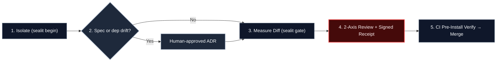

<div align="center">
  <picture>
    <source media="(prefers-color-scheme: dark)" srcset="./docs/logo-dark.svg" />
    <source media="(prefers-color-scheme: light)" srcset="./docs/logo-light.svg" />
    
  </picture>

  <p><strong>AI coding agents love saying <em>"all tests pass."</em> <code>sealit</code> makes them prove it before merge.</strong></p>

  <p>
    <a href="https://github.com/fmatar/sealit/actions/workflows/sealit-quality-gate.yml"></a>
    <a href="https://nodejs.org">= 22" /></a>
    <a href="./package.json"></a>
    <a href="./LICENSE"></a>
  </p>
</div>

---

`sealit` is a zero-dependency verification CLI and agent skill suite for **Claude Code**, **Cursor**, **Codex**, **Antigravity**, and **GitHub Copilot**. It wraps AI-authored pull requests in mechanical checks and seals every verified branch with a cryptographic merge receipt (`HMAC-SHA256` or asymmetric OpenSSH `SSHSIG`) that CI validates **before** `npm ci` or untrusted PR code ever runs.

## What `sealit` Enforces

- **Protected branches stay clean** — Git hooks block direct commits or pushes to `main` and `develop` and isolate concurrent agent sessions across branches and git worktrees.
- **Specs, dependencies, and contracts don't drift silently** — Edits to `PRODUCT.md`, `docs/specs/*`, dependency manifests, schemas, OpenAPI specs, or optional layer boundary rules require a human-approved ADR before the gate passes.
- **Diffs are actually tested, not rubber-stamped** — Parses fresh coverage and diff-scoped mutation reports directly on changed hunks, failing closed on stale reports, unimported `0%` files, shell metacharacters, or leaked secrets.
- **Every PR carries a cryptographic merge receipt** — Signs `HEAD`, the content tree hash, spec/ADR hashes, measured diff coverage & mutation scores, and reviewer sign-off into an append-only hash chain (`docs/AUDIT_CHAIN.jsonl`) that survives Squash, `--no-ff`, and fast-forward merges.

---

## How a Pull Request Gets Sealed



1. **Isolate** — The agent starts an isolated branch or worktree session (`sealit begin`).
2. **Align** — If specs, dependencies, or contracts changed, `sealit drift` pauses until a human approves an ADR (`sealit adr`).
3. **Measure** — `sealit gate` runs secret scanning, lint, build, unit tests, diff line coverage, and diff-scoped mutation testing in a single pass.
4. **Seal** — Two fresh-context reviewers audit Spec Fidelity and Architecture/Security, and `sealit` appends a signed `SSHSIG` or `HMAC-SHA256` receipt to `docs/AUDIT_CHAIN.jsonl`.
5. **Verify in CI** — GitHub Actions, GitLab CI, or any Git pipeline extracts the trusted verifier from the base branch and validates the receipt **before** installing dependencies or executing PR code.

---

## Quickstart

Requires **Node.js `>= 22`** and **Git `>= 2.38`**.

### 1. Initialize your repository (one-time)

```bash
npx --yes @sealit/cli init
```

The interactive setup detects your language stack, scaffolds `.agent/sealit-config.json`, installs Git hooks and `.github/workflows/sealit-quality-gate.yml`, configures skills for your selected coding agents, and generates `.agent/.receipt-key` (gitignored).

Upload the signing key to your CI secret store (`SEALIT_RECEIPT_KEY`) once so pipelines can verify receipts:

```bash
# Standard mode (HMAC-SHA256 shared team secret on GitHub Actions)
tr -d '\r\n' < .agent/.receipt-key | gh secret set SEALIT_RECEIPT_KEY
```

Commit the initial scaffold on an onboarding branch (and whenever you later change `.agent/sealit-config.json` or `.archlens/policy.json`, record an approved architectural ADR with `sealit adr create` → `sealit adr decide --status approve`).

<details>
<summary><strong>Standard HMAC-SHA256 vs. Hardened Asymmetric OpenSSH <code>SSHSIG</code> (recommended for multi-developer / untrusted-agent threat models)</strong></summary>

- **Standard mode (default, zero extra setup)**: Signs receipts with symmetric `HMAC-SHA256` using `.agent/.receipt-key` (gitignored, `0600`) and CI secret `SEALIT_RECEIPT_KEY`. Because the key is shared on the developer workstation, it protects against accidental agent shortcuts, stale claims, and CI tampering—not a malicious agent running in the same shell as `.agent/.receipt-key` (Claude Code installations add `.claude/settings.json` `permissions.deny` rules as accidental-edit friction).
- **Hardened asymmetric mode (`.agent/allowed_signers`)**: Commit an OpenSSH [`allowed_signers`](https://man.openbsd.org/ssh-keygen#ALLOWED_SIGNERS) file at `.agent/allowed_signers` on your base branch (e.g. `@you ssh-ed25519 AAAA...`) and set `SEALIT_SIGNING_KEY` or `git config user.signingkey` to your personal SSH key (TouchID / Secretive / FIDO2-SK / `ssh-add -c`). Once `.agent/allowed_signers` exists on `origin/<base>`, `sealit` automatically switches to native `ssh-keygen -Y` (`SSHSIG`), cryptographically binds `reviewer` to the verified principal, requires no `SEALIT_RECEIPT_KEY` CI secret, and rejects HMAC downgrades or PR-injected keys.

</details>

<details>
<summary><strong>Using GitLab CI, Bitbucket Pipelines, or self-hosted CI?</strong></summary>

`sealit` works with any Git host and auto-detects target/source branch variables across GitHub (`GITHUB_BASE_REF`), GitLab (`CI_MERGE_REQUEST_TARGET_BRANCH_NAME`), Bitbucket (`BITBUCKET_PR_DESTINATION_BRANCH`), and Azure DevOps (`SYSTEM_PULLREQUEST_TARGETBRANCH`). Store `.agent/.receipt-key` as masked secret `SEALIT_RECEIPT_KEY` and verify the merge receipt from the trusted base branch **before** installing dependencies:

```yaml
# .gitlab-ci.yml example
sealit-verify:
  image: node:22-alpine
  variables:
    GIT_DEPTH: 0
  rules:
    - if: $CI_PIPELINE_SOURCE == "merge_request_event"
  script:
    - apk add --no-cache git
    - git fetch origin "+refs/heads/$CI_MERGE_REQUEST_TARGET_BRANCH_NAME:refs/remotes/origin/$CI_MERGE_REQUEST_TARGET_BRANCH_NAME" "+refs/heads/develop:refs/remotes/origin/develop" || git fetch origin "+refs/heads/$CI_MERGE_REQUEST_TARGET_BRANCH_NAME:refs/remotes/origin/$CI_MERGE_REQUEST_TARGET_BRANCH_NAME"
    - |
      if [ "$CI_MERGE_REQUEST_TARGET_BRANCH_NAME" = "main" ] && git show-ref --verify --quiet refs/remotes/origin/develop && [ "$CI_MERGE_REQUEST_SOURCE_BRANCH_NAME" != "develop" ]; then
        echo "Merge requests targeting main must originate from develop." && exit 1
      fi
      TRUSTED_DIR="/tmp/trusted-sealit" && mkdir -p "$TRUSTED_DIR"
      if git cat-file -e "origin/$CI_MERGE_REQUEST_TARGET_BRANCH_NAME:.agent/scripts/sealit-engine.mjs" 2>/dev/null; then
        git archive "origin/$CI_MERGE_REQUEST_TARGET_BRANCH_NAME" .agent/scripts | tar -x -C "$TRUSTED_DIR"
        ENGINE_BIN="$TRUSTED_DIR/.agent/scripts/sealit-engine.mjs"
      else
        ENGINE_BIN=".agent/scripts/sealit-engine.mjs"
      fi
      MR_SHA="${CI_MERGE_REQUEST_SOURCE_BRANCH_SHA:-$CI_COMMIT_SHA}"
      if [ "$CI_MERGE_REQUEST_TARGET_BRANCH_NAME" = "main" ]; then
        node "$ENGINE_BIN" verify --sha "$MR_SHA"
      else
        node "$ENGINE_BIN" verify --sha "$MR_SHA" --branch "$CI_MERGE_REQUEST_SOURCE_BRANCH_NAME"
      fi
```

</details>

> [!IMPORTANT]
> Only the first initialization creates `.agent/.receipt-key`. Teammates cloning an already-initialized repo should place the shared team key in `.agent/.receipt-key` or `.env`—do not overwrite `SEALIT_RECEIPT_KEY` in CI with a new key.

### 2. Prompt your coding agent

Open **Claude Code**, **Cursor**, **Codex**, **Antigravity**, or **GitHub Copilot** and invoke a `/sealit-*` skill directly—or ask in plain English:

```text
# Ship a feature end-to-end (branch → TDD → gate → 2-axis review → signed receipt)
/sealit-flow Add token-bucket rate limiting to POST /api/login

# Clarify edge cases and write or update a capability spec before coding
/sealit-spec Define retry, backoff, and dead-letter rules for webhook delivery

# Fix a bug with a failing test first and diff coverage/mutation proof
/sealit-tdd Fix timezone boundary bug in monthly billing rollover

# Run a 2-axis cold review and seal your current branch before opening a PR
/sealit-gate

# Run an explicit kernel check
/sealit doctor
/sealit status
```

- **Slash or natural language**: `sealit-flow`, `sealit-spec`, `sealit-adr`, `sealit-tdd`, and `sealit-gate` work via slash commands (`/sealit-flow ...` in Claude Code, Cursor, Antigravity; `$sealit-flow` in Codex) **and** auto-trigger from plain-English requests (*"Implement rate limiting on `/api/login` with TDD and seal the PR"*).
- **Manual-only CLI router**: `/sealit` sets `disable-model-invocation: true`, so the model only runs direct CLI subcommands when you explicitly invoke `/sealit <command>`.
- **Human-in-the-loop checkpoints**: Your agent handles branching, Red-Green-Refactor TDD, `gate`, and cold-review dispatch autonomously, pausing for your sign-off only when an ADR needs `approve` or when signing the merge receipt.

<details>
<summary><strong>Prefer running the CLI directly?</strong></summary>

```bash
# Start a feature branch & session
npx @sealit/cli begin --title "add rate limiter" --type feat --checkout

# ... write tests and implementation ...

# Run drift check, secret scan, lint, tests, diff coverage, and diff mutation
npx @sealit/cli gate

# Record review approval, sign, commit docs/AUDIT_CHAIN.jsonl, verify, and emit PR proof in one step
npx @sealit/cli review record --verdict approve --reviewer "@you" --notes "LGTM" --commit
```

</details>

### Skills-only mode (no hooks or CI gate)

If you want the spec, ADR, and TDD agent workflows without adding hooks or CI to a repository:

```bash
npx skills add fmatar/sealit        # current project (.agents/skills)
npx skills add fmatar/sealit -g     # global across all coding agents
```

---

## Agent Skills

All 6 skills ship in `.agent/skills/` (with Codex `agents/openai.yaml` metadata and Claude Code `.claude-plugin/plugin.json` support):

| Skill | What it does (with `sealit init`) | Standalone (`npx skills` only) |
| :--- | :--- | :--- |
| `/sealit-flow` | Orchestrates a feature or fix end-to-end: `begin` → `drift` → `tdd` → `gate` → 2-axis review → signed receipt → `pr-body` | Stops and offers `sealit init` |
| `/sealit-spec` | Resolves ambiguous requirements, updates `GLOSSARY.md`, and writes pure-Markdown `PRODUCT.md` & `docs/specs/*` contracts | Authors specs & `GLOSSARY.md` using repo conventions |
| `/sealit-adr` | Drafts an ADR when specs, dependencies, or contracts change and pauses for human approval | Authors MADR `docs/adr/NNNN-slug.md` with human sign-off |
| `/sealit-tdd` | Drives Red-Green-Refactor TDD at public module seams and checks diff coverage & mutation scores | Runs Red-Green TDD with the repo's native test runner |
| `/sealit-gate` | Spawns two cold read-only reviewers (Spec Fidelity + Architecture & Security), runs `sealit gate`, and signs the receipt | Stops and offers `sealit init` |
| `/sealit` | Explicit user-invoked 1:1 slash router for every CLI command in the reference table below | Runs `init` and `doctor`; prompts `init` for repo commands |

---

## Command Reference (`npx @sealit/cli <command>` or `/sealit <command>`)

Every command supports `--json` for structured machine output. In Claude Code, read/measure commands are allowlisted while approval, signing, exemption, and setup commands always prompt a human.

### Setup & Repository Health

| Command | What it does | Common flags |
| :--- | :--- | :--- |
| `init` | Scaffolds `.agent/sealit-config.json`, Git hooks, CI workflow, agent skills, and initial `.agent/.receipt-key` | `--agents`, `--global`, `--yes`, `--force` |
| `doctor` | Audits Node/Git versions, config validity, `.gitignore`, hooks, CI workflow, receipt key, skills, and ledger continuity | `--fix` (repairs & migrates in place) |
| `config check` | Validates `.agent/sealit-config.json` schema, thresholds, shell-free commands, and path confinement | `--json` |
| `skill-audit` | Checks all 6 canonical skills for frontmatter rules, line budgets, pinned `npx` packages, and plugin version parity | `--json` |

### Branch Sessions & Spec Alignment

| Command | What it does | Common flags |
| :--- | :--- | :--- |
| `begin` | Starts a tracked session and creates/checks out a feature, fix, or chore branch (or linked git worktree) | `--title`, `--type`, `--issue`, `--base`, `--checkout`, `--worktree` |
| `status` | Shows active branch, session ticket, diff classification (`docs-only` vs `code`), drift status, and receipt readiness | `--json` |
| `drift` | Verifies that changes to specs, manifests, schemas, contracts, or layer rules are covered by an approved ADR | `--base <branch>` |
| `adr` | Lists ADRs (`adr list`), scaffolds a pending ADR with explicit `files:` scope (`adr create`), or records approval/rejection (`adr decide`) | `--title`, `--scope`, `--files`, `--id`, `--status approve\|reject`, `--reviewer` |
| `end` | Closes a completed session after merge and prunes clean linked worktrees without touching unsaved files | `--issue <id>` |

### Testing, Quality Gate & Signed Receipts

| Command | What it does | Common flags |
| :--- | :--- | :--- |
| `test` | Runs configured module test suites, or only unit tests mapped to modified files | `--affected-only` |
| `coverage` | Executes the coverage command and calculates line coverage strictly across changed diff hunks | `--no-cache` |
| `mutation` | Runs diff-scoped mutation testing on modified lines (or the full module) and evaluates the kill score | `--full`, `--force`, `--no-cache` |
| `exemption` | Lists (`exemption list`) or records (`exemption add`) an audited waiver for an equivalent mutant (active only after merge) | `--mutant`, `--file`, `--reason` |
| `gate` | Executes drift, secret scan, lint, build, tests, diff coverage, and diff mutation in one pass and updates session state | `--no-cache`, `--force-mutation`, `--online` |
| `review` | Emits 2-axis cold reviewer prompts (`review plan`) or records sign-off, signs receipt, and optionally commits/verifies (`review record`) | `--verdict approve\|request-changes`, `--reviewer`, `--commit`, `--pr` |
| `pr-body` | Generates a structured PR description with measured coverage/mutation proof and One-Way vs. Two-Way door blast radius | `--base <branch>` |
| `receipt` | Signs a standalone `SSHSIG` or `HMAC-SHA256` merge receipt into `docs/AUDIT_CHAIN.jsonl` (e.g., for `docs-only` branches) | `--docs-only`, `--commit` |
| `verify` | Verifies `docs/AUDIT_CHAIN.jsonl` hash continuity and validates the `SSHSIG` or `HMAC-SHA256` merge receipt for `HEAD` or a target commit | `--sha`, `--branch`, `--chain-only` |

---

## Language & Runner Support

`sealit init` auto-detects your stack from repository manifests (including `vitest`, `jest`, `c8`, lockfile package managers, and `tests/`/`test/`/`__tests__`/`src/` roots for JS/TS) and parses native per-line diff coverage and mutation reports with zero plugins:

| Ecosystem | Manifests Detected | Per-Line Diff Coverage Formats | Mutation Formats |
| :--- | :--- | :--- | :--- |
| **JavaScript / TypeScript** | `package.json`, `tsconfig.json` | LCOV (`lcov.info` — summary-only `coverage-summary.json` fails closed on source diffs) | Stryker (`mutation.json`) |
| **Python** | `pyproject.toml`, `requirements.txt` | Cobertura XML (`coverage.xml`), LCOV (`lcov.info`) | `mutmut` (`.mutmut-results.json`, `.txt`) |
| **Go** | `go.mod` | `go test -coverprofile` (`cover.out`) | `go-mutesting` (`go-mutesting.txt`) |
| **Rust** | `Cargo.toml` | LCOV (`lcov.info`), Cobertura XML (`coverage.xml`) | `cargo-mutants` (`outcomes.json`) |
| **Java / Kotlin** | `pom.xml`, `build.gradle(.kts)` | JaCoCo XML (`jacoco.xml` — summary-only `jacoco.csv` fails closed on source diffs) | PITest (`mutations.xml`) |

**Monotonic PR policy**: Raising coverage or mutation thresholds in `.agent/sealit-config.json` takes effect immediately on that PR. Lowering thresholds, narrowing mutation globs, or adding mutant exemptions is evaluated against the base branch's floor until reviewed and merged, preventing an agent from weakening its own gate; changing `commands.*` runs the PR's updated commands (so test-runner migrations don't deadlock) while flagging `GATE_POLICY_DRIFT` requiring an approved architectural ADR. Optional JS/TS architectural layer rules can also be configured in `.archlens/policy.json` (use [Archlens](https://github.com/fmatar/archlens) for polyglot AST ring checks).

---

## Documentation & License

- **Contributing**: [CONTRIBUTING.md](./CONTRIBUTING.md)
- **Product Specification & ADR Index**: [PRODUCT.md](./PRODUCT.md)
- **LLM Context Map**: [llms.txt](./llms.txt)
- **License**: [Apache-2.0](./LICENSE)
