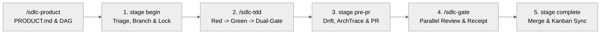

<div align="center">

<picture>
  <source media="(prefers-color-scheme: dark)" srcset="docs/logo-dark.svg">
  
</picture>

# Agentic SDLC Framework

**Deterministic engineering governance for AI coding agents that enforces Robert Martin TDD, Clean Architecture rings, and cryptographic PR merge gates.**

[](#how-it-works)
[](./CHANGELOG.md)
[](./LICENSE)
[](./wiki/Skills-Reference.md)

[Quickstart](#quickstart) · [Why Agentic SDLC?](#why-agentic-sdlc) · [How It Works](#how-it-works) · [Docs](#documentation--roadmap) · [Contributing](#contributing--license)

</div>

```text
$ npx github:fmatar/agentic-sdlc-framework install --agents gemini,claude,cursor --with-archlens --with-hooks --yes
✔ Provisioned 11 Canonical Skills (/sdlc + 9 Verb Skills + ub-mode) across Gemini, Claude Code & Cursor
✔ Installed SHA-256 verified 4-Layer Git Guard hooks (.git/hooks/pre-commit, pre-merge-commit, pre-push)
✔ Scaffolded Concentric Clean Architecture ring policy (.archlens/policy.json)
✔ Auto-detected polyglot test, coverage & mutation runners (.agent/sdlc-config.json)
```

## Why Agentic SDLC?

AI coding assistants ship code fast—until they commit directly to `main`, import database adapters inside pure domain models, or silently drift from your product spec mid-session. **Agentic SDLC Framework** equips **Gemini / Antigravity**, **Claude Code**, **Cursor**, **Grok**, **Windsurf**, and **GitHub Copilot** with a zero-dependency Node.js governance engine (`sdlc-engine.mjs`) and enforceable Git gates.

- ⚡ **Proportional Lanes & Verified TDD** — Scales ceremonies across `trivial`, `standard`, and `full` risk lanes while verifying real coverage and mutation reports against `.agent/sdlc-config.json` across Node/TS, Java, Python, Go, and Rust.
- 🔒 **4-Layer Git Guard & Clean Architecture** — Blocks direct commits to `main`, validates concentric ring imports against `.archlens/policy.json` on every diff, and requires HMAC-SHA256-signed Stage 7 merge receipts.
- 🧩 **Drop-In Multi-Agent & Spec-Drift Sync** — Provisions native skills and Cowork bundles across 6 AI IDEs while requiring an accepted ADR (`docs/adr/`) for any contract or `PRODUCT.md` drift.

## Quickstart

> [!TIP]
> Zero external runtime dependencies—runs in any repository with **Node.js >= 18**.

### 1. Install in One Command

```bash
npx github:fmatar/agentic-sdlc-framework install
```

### 2. Run Your First Governed Feature Flow

```bash
# Start an atomic ticket session, checkout feature/issue-#1-jwt-auth, and lock .sdlc-session.json
node .agent/scripts/sdlc-engine.mjs stage begin --issue 1 --title "jwt-auth" --type feat --checkout

# Run affected tests, Concentric Ring diff, Spec-Drift sentinel & README/Wiki audits
node .agent/scripts/sdlc-engine.mjs gate --strict
```

Expected output:

```text
🚀 Stage Begin (#1 | lane=full): branch 'feature/issue-#1-jwt-auth' | Stage 2/8
✅ Archlens Diff Check: Zero architectural layer inversions introduced in diff.
✅ Spec-Drift Check Passed (0 undeclared contract mutations).
✅ README & Wiki Audits Passed (0 broken paths, 0 anti-patterns).
```

Or drive the entire 8-stage lifecycle directly from your AI chat prompt:
> `"/sdlc-flow Implement ticket #1: Add multi-tenant JWT rotation with rate limiting."`

## How It Works



<details>
<summary><strong>Supported AI Coding Tools & Provisioned Paths (Local vs. Global)</strong></summary>

| AI Coding Tool | `--agents` ID | Local Project Files | Global Config (`--global`) |
| :--- | :--- | :--- | :--- |
| **Gemini / Antigravity** | `gemini` | `.agent/skills/<skill>/SKILL.md`, `.agent/scripts/`, `AGENTS.md` | `~/.gemini/config/skills/` |
| **Claude Code & Cowork** | `claude` | `CLAUDE.md`, `.claude/skills/<skill>/SKILL.md`, `.claude-plugin/plugin.json`, `.claude/cowork/*.zip` | `~/.claude/skills/`, `~/.claude/cowork/*.zip` |
| **Cursor** | `cursor` | `.cursor/skills/<skill>/SKILL.md`, `.cursor/rules/*.mdc` | `~/.cursor/skills/`, `~/.cursor/rules/` |
| **Grok (xAI)** | `grok` | `GROK.md`, `.grok/skills/<skill>/SKILL.md` | `~/.grok/skills/` |
| **Windsurf** | `windsurf` | `.windsurf/rules/agentic-sdlc.md`, `.windsurf/workflows/<skill>.md` | `~/.codeium/windsurf/memories/` |
| **GitHub Copilot** | `copilot` | `.github/copilot-instructions.md`, `.github/prompts/*.prompt.md` | `~/.github/copilot-instructions.md` |

Non-interactive & global examples:

```bash
# Configure all 6 AI coding tools + GitHub Actions CI + Git hooks:
npx github:fmatar/agentic-sdlc-framework install --agents all --with-archlens --with-hooks --with-ci --yes

# Install globally across your machine:
npx github:fmatar/agentic-sdlc-framework install --global --agents gemini,claude,cursor,grok --yes
```

</details>

<details>
<summary><strong>Polyglot Stack Auto-Detection & Dual-Gate Parsers</strong></summary>

| Ecosystem | Manifest | Test Runner | Coverage Parser (`.agent/sdlc-config.json`) | Mutation Engine (`.agent/sdlc-config.json`) |
| :--- | :--- | :--- | :--- | :--- |
| **Node.js / TS** | `package.json` | `node --test` / Vitest / Jest | `lcov.info`, `coverage-summary.json` | Stryker (`mutation.json`) |
| **Java / Kotlin** | `pom.xml`, `build.gradle` | `mvn test` / `./gradlew test` | JaCoCo (`jacoco.csv`, `jacoco.xml`) | PITest (`mutations.xml`) |
| **Python** | `pyproject.toml`, `pytest.ini` | `pytest` | Cobertura (`coverage.xml`), `lcov.info` | `mutmut` / Cosmic Ray |
| **Go** | `go.mod` | `go test ./...` | `coverage.out` | `go-mutesting` |
| **Rust** | `Cargo.toml` | `cargo test` | `cargo-tarpaulin` / `lcov.info` | `cargo-mutants` |

</details>

## Documentation & Roadmap

- **Skills & Full CLI Reference**: [`wiki/Skills-Reference.md`](./wiki/Skills-Reference.md) (`11 Canonical Skills` & every `sdlc-engine.mjs` subcommand)
- **Architecture & Concentric Rings**: [`wiki/Architecture.md`](./wiki/Architecture.md) & [`wiki/Codebase-Map.md`](./wiki/Codebase-Map.md)
- **Product Constitution & Specs**: [`PRODUCT.md`](./PRODUCT.md), [`docs/PRD.md`](./docs/PRD.md), and [`docs/SRS.md`](./docs/SRS.md)
- **AI Coding Agent Context**: [`llms.txt`](./llms.txt)
- **Open Milestones & Traceability**: [`docs/KANBAN.md`](./docs/KANBAN.md) & [`docs/DECISION_MAP.md`](./docs/DECISION_MAP.md)

## Contributing & License

Source builds, F.I.R.S.T. test execution, and pull request guidelines live in [CONTRIBUTING.md](./CONTRIBUTING.md).
Licensed under the [Apache 2.0 License](./LICENSE).
