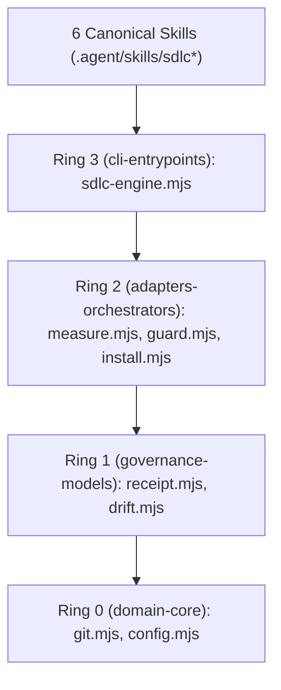

# `@fmatar/agentic-sdlc` (v0.2.0)

**Alignment and Proof Kernel for AI Coding Agents**: mechanical specification & ADR drift checks, [Archlens](https://github.com/fmatar/archlens) Concentric Clean Architecture ring checks, measured diff coverage & mutation gates, and HMAC-SHA256 cryptographic merge receipts.

[](https://github.com/fmatar/agentic-sdlc-framework/actions/workflows/sdlc-quality-gate.yml)
[](https://nodejs.org)
[](./LICENSE)

---

## Why `@fmatar/agentic-sdlc`?

AI coding agents write code quickly while making it easy to drift from specifications, leave diff lines untested, violate layer boundaries, or assert tests passed without fresh execution proof.

`@fmatar/agentic-sdlc` is a zero-dependency Node.js (`>= 22.0.0`) CLI and 6-skill suite (`< 120 kB` packed) that enforces four mechanical guarantees on every pull request:

1. **Git Flow & Session Guard (`INV-01`)**: Blocks direct commits, pushes, or unverified merges to `main` and `develop` via SHA-256 verified Git hooks and linked-worktree-aware session locks.
2. **Spec, ADR & Architecture Alignment (`INV-03`)**: Detects changes to `PRODUCT.md`, `docs/specs/*.md`, `.archlens/policy.json`, structural dependency manifests, schemas, and OpenAPI contracts, requiring a human-approved (`accepted`) ADR and zero inward ring or circular dependency violations.
3. **Single-Path Measured Proof (`INV-02` & `INV-04`)**: Parses real coverage (`lcov`, `coverage-summary.json`, `jacoco.xml`, `jacoco.csv`, `coverage.xml`, `cover.out`) and diff-scoped mutation reports (`Stryker`, `PITest`, `cargo-mutants`, `mutmut`, `go-mutesting`) via shell-free `execFileSync` execution, failing closed on stale reports, unimported `0%` source files, or leaked secrets.
4. **Cryptographic Merge Receipts**: Signs `headSha`, `treeSha`, `specHash`, `adrHashes`, measured `diffCoverage`, measured `mutationScore`, and independent reviewer sign-off into an append-only SHA-256 hash chain (`docs/AUDIT_CHAIN.jsonl`), verified across Squash, `--no-ff`, and fast-forward merges.

---

## 90-Second Quickstart

```bash
# 1. Install hooks, .agent/sdlc-config.json, .archlens/policy.json, CI workflow, and agent skills
npx --yes github:fmatar/agentic-sdlc-framework init --agents antigravity,claude,cursor --yes

# 2. Check environment health and provision CI signing secret
node .agent/scripts/sdlc-engine.mjs doctor
tr -d '\r\n' < .agent/.receipt-key | gh secret set SDLC_RECEIPT_KEY

# 3. Start a feature session & branch from develop
node .agent/scripts/sdlc-engine.mjs begin --title "add-payment-webhook" --type feat --checkout

# 4. Run Red-Green-Refactor TDD, then execute the measured quality gate
node .agent/scripts/sdlc-engine.mjs gate

# 5. Record independent review approval & verify the Stage 7 HMAC receipt
node .agent/scripts/sdlc-engine.mjs review record --verdict approve --reviewer "@sdlc-gate" --notes "Reviewed diff"
git add docs/AUDIT_CHAIN.jsonl && git commit -m "chore(audit): record Stage 7 gate receipt"
node .agent/scripts/sdlc-engine.mjs verify
```

---

## Architecture (8-Module Concentric Kernel)



| Ring | Module | Responsibility |
| :--- | :--- | :--- |
| **Ring 0** (`domain-core`) | `.agent/scripts/lib/git.mjs` | Sanitized `git` execution, linked-worktree resolution, shell-free `parseCommandArgv` / `runConfiguredCommand`, atomic file locks |
| **Ring 0** (`domain-core`) | `.agent/scripts/lib/config.mjs` | Polyglot stack auto-detection, `.agent/sdlc-config.json` validation, `v0.0.2` -> `v0.1.0` config migration |
| **Ring 1** (`governance-models`) | `.agent/scripts/lib/receipt.mjs` | Session persistence, SHA-256 gate cache, append-only `AUDIT_CHAIN.jsonl`, multi-topology HMAC-SHA256 Stage 7 receipts |
| **Ring 1** (`governance-models`) | `.agent/scripts/lib/drift.mjs` | Spec/manifest/OpenAPI drift detection, ADR lifecycle (`pending_approval` -> `accepted`), [Archlens](https://github.com/fmatar/archlens) ring & cycle checker |
| **Ring 2** (`adapters-orchestrators`) | `.agent/scripts/lib/measure.mjs` | Single-path `runGate` (`docs-only` vs `code`), diff secret scanner, polyglot coverage/mutation report parsers, `buildReviewPlan` |
| **Ring 2** (`adapters-orchestrators`) | `.agent/scripts/lib/guard.mjs` | Session lifecycle (`beginSession` `--base` / `endSession`), 4-Layer Git hooks, 2-axis `buildReviewPlan`, `buildPrSummary`, review recording |
| **Ring 2** (`adapters-orchestrators`) | `.agent/scripts/lib/install.mjs` | Symlink-safe local & `--global` multi-agent skill installer, `skill-audit`, `doctor`, and GitHub Actions workflow generator |
| **Ring 3** (`cli-entrypoints`) | `.agent/scripts/sdlc-engine.mjs` | Declarative CLI command registry, `--json` output, and fail-closed exit codes |

---

## Canonical 6-Skill Suite

All skills live in `.agent/skills/` (the single source of truth tracked in git alongside `agents/openai.yaml` metadata) and are adapted at install time for **Antigravity**, **Claude Code**, **Cursor**, **Codex**, and **GitHub Copilot** without touching non-`sdlc*` user skills:

| Skill | Purpose |
| :--- | :--- |
| `sdlc` | User-invoked 1:1 CLI subcommand router (`init`, `doctor`, `begin`, `status`, `drift`, `adr`, `test`, `coverage`, `mutation`, `gate`, `review`, `pr-body`, `receipt`, `verify`, `end`) |
| `sdlc-spec` | Resolve requirements via decision-tree discovery, sharpen `GLOSSARY.md`, and author `PRODUCT.md` / `docs/specs/cap-XX-*.md` contracts |
| `sdlc-adr` | Compare architectural options (`ADR-NNN` & MADR `NNNN-slug.md`) and obtain human sign-off (`accepted`) on `INV-03` drift |
| `sdlc-tdd` | Drive public-seam vertical tracer-bullet Red-Green TDD, bug diagnosis loops, and fresh diff coverage & mutation gates |
| `sdlc-gate` | Dispatch orthogonal 2-axis cold reviewers (Spec Fidelity + Architecture/Security/Smells), run `sdlc gate`, sign Stage 7 receipts, and emit `pr-body` proof |
| `sdlc-flow` | Orchestrate vertical-slice or expand-contract delivery (`begin -> align -> tdd -> gate -> receipt -> pr-body -> end`), including `--base` worktrees |

---

## License

Apache-2.0. See [LICENSE](./LICENSE).
