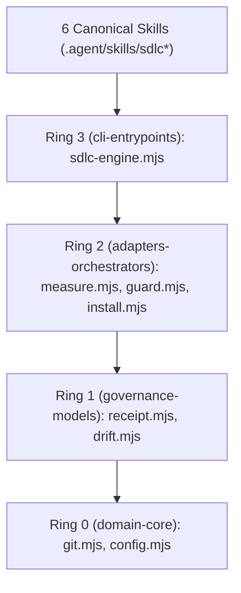

# `@fmatar/agentic-sdlc` (v0.1.0)

**Alignment and Proof Kernel for AI Coding Agents**: mechanical specification & ADR drift checks, [Archlens](https://github.com/fmatar/archlens) Concentric Clean Architecture ring checks, measured diff coverage & mutation gates, and HMAC-SHA256 cryptographic merge receipts.

[](https://github.com/fmatar/agentic-sdlc-framework/actions/workflows/sdlc-quality-gate.yml)
[](https://nodejs.org)
[](./LICENSE)

---

## Why `@fmatar/agentic-sdlc`?

AI coding agents write code quickly while making it easy to drift from specifications, leave diff lines untested, violate layer boundaries, or assert tests passed without fresh execution proof.

`@fmatar/agentic-sdlc` is a zero-dependency Node.js CLI and 6-skill suite (`< 120 kB` packed) enforcing four mechanical guarantees on every pull request:

1. **Git Flow & Session Guard (`INV-01`)**: Blocks direct commits, pushes, or unverified merges to `main` and `develop` via SHA-256 verified Git hooks and linked-worktree-aware session locks.
2. **Spec, ADR & Architecture Alignment (`INV-03`)**: Detects changes to `PRODUCT.md`, `docs/specs/*.md`, `.archlens/policy.json`, structural dependency manifests, schemas, and OpenAPI contracts, requiring a human-approved (`accepted`) ADR and zero inward ring or cycle violations.
3. **Single-Path Measured Proof (`INV-02` & `INV-04`)**: Parses real coverage and diff-scoped mutation reports via shell-free `execFileSync` execution, failing closed on stale reports, unimported `0%` source files, or leaked secrets.
4. **Cryptographic Merge Receipts**: Signs `headSha`, `treeSha`, `specHash`, `adrHashes`, measured `diffCoverage`, measured `mutationScore`, and reviewer sign-off into an append-only SHA-256 hash chain (`docs/AUDIT_CHAIN.jsonl`), verified across Squash, `--no-ff`, and fast-forward merges.

**Prerequisites**: **Node.js `>= 22.0.0`** and **Git `>= 2.38`**.

---

## Two-Track Installation

### Track 1: Install Skills Only (No Repo Hooks or CI)
Install the 6 workflow skills across **Antigravity**, **Claude Code**, **Cursor**, **Codex**, **GitHub Copilot**, and 30+ coding harnesses via [`vercel-labs/skills`](https://github.com/vercel-labs/skills):

```bash
# Project-local (.agents/skills + harness links)
npx skills add fmatar/agentic-sdlc-framework

# Machine-global across all installed coding agents
npx skills add fmatar/agentic-sdlc-framework -g
```

- **Alternatives**: Load directly as a **Claude Code Plugin** (`.claude-plugin/plugin.json`), or install globally with zero third-party tooling via `npx --yes github:fmatar/agentic-sdlc-framework init --global --agents all --yes`.
- **Standalone behavior (no `.agent/sdlc-config.json`)**: `sdlc-spec`, `sdlc-adr`, and `sdlc-tdd` run non-invasively using the repository's native test runners and Markdown ADRs without claiming kernel measurements; `sdlc-gate` and `sdlc-flow` stop and offer `/sdlc init`.

### Track 2: Add the Proof Kernel to a Repository (`sdlc init`)
Provision `.agent/scripts/`, `.agent/sdlc-config.json`, a layout-aware `.archlens/policy.json`, 4-Layer Git hooks, `.github/workflows/sdlc-quality-gate.yml`, and agent skills (automatically skipping skills already managed in `.agents/skills/` by `npx skills`):

```bash
npx --yes github:fmatar/agentic-sdlc-framework init --agents antigravity,claude,cursor,codex,copilot --yes
```

---

## 90-Second Quickstart (Full Proof Kernel)

```bash
# 1. Scaffold Proof Kernel, hooks, CI workflow, skills, and first-adoption .agent/.receipt-key
npx --yes github:fmatar/agentic-sdlc-framework init --agents antigravity,claude,cursor --yes

# 2. Verify environment health and sync the signing secret to GitHub Actions
node .agent/scripts/sdlc-engine.mjs doctor
tr -d '\r\n' < .agent/.receipt-key | gh secret set SDLC_RECEIPT_KEY

# 3. Start an onboarding branch & session from develop (or main)
node .agent/scripts/sdlc-engine.mjs begin --title "adopt" --type chore --checkout

# 4. Record & approve ADR-001 for the initial architecture policy, then commit
node .agent/scripts/sdlc-engine.mjs adr create --title "Adopt agentic-sdlc" --scope architectural \
  --context "Onboard Proof Kernel" --decision "Adopt .archlens/policy.json and gate" --consequences "PRs verify proof"
node .agent/scripts/sdlc-engine.mjs adr decide --id ADR-001 --status approve --by "@lead" --reason "Approved onboarding"
git add -A && git commit -m "chore: adopt agentic-sdlc"

# 5. Run the single-path gate, sign the Stage 7 receipt, commit AUDIT_CHAIN.jsonl, and verify
node .agent/scripts/sdlc-engine.mjs gate --no-cache
node .agent/scripts/sdlc-engine.mjs review record --verdict approve --reviewer "@lead" --notes "Verified onboarding"
git add docs/AUDIT_CHAIN.jsonl && git commit -m "chore(audit): record Stage 7 receipt"
node .agent/scripts/sdlc-engine.mjs verify
```

> **Teammate onboarding note**: Only the first adoption generates `.agent/.receipt-key`. Teammates cloning an already-adopted repository must get the shared team key (into `.agent/.receipt-key` or `.env`)—never run `gh secret set SDLC_RECEIPT_KEY` with a new key, or existing CI receipts will fail verification.

---

## Canonical 6-Skill Suite

All skills live in `.agent/skills/` alongside `agents/openai.yaml` metadata:

| Skill | With Proof Kernel (`.agent/sdlc-config.json`) | Standalone (`npx skills` without kernel) |
| :--- | :--- | :--- |
| `sdlc` | 1:1 router for `init`, `doctor`, `begin`, `status`, `drift`, `adr`, `test`, `coverage`, `mutation`, `gate`, `review`, `pr-body`, `receipt`, `verify`, `end` | Runs `init` / `doctor` via `npx`; stops and offers `/sdlc init` for repo-governed commands |
| `sdlc-spec` | Decision-tree discovery, `GLOSSARY.md`, `PRODUCT.md` / `docs/specs/cap-XX-*.md` contracts + `sdlc drift` | Authors specs & `GLOSSARY.md` with repo Markdown conventions without claiming kernel drift proof |
| `sdlc-adr` | Creates `ADR-NNN` / MADR `NNNN-slug.md` records, awaits human `approve`, and clears `INV-03` drift | Authors MADR `docs/adr/NNNN-slug.md` with human sign-off |
| `sdlc-tdd` | Public-seam vertical Red-Green TDD, bug diagnosis, and measured `coverage` / `mutation` checks | Runs Red-Green TDD & bug diagnosis with native test/coverage runners |
| `sdlc-gate` | Dispatches 2-axis cold reviewers, runs `sdlc gate`, signs Stage 7 receipts, and emits `pr-body` | Stops and offers `/sdlc init` (never claims unverified gate proof) |
| `sdlc-flow` | Orchestrates `begin -> align -> tdd -> gate -> receipt -> pr-body -> end` (including `--base` worktrees) | Stops and offers `/sdlc init` |

---

## Polyglot Coverage & Mutation Support

| Ecosystem | Coverage Reports Parsed | Diff-Scoped / Module Mutation Reports |
| :--- | :--- | :--- |
| **JavaScript / TypeScript** | `coverage/lcov.info`, `coverage/coverage-summary.json` | Stryker (`reports/mutation/mutation.json`) |
| **Java / Kotlin (Maven & Gradle)** | `jacoco.xml`, `jacoco.csv`, `jacocoTestReport.xml` | PITest (`mutations.xml`) |
| **Python** | Cobertura `coverage/coverage.xml`, `lcov.info` | `mutmut` (`.mutmut-results.json`, `.mutmut-results.txt`) |
| **Rust** | `coverage/lcov.info`, Cobertura `cobertura-coverage.xml` | `cargo-mutants` (`mutants.out/outcomes.json`) |
| **Go** | `coverage/cover.out` | `go-mutesting` (`reports/mutation/go-mutesting.txt`) |

---

## Architecture (8-Module Concentric Kernel)



| Ring | Module | Responsibility |
| :--- | :--- | :--- |
| **Ring 0** (`domain-core`) | `.agent/scripts/lib/git.mjs` | Sanitized `git` plumbing, linked-worktree resolution, shell-free `runConfiguredCommand`, atomic file locks |
| **Ring 0** (`domain-core`) | `.agent/scripts/lib/config.mjs` | Polyglot stack auto-detection, `.agent/sdlc-config.json` validation, monotonic effective policy, `isEngineOwnerRepo` |
| **Ring 1** (`governance-models`) | `.agent/scripts/lib/receipt.mjs` | Session persistence, SHA-256 gate cache, append-only `AUDIT_CHAIN.jsonl`, multi-topology HMAC-SHA256 Stage 7 receipts |
| **Ring 1** (`governance-models`) | `.agent/scripts/lib/drift.mjs` | Spec/manifest/OpenAPI drift detection, dual ADR/MADR lifecycle, [Archlens](https://github.com/fmatar/archlens) ring & cycle checker |
| **Ring 2** (`adapters-orchestrators`) | `.agent/scripts/lib/measure.mjs` | Single-path `runGate` (`docs-only` vs `code`), diff secret scanner, polyglot coverage/mutation parsers |
| **Ring 2** (`adapters-orchestrators`) | `.agent/scripts/lib/guard.mjs` | Session lifecycle (`begin` `--base` / `end`), 4-Layer Git hooks, 2-axis `buildReviewPlan`, `buildPrSummary` |
| **Ring 2** (`adapters-orchestrators`) | `.agent/scripts/lib/install.mjs` | `npx skills`-aware multi-agent installer, layout-aware Archlens scaffold, `skill-audit`, `doctor`, CI workflow generator |
| **Ring 3** (`cli-entrypoints`) | `.agent/scripts/sdlc-engine.mjs` | Declarative CLI command registry, `--json` output, and fail-closed exit codes |

---

## Further Documentation & License

- [PRODUCT.md](./PRODUCT.md) — Constitutional invariants (`INV-01`..`INV-04`), capability matrix (`CAP-01`..`CAP-06`), and ADR index
- [CONTRIBUTING.md](./CONTRIBUTING.md) — Local setup, TDD workflow, and pull request verification checklist
- [llms.txt](./llms.txt) — Machine-readable documentation map for AI coding agents
- **License**: Apache-2.0. See [LICENSE](./LICENSE).
