<div align="center">
  <h1>Agentic SDLC Framework</h1>
  <p><b>State-of-the-Art Autonomous Software Development Lifecycle Orchestration</b></p>

  [](https://opensource.org/licenses/Apache-2.0)
  [](#)
  [](http://makeapullrequest.com)

</div>

---

## ⚡ What is the Agentic SDLC Framework?

The Agentic SDLC Framework is a **Hybrid Orchestration** system that transforms standard coding agents (like Google Antigravity) into a highly disciplined, multi-agent engineering team. Instead of letting agents write code aimlessly, this framework enforces industry best practices (SVPG PRDs, IEEE 29148 SRS, Simon Brown C4 Architecture) and automates the entire software lifecycle from ideation to release.

## 🚀 Key Features

* **Autonomous 8-Stage Lifecycle & Circuit Breaker**: The `sdlc-flow` orchestrator drives intake auto-classification (`feat`, `bug`, `hotfix`, `spike`), branching, TDD implementation, coverage enforcement, docs sync, PR creation, parallel subagent peer review, CI status polling, and release with session concurrency locking (`.agent/.sdlc-session.json`), Git worktree isolation, automated remediation circuit breakers (max 3 loops), and real-time visual progress dashboards.
* **Living Kanban & Pluggable PM Providers**: The `sdlc-kanban` skill automates ticket state transitions (`status:*`), manages GitHub Projects v2 multi-views, Jira, Linear, and syncs an in-repo `docs/KANBAN.md` dashboard with full bidirectional traceability.
* **Dual-Gate Testing & Mutation Defense**: Enforces Robert C. Martin (Uncle Bob) craftsmanship with $\ge 85\%$ diff coverage and $\ge 80\%$ mutation kill score (PITest for Quarkus, Stryker for Svelte 5) to eliminate vanity coverage metrics and kill surviving mutants.
* **Fork-Join Parallel Peer Review & Quality Gate**: Spawns independent read-only subagents via `invoke_subagent` to audit PR diffs, detect test smells (no trivial getter tests, no mock abuse), run static gates, and post review comments via GitHub MCP.
* **Built-in DevSecOps & Quality Gate**: `sdlc-quality-gate` verifies Spotless formatting, static typing (`svelte-check`), test port isolation (`quarkus.http.test-port=0`), WCAG a11y, SAST audits, and production builds.
* **Architectural Traceability & Mutation Ledger**: The `sdlc-arch-trace` skill continuously audits system architecture evolution, extracts Mermaid AST graphs, detects node/edge mutations, and appends an immutable audit log to `docs/ARCH_TRACE.md` and `.agent/arch-trace.jsonl`.
* **Zero-Direct-Push Branch Protection**: Enforces physical Git `pre-push` hooks and SDLC flow guards forbidding direct pushes to `develop` and `main`, mandating feature branches (`feature/*`), Dual-Gate verification, and PR reviews.
* **Automated Releases & Deployments**: `sdlc-release-changelog` automatically manages Semantic Versioning (SemVer), keeps an automated changelog, generates Docker containers, and deploys via Helm.

## 🏛️ Comprehensive Architecture & Lifecycle Workflow

The following diagram illustrates the complete supervisor fork-join lifecycle of the `sdlc-flow` orchestrator, from Gate 0 ticket ingestion to Stage 8 release and session teardown:

```mermaid
%%{init: {'theme': 'base', 'themeVariables': { 'fontFamily': 'system-ui, -apple-system, BlinkMacSystemFont, Segoe UI, Roboto, sans-serif', 'fontSize': '13px', 'darkMode': false, 'lineColor': '#64748b' }}}%%
flowchart LR
    %% Styling Palette (High Contrast, GitHub-Native Aesthetics)
    classDef trigger fill:#4f46e5,stroke:#4338ca,stroke-width:2px,color:#ffffff,font-weight:bold;
    classDef gate0 fill:#7c3aed,stroke:#6d28d9,stroke-width:1.5px,color:#ffffff;
    classDef stage fill:#0284c7,stroke:#0369a1,stroke-width:1.5px,color:#ffffff;
    classDef gate fill:#0d9488,stroke:#0f766e,stroke-width:1.5px,color:#ffffff;
    classDef subagent fill:#059669,stroke:#047857,stroke-width:1.5px,color:#ffffff;
    classDef circuit fill:#e11d48,stroke:#be123c,stroke-width:1.5px,color:#ffffff;
    classDef done fill:#16a34a,stroke:#15803d,stroke-width:2px,color:#ffffff,font-weight:bold;

    %% 1. Ingestion & Pre-Flight
    subgraph Phase1 [" 🛑 INTAKE & CONCURRENCY "]
        direction TB
        UserReq["🎯 User Request<br/><i>(Feature, Fix, Hotfix, Spike)</i>"]:::trigger
        Gate0["Gate 0: Auto-Classifier<br/>• Provision Ticket #id<br/>• Tag status:ready"]:::gate0
        PreFlight{"Active Session<br/>Check"}:::gate0
        UserReq --> Gate0 --> PreFlight
    end

    %% 2. TDD & Architecture
    subgraph Phase2 [" ⚙️ TDD & CLEAN ARCHITECTURE "]
        direction TB
        BranchSync["Stage 2: Branch & Kanban<br/>• feature/issue-#id<br/>• status:in-progress"]:::stage
        TDDLoop["Stage 3: Uncle Bob TDD<br/>• Failing test first (Red-Green)<br/>• Port decoupling (DIP)"]:::stage
        BranchSync --> TDDLoop
    end

    %% 3. Dual-Gate Verification
    subgraph Phase3 [" 🛡️ DUAL-GATE DEFENSE "]
        direction TB
        DualGate["Stage 4: Dual-Gate<br/>• ≥85% Diff Coverage<br/>• ≥80% Mutation Score<br/>• Archlens concentric rings"]:::gate
        ArchTrace["Stage 5: Docs & Trace<br/>• docs/ARCH_TRACE.md<br/>• 5-min Quickstart README<br/>• CHANGELOG.md"]:::gate
        DualGate --> ArchTrace
    end

    %% 4. Fork-Join Review
    subgraph Phase4 [" ⚡ FORK-JOIN AUDIT "]
        direction TB
        OpenPR["Stage 6: Pull Request<br/>• status:in-review<br/>• Generated PR summary"]:::subagent
        ForkJoin["Stage 7: Concurrent Subagents<br/>• PR Peer Reviewer<br/>• Strict Quality Gatekeeper<br/>• Archlens Auditor"]:::subagent
        CircuitBreaker{"Gate & Review<br/>Passed?"}:::circuit
        OpenPR --> ForkJoin --> CircuitBreaker
    end

    %% 5. Release & Teardown
    subgraph Phase5 [" 🏁 RELEASE & TEARDOWN "]
        direction TB
        RemoteCI["Stage 8: CI Polling<br/>• GitHub Actions green"]:::done
        MergeDone["Release Lock & Done<br/>• Squash merge & SemVer<br/>• status:done"]:::done
        RemoteCI --> MergeDone
    end

    %% Pipeline Interconnections
    PreFlight -->|"No Active Session"| BranchSync
    PreFlight -.->|"Active Ticket"| TDDLoop
    TDDLoop --> DualGate
    ArchTrace --> OpenPR
    CircuitBreaker -->|"Approved"| RemoteCI
    CircuitBreaker -->|"Changes Requested (Max 3)"| TDDLoop
```



## 🧠 Core Agentic Skills

The framework operates via interlocking skills located in `.agent/skills/`. Each skill defines a "Next Recommended Step," allowing agents to chain workflows autonomously:

1. **`sdlc-flow`**: Master orchestrator running the 8-stage issue-to-PR automated pipeline with session concurrency locking, ad-hoc fast-path routing, and parallel fork-join subagent reviews.
2. **`sdlc-arch-trace`**: Architectural mutation tracer & Mermaid diagram diff auditor maintaining an immutable audit log in `docs/ARCH_TRACE.md` and strictly blocking direct pushes to `develop` or `main`.
3. **`sdlc-feature-spec`**: Generates structured PRD/SRS documentation, C4 diagrams, and GitHub issues.
4. **`sdlc-tdd-implement`**: Clean-code and TDD feature development adhering to Uncle Bob's Three Laws of TDD and the Transformation Priority Premise (TPP).
5. **`sdlc-test-coverage`**: Dual-Gate test enforcer requiring $\ge 85\%$ diff coverage and $\ge 80\%$ mutation score via PITest & Stryker.
6. **`sdlc-peer-review`**: Subagent that audits PR diffs, detects Uncle Bob test smells and mock abuse, and posts review comments.
7. **`sdlc-kanban`**: Manages GitHub Projects v2, ticket state transitions (`status:*`), WIP limits, and `docs/KANBAN.md`.
8. **`sdlc-docs-wiki`**: Synchronizes documentation across `docs/specs/`, `CHANGELOG.md`, and `/wiki`.
9. **`sdlc-quality-gate`**: Pre-merge quality, formatting, security, Archlens concentric layers, and build validation.
10. **`sdlc-release-changelog`**: Version bumping, Docker containerization, and K8s/Helm deployment.
11. **`sdlc-analyze`**: SDLC compliance auditor evaluating project health against framework standards.
12. **`sdlc-initialize`**: Interactive full-stack project bootstrapper and skill installer.
13. **`sdlc-help`**: Interactive diagnostic guide and prompt recipes.

---

## 💬 Prompting the Agent: Practical Real-World Scenarios

You can drive the entire framework through standard conversational prompts. Here are the exact prompts to use:

### 1. New Feature Implementation (Autonomous End-to-End)
> **Prompt**: `"Implement feature #104: Add multi-tenant JWT token rotation with rate limiting. Follow the sdlc-flow lifecycle."`
> *(If you don't have an issue number, say: `"Build a multi-tenant JWT token rotation with rate limiting."` Gate 0 will auto-classify it as `feat`, provision the issue, and begin).*
* **What happens**: Auto-proves Archlens Clean Architecture governance, creates branch, executes Uncle Bob TDD, enforces $\ge 85\%$ diff coverage & $\ge 80\%$ mutation kill score, syncs README & CHANGELOG, opens PR, and launches parallel peer review & quality gate subagents.

### 2. Bug Fix with Mandatory Reproduction Harness
> **Prompt**: `"Fix bug #205: Session timeout triggers NullPointerException when user profile has null email."`
* **What happens**: The agent adheres to the **Reproduction Invariant**: it authors a failing test reproducing the exact failure *before* modifying any application logic, proves it fails red, applies the fix, and runs through the Dual-Gate.

### 3. Ad-Hoc Fast-Path (Tweaking an In-Flight Ticket)
> **Prompt**: `"Also make sure the token TTL is configurable via environment variable JWT_ROTATION_TTL_SECONDS."`
* **What happens**: Detects active session on `#104`, appends the checklist item to the active ticket, skips intake overhead, and executes TDD + affected-only tests (`sdlc-engine test --affected-only`) directly on the branch.

### 4. Concurrent Urgent Hotfix (Git Worktree Isolation)
> **Prompt**: `"Urgent hotfix: Stripe webhook payload version 2026-09-01 breaks checkout. Don't lose my current work on the JWT feature!"`
* **What happens**: Detects session collision, creates an isolated git worktree (`../worktree-hotfix-stripe`), provisions `#206`, resolves the fix in isolation, and tears down the worktree without stashing or dirtying your active feature workspace.

---

## ⏱️ 5-Minute Developer Quickstart

### Step 1: Install Framework

#### Method A: Modern Skills Ecosystem (Recommended via [skills.sh](https://skills.sh) / [vercel-labs/skills](https://github.com/vercel-labs/skills))
```bash
# Add all 13 framework skills to your project:
npx skills add fmatar/agentic-sdlc-framework -y

# Or install globally for all Antigravity agent sessions:
npx skills add fmatar/agentic-sdlc-framework -g -y

# Select specific skills interactively or by name:
npx skills add fmatar/agentic-sdlc-framework --skill sdlc-flow sdlc-quality-gate -y
```

#### Method B: Turnkey POSIX Script or npm Package
```bash
# Automated installer (auto-detects skills CLI, with zero-dependency POSIX fallback):
curl -sL "https://raw.githubusercontent.com/fmatar/agentic-sdlc-framework/main/install.sh" | bash

# Or via npm package CLI:
npx @fmatar/agentic-sdlc init          # Local
npx @fmatar/agentic-sdlc init --global # Global
```

### Step 2: Bootstrap & Auto-Heal Project
```bash
# Verify toolchain, git hooks, Archlens governance, and local Kanban board:
node .agent/scripts/sdlc-engine.mjs doctor --fix

# Auto-detect stack, CI workflows, and scaffold .agent/sdlc-config.json:
node .agent/scripts/sdlc-engine.mjs detect
```

### Step 3: Run the Universal Engine CLI
All stages can be monitored or executed directly via the unified `sdlc-engine`:

| Command | Purpose |
|---|---|
| `sdlc-engine session status` | View active ticket, stage, branch, and subagents |
| `sdlc-engine session dashboard` | View live interactive ASCII lifecycle progress |
| `sdlc-engine serve [--port <port>]` | Launch interactive web-based Mission Control visual workbench |
| `sdlc-engine test --affected-only` | Run tests strictly for files modified in the active diff |
| `sdlc-engine coverage` | Run diff coverage gate ($\ge 85\%$ line & branch) |
| `sdlc-engine mutation` | Run mutation testing defense ($\ge 80\%$ kill score) |
| `sdlc-engine archlens diff` | Audit diff for Clean Architecture concentric layer inversions |
| `sdlc-engine gate --strict` | Unified strict gate (Lint, Build, Test, Risk, Security, Flake) |
| `sdlc-engine arch trace --reason "<msg>"` | Audit Mermaid AST & record changes to `docs/ARCH_TRACE.md` |
| `sdlc-engine arch diff` | Verify Clean Architecture concentric rings against git diff |
| `sdlc-engine hooks install` | Scaffold pre-push & pre-commit hooks enforcing branch protection |
| `sdlc-engine review plan` | Generate parallel subagent review plan JSON payload |
| `sdlc-engine pr-summary --issue <id>` | Generate formatted markdown summary for GitHub PR |
| `sdlc-engine flake-check --runs 5` | Detect non-deterministic test race conditions |
| `sdlc-engine security-audit` | Scan diff for leaked secrets, API keys, and package CVEs |
| `sdlc-engine interop export [--agent <all\|claude\|cursor\|windsurf>]` | Export framework rules & TDD invariants to Claude Code (`CLAUDE.md`), Cursor (`.cursorrules`), and Windsurf |
| `sdlc-engine release [patch\|minor\|major]` | Bump SemVer, update package/changelog, and tag release |

---

## 🛠️ Advanced Framework Architecture

<details>
<summary><b>Click to expand Advanced SDLC Engine Features & Safeguards</b></summary>

### 1. Zero-Code Ticket Auto-Classification
Incoming requests without an explicit `#id` are deterministically classified:
- `feat`: Architectural capabilities or user features (`status:ready`).
- `fix`: Defect remediation requiring an upfront failing reproduction test.
- `hotfix`: Critical production blockers with P0 priority.
- `spike`: Timeboxed research ending in an ADR.

### 2. Remediation Circuit Breaker & Exemption Ledger
If parallel subagent peer review or mutation testing rejects a PR, the agent remediates up to 3 times automatically. On the 3rd failure, the circuit breaker halts token consumption and presents an interactive `ask_question` modal (request exemption, extend budget, or rollback).
- **Exemption Ledger**: Document unkillable compiler bytecode quirks or shutdown hooks in `.agent/sdlc-exemptions.json`:
  ```bash
  node .agent/scripts/sdlc-engine.mjs exemption add --mutant "OrderService:42:NegateCondition" --reason "JVM shutdown hook side-effect" --by "@lead"
  ```

### 3. Remote CI Polling & Git Hooks
- Install zero-dependency local pre-commit/pre-push hooks: `node .agent/scripts/sdlc-engine.mjs hooks install`.
- Scaffold GitHub Actions Quality Gate CI: `node .agent/scripts/sdlc-engine.mjs ci-workflow install`.
- Verify GitHub Actions matrix status before merging: `node .agent/scripts/sdlc-engine.mjs check-ci <pr-id>`.

</details>

## 📖 Documentation & Specifications
Detailed deep dives and architecture guides are available in:
- [`docs/SDLC_AGENTIC_OPERATIONS_GUIDE.md`](./docs/SDLC_AGENTIC_OPERATIONS_GUIDE.md)
- [`wiki/`](./wiki/)

## 📄 License
This project is licensed under the Apache 2.0 License - see the [LICENSE](./LICENSE) file for details.

