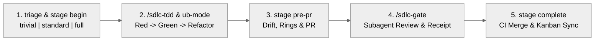

<div align="center">

<picture>
  <source media="(prefers-color-scheme: dark)" srcset="docs/logo-dark.svg">
  
</picture>

# Agentic SDLC Framework

**Risk-proportional engineering governance for AI coding agents enforcing Robert Martin TDD, [Archlens](https://github.com/fmatar/archlens) Clean Architecture rings, and cryptographic PR merge gates.**

[](https://github.com/fmatar/agentic-sdlc-framework/actions/workflows/sdlc-quality-gate.yml)
[](./CHANGELOG.md)
[](https://github.com/fmatar/archlens)
[](./LICENSE)

[Quickstart](#quickstart) · [Why Agentic SDLC?](#why-agentic-sdlc) · [How It Works](#how-it-works) · [Archlens Integration](#clean-architecture-with-archlens) · [Docs](#documentation--roadmap) · [Contributing](#contributing--license)

</div>

```text
$ npx github:fmatar/agentic-sdlc-framework install --agents gemini,claude,cursor --with-archlens --with-hooks --with-ci --yes
✔ Provisioned 11 Canonical Skills (/sdlc + 9 Verb Skills + ub-mode) across Gemini, Claude Code & Cursor
✔ Installed SHA-256 verified 4-Layer Git Guard hooks (.git/hooks/pre-commit, pre-merge-commit, pre-push)
✔ Scaffolded Concentric Clean Architecture ring policy (.archlens/policy.json) & GitHub Actions CI gate
✔ Auto-detected polyglot test, coverage & mutation runners (.agent/sdlc-config.json)
```

## Why Agentic SDLC?

AI coding assistants ship code fast—until they commit directly to `main`, leak database adapters into pure domain models, or force heavyweight enterprise ceremony onto a two-line typo fix. **Agentic SDLC Framework** equips **Gemini / Antigravity**, **Claude Code**, **Cursor**, **Grok**, **Windsurf**, and **GitHub Copilot** with a zero-dependency Node.js governance engine (`sdlc-engine.mjs`, `< 180 KB` packed) that right-sizes ceremony to actual blast radius.

- ⚡ **Risk-Proportional Lanes & Verified TDD** — Automatically triages diffs into `trivial`, `standard`, or `full` lanes while verifying real coverage and mutation reports against `.agent/sdlc-config.json` across Node/TS, Java, Python, Go, and Rust.
- 🔒 **4-Layer Git Guard & [Archlens](https://github.com/fmatar/archlens) Clean Architecture** — Blocks direct commits to `main` in `< 100 ms`, validates concentric ring imports against `.archlens/policy.json`, and enforces HMAC-SHA256-signed Stage 7 merge receipts in CI.
- 🧩 **Drop-In 6-Agent Skills & Spec-Drift ADRs** — Provisions native `SKILL.md` skills and Claude Cowork bundles while requiring an accepted ADR (`docs/adr/`) only when `PRODUCT.md`, `docs/specs/`, or structural dependency/API contracts change.

## Quickstart

> [!TIP]
> Zero external runtime dependencies—runs in any repository with **Node.js >= 18** and **Git >= 2.30**.

### 1. Install in One Command

```bash
npx github:fmatar/agentic-sdlc-framework install
```

### 2. Run a Proportional Workflow (`trivial` Fast-Path vs. `full` Feature Flow)

```bash
# Fast-path for small docs/CSS/copy tweaks (<= 25 lines, zero remote issue spam):
node .agent/scripts/sdlc-engine.mjs stage begin --lane trivial --title "fix-typo" --checkout

# Governed feature flow: branch lock -> TDD -> Concentric Ring + Spec-Drift + Coverage gates
node .agent/scripts/sdlc-engine.mjs stage begin --issue 1 --title "jwt-auth" --type feat --checkout
node .agent/scripts/sdlc-engine.mjs gate --strict
```

Expected output:

```text
🚀 Stage Begin (#1 | lane=full): branch 'feature/issue-#1-jwt-auth' | Stage 2/8
✅ Archlens Diff Check: Zero architectural layer inversions introduced in diff.
✅ Spec-Drift Check Passed (0 undeclared contract or PRODUCT.md mutations).
✅ README & Wiki Audits Passed (0 broken paths, 0 anti-patterns).
```

Or drive the lifecycle directly from your AI coding assistant:
> `"/sdlc quick Fix broken link in docs"` · `"/sdlc-flow Implement #1: Add multi-tenant JWT rotation"`

## How It Works



### Clean Architecture with Archlens

Concentric ring dependency governance (`Domain Core` ← `Governance Models` ← `Adapters & Orchestrators` ← `CLI Entrypoints`) is powered by **[Archlens](https://github.com/fmatar/archlens)**:

- **Deterministic Diff Gate**: `sdlc-engine.mjs gate --strict` evaluates every modified import against `.archlens/policy.json` with zero external servers required.
- **Visual Workbench & MCP Companion**: Install the full [Archlens Dynamic Clean Architecture Workbench](https://github.com/fmatar/archlens) (`npx skills add fmatar/archlens` or `npx @fmatar/archlens-skill start --open`) to inspect live coupling/instability ($Ca, Ce, I$) at `http://localhost:8088`, run MCP architecture queries (`inspectArchitecture`, `exportLlmDossier`), and dispatch refactoring proposals via `.archlens/to-agent.json`.

<details>
<summary><strong>11 Canonical Skills & Risk-Proportional Execution Lanes</strong></summary>

| Lane | Auto-Selected When (`sdlc-engine.mjs triage`) | Required Verification |
| :--- | :--- | :--- |
| **`trivial`** | Docs/CSS/copy only, `<= 25` changed lines, `LOW` risk, `0` drift triggers | Local `L-*` session, affected tests / doc audit, auto-signed `trivial` receipt on `stage pre-pr`. |
| **`standard`** | Standard code/bugfix `<= 200` lines, `LOW`/`MEDIUM` risk, `0` drift triggers | `stage begin`, TDD + diff coverage (`sdlc-config.json`), 1 read-only reviewer, Stage 7 receipt. |
| **`full`** | `HIGH`/`CRITICAL` risk, any spec/manifest drift trigger, or `> 200` lines | `stage begin`, ADR (if drift), TDD + coverage + mutation, 2–3 parallel reviewers, `gate --strict`, Stage 7 receipt. |

| Skill | Purpose |
| :--- | :--- |
| **`/sdlc`** | Universal 1:1 CLI router (`/sdlc doctor`, `/sdlc quick`, `/sdlc triage`, `/sdlc begin #id`, `/sdlc gate`) |
| **`/sdlc-flow`** | Proportional end-to-end delivery orchestrator (`stage begin` → TDD → `stage pre-pr` → review → `stage complete`) |
| **`/sdlc-product`** | Constitutional `PRODUCT.md` autopilot, `docs/PRD.md`, IEEE 29148 `docs/SRS.md`, and topological DAG waves |
| **`/sdlc-tdd`** | Robert Martin Red-Green-Refactor TDD, bug reproduction harnesses (`reproduce`), coverage & mutation gates |
| **`/sdlc-gate`** | Risk-tiered parallel read-only PR review (`review plan`), `gate --strict`, and HMAC-SHA256 Stage 7 receipts |
| **`/sdlc-adr`** | Spec-Drift sentinel (`drift check`), two-speed ADR lifecycle (`docs/adr/`), and SRS release compaction |
| **`/sdlc-doctor`** | Read-only toolchain/hook SHA-256 diagnostics (`doctor`), `--fix` auto-healer, and 6-agent installer |
| **`/sdlc-status`** | Strictly read-only 8-stage dashboard, drift status, audit-chain verification, and estimated telemetry |
| **`/sdlc-wiki`** | 10–30–90 `README.md` engine, `llms.txt`, and [Archlens](https://github.com/fmatar/archlens) AST-to-Wiki synchronization |
| **`/sdlc-release`** | SemVer bumps, ADR compaction into `docs/SRS.md`, SHA-256 regression proofs, and canary health watchdog |
| **`/ub-mode`** | Robert C. Martin reduced coding principles (*First Make it Work → Then Make it Right → Practice*) |

</details>

<details>
<summary><strong>Supported AI Coding Tools & Provisioned Paths (Local vs. Global)</strong></summary>

| AI Coding Tool | `--agents` ID | Local Project Files | Global Config (`--global`) |
| :--- | :--- | :--- | :--- |
| **Gemini / Antigravity** | `gemini` | `.agent/skills/<skill>/SKILL.md`, `.agent/scripts/`, `AGENTS.md` | `~/.gemini/config/skills/` |
| **Claude Code & Cowork** | `claude` | `CLAUDE.md`, `.claude/skills/<skill>/SKILL.md`, `.claude-plugin/plugin.json`, `.claude/cowork/*.zip` | `~/.claude/skills/`, `~/.claude/cowork/*.zip` |
| **Cursor** | `cursor` | `.cursor/skills/<skill>/SKILL.md`, `.cursor/rules/*.mdc` | `~/.cursor/skills/`, `~/.cursor/rules/` |
| **Grok (xAI)** | `grok` | `GROK.md`, `.grok/skills/<skill>/SKILL.md` | `~/.grok/skills/` |
| **Windsurf** | `windsurf` | `.windsurf/rules/agentic-sdlc.md`, `.windsurf/workflows/<skill>.md` | `~/.codeium/windsurf/memories/` |
| **GitHub Copilot** | `copilot` | `.github/copilot-instructions.md`, `.github/prompts/*.prompt.md` | `~/.github/copilot-instructions.md` |

```bash
# Configure all 6 AI coding tools + Archlens policy + GitHub Actions CI + Git hooks:
npx github:fmatar/agentic-sdlc-framework install --agents all --with-archlens --with-hooks --with-ci --yes

# Refresh global skills across your machine:
npx github:fmatar/agentic-sdlc-framework install --global --agents gemini,claude,cursor,grok --yes
```

</details>

<details>
<summary><strong>Polyglot Stack Auto-Detection & Dual-Gate Parsers</strong></summary>

| Ecosystem | Manifest | Test Runner | Coverage Parser (`.agent/sdlc-config.json`) | Mutation Engine (`.agent/sdlc-config.json`) |
| :--- | :--- | :--- | :--- | :--- |
| **Node.js / TS** | `package.json` | `node --test` / Vitest / Jest | `lcov.info`, `coverage-summary.json` | Stryker (`mutation.json`) |
| **Java / Kotlin** | `pom.xml`, `build.gradle` | `mvn test` / `./gradlew test` | JaCoCo (`jacoco.csv`, `jacoco.xml`) | PITest (`mutations.xml`) |
| **Python** | `pyproject.toml`, `pytest.ini` | `pytest` | Cobertura (`coverage.xml`), `lcov.info` | `mutmut` / Cosmic Ray |
| **Go** | `go.mod` | `go test ./...` | `coverage.out` | `go-mutesting` |
| **Rust** | `Cargo.toml` | `cargo test` | `cargo-tarpaulin` / `lcov.info` | `cargo-mutants` |

</details>

## Documentation & Roadmap

- **Wiki Overview & Quickstart**: [`wiki/Home.md`](./wiki/Home.md) & [`wiki/Skills-Reference.md`](./wiki/Skills-Reference.md) (`11 Canonical Skills` & full CLI reference)
- **Concentric Ring Architecture & AST Map**: [`wiki/Architecture.md`](./wiki/Architecture.md), [`wiki/Codebase-Map.md`](./wiki/Codebase-Map.md), and [`wiki/Traceability.md`](./wiki/Traceability.md)
- **Companion Clean Architecture Engine**: [Archlens (`github.com/fmatar/archlens`)](https://github.com/fmatar/archlens) (`.archlens/policy.json`, visual workbench & MCP server)
- **Product Constitution & IEEE 29148 Specs**: [`PRODUCT.md`](./PRODUCT.md), [`docs/PRD.md`](./docs/PRD.md), and [`docs/SRS.md`](./docs/SRS.md)
- **AI Coding Agent Context**: [`llms.txt`](./llms.txt)
- **Living Kanban & Decision Lineage**: [`docs/KANBAN.md`](./docs/KANBAN.md) & [`docs/DECISION_MAP.md`](./docs/DECISION_MAP.md)

## Contributing & License

Source builds, F.I.R.S.T. test execution, and pull request guidelines live in [CONTRIBUTING.md](./CONTRIBUTING.md).
Licensed under the [Apache 2.0 License](./LICENSE).
