<div align="center">
  <h1>⚡ Agentic SDLC Framework</h1>
  <p><b>Constitutional Multi-Agent Software Development Lifecycle Orchestration</b></p>

  [](./CHANGELOG.md)
  [](./wiki/Skills-Reference.md)
  [](#1-install-via-npx-interactive-multi-agent-wizard)
  [](#)
  [](https://opensource.org/licenses/Apache-2.0)
</div>

---

## 🎯 Overview

The **Agentic SDLC Framework** transforms AI coding assistants (**Google Antigravity / Gemini**, **Claude Code**, **Cursor**, **Grok**, **Windsurf**, and **GitHub Copilot**) into a disciplined software engineering organization. Instead of letting agents write ad-hoc code on `main`, it enforces **Constitutional Product Specs (`PRODUCT.md`)**, **Spec-Drift ADR Gates**, **Robert C. Martin TDD**, **Concentric Clean Architecture (`.archlens/policy.json`)**, **Parallel Fork-Join Subagent Peer Reviews**, and **Cryptographic SHA-256 Merkle Gate Receipts**.

---

## 🚀 30-Second Quickstart

### 1. Install via `npx` (Interactive Multi-Agent Wizard)

Run the zero-dependency installer inside any repository. Use `↑/↓` and `Space` to select your AI coding tools, installation scope (**Local** vs. **Global**), and governance add-ons:

```bash
# Launch the interactive multi-agent TUI wizard:
npx github:fmatar/agentic-sdlc-framework install
```

#### Non-Interactive & Global One-Liners
```bash
# Install for specific AI tools in the current project:
npx github:fmatar/agentic-sdlc-framework install --agents gemini,claude,cursor,grok --with-archlens --with-hooks --yes

# Install for ALL 6 supported AI tools + Archlens + 4-Layer Git Hooks + GitHub Actions CI:
npx github:fmatar/agentic-sdlc-framework install --agents all --with-archlens --with-hooks --with-ci --yes

# Install globally into ~/.gemini, ~/.claude, ~/.grok, and ~/.cursor:
npx github:fmatar/agentic-sdlc-framework install --global --agents gemini,claude,grok,cursor --yes

# Alternative: Skills-only install via Vercel Labs skills.sh CLI:
npx skills add fmatar/agentic-sdlc-framework -y
```

### 2. What Gets Provisioned Per AI Tool (`ADR-003`)

| AI Coding Tool | Flag | Local Project Artifacts | Global User Config (`--global`) |
| :--- | :--- | :--- | :--- |
| **Gemini / Antigravity** | `gemini` | `.agent/skills/<skill>/SKILL.md`, `.agent/scripts/`, `AGENTS.md` | `~/.gemini/config/skills/<skill>/SKILL.md` |
| **Claude Code** | `claude` | `CLAUDE.md`, `.claude/skills/<skill>/SKILL.md`, `.claude/commands/<skill>.md` | `~/.claude/CLAUDE.md`, `~/.claude/skills/`, `~/.claude/commands/` |
| **Cursor** | `cursor` | `.cursor/rules/agentic-sdlc.mdc`, `.cursor/rules/<skill>.mdc`, `.cursorrules` | `~/.cursor/rules/agentic-sdlc.mdc`, `~/.cursor/rules/<skill>.mdc` |
| **Grok (xAI)** | `grok` | `GROK.md`, `.grok/skills/<skill>/SKILL.md`, `.grok/rules/agentic-sdlc.md` | `~/.grok/GROK.md`, `~/.grok/skills/<skill>/SKILL.md` |
| **Windsurf** | `windsurf` | `.windsurf/rules/agentic-sdlc.md`, `.windsurf/workflows/<skill>.md`, `.windsurfrules` | `~/.codeium/windsurf/memories/global_rules.md` |
| **GitHub Copilot** | `copilot` | `.github/copilot-instructions.md`, `.github/prompts/<skill>.prompt.md` | `~/.github/copilot-instructions.md`, `~/.github/prompts/` |

---

## 🏛️ Six Core Engineering Pillars

| Pillar | What It Enforces | Engine Entrypoint |
| :--- | :--- | :--- |
| **1. Constitutional Product Autopilot** | Synthesizes specs into `PRODUCT.md` (`CAP-XX`, `INV-XX`, `SPEC-XX`), authors PRDs/SRS/C4 in `docs/specs/`, and schedules topological DAG waves. | `sdlc-engine product <init\|plan\|control>` |
| **2. Spec-Drift Sentinel & ADR Engine** | Blocks undeclared changes to stack dependencies, C4 diagrams, DB migrations, or OpenAPI/GraphQL contracts unless linked to an accepted `docs/adr/ADR-00X.md`. | `sdlc-engine drift check` / `adr create` |
| **3. Composite 3-Command Lifecycle** | Collapses branching, session locking, Kanban state transitions, architectural trace logging, and Merkle receipt signing into 3 atomic transitions. | `sdlc-engine stage <begin\|pre-pr\|complete>` |
| **4. 4-Layer Git Guard & Merkle Receipts** | Physically blocks direct commits/pushes to `main`/`develop`, requires an active branch-matched session on `pre-commit`, and verifies a signed SHA-256 Gate Receipt on `pre-merge`. | `sdlc-engine guard <pre-commit\|pre-merge\|receipt>` |
| **5. Polyglot TDD & Real Dual-Gate** | Enforces Robert Martin's 3 Laws of TDD with real report parsers (`coverage-summary.json`, `lcov.info`, `jacoco.csv`, `coverage.xml`, `coverage.out`, Stryker, PITest) at $\ge 85\%$ coverage and $\ge 80\%$ mutation kill score. | `sdlc-engine coverage` / `mutation` |
| **6. Clean Architecture & Live Workbench UI** | Audits imports against `.archlens/policy.json` concentric rings (`Core -> UseCase -> Adapter`) and renders an interactive Architecture Diff & Decision Lineage UI (`http://localhost:4120` & inline `<agent-embed>`). | `sdlc-engine ui-snapshot` / `serve` |

---

## 🧠 Canonical 6-Skill Ecosystem (`ADR-002`)

All 6 skills live in `.agent/skills/` with validated tool schemas (`read_file`, `write_file`, `edit_file`, `run_command`, `invoke_subagent`):

| Skill | Role | Primary Responsibilities |
| :--- | :--- | :--- |
| **`/sdlc-init`** | **Bootstrap & Doctor** | Runs the multi-agent installer wizard, auto-detects polyglot stacks (`.agent/sdlc-config.json`), scaffolds `.archlens/policy.json` & CI workflows, and heals repos via `doctor --fix`. |
| **`/sdlc-product`** | **Product Autopilot** | Authors `PRODUCT.md` (`CAP-XX`, `INV-XX`), `docs/specs/*.md`, C4 diagrams, and ADRs; provisions templated tickets and schedules topological DAG waves. |
| **`/sdlc-flow`** | **Master Orchestrator** | Drives end-to-end implementation (`stage begin` $\rightarrow$ TDD $\rightarrow$ `stage pre-pr` $\rightarrow$ Review Gate $\rightarrow$ `stage complete`), syncs `docs/KANBAN.md`, and embeds the live Architecture Diff UI. |
| **`/sdlc-tdd`** | **TDD & Dual-Gate** | Enforces Robert C. Martin Red-Green-Refactor cycles, Transformation Priority Premise (TPP), F.I.R.S.T. test isolation, affected-only test runs, and real coverage/mutation gates. |
| **`/sdlc-review-gate`** | **Parallel Review Gate** | Spawns concurrent read-only subagents (`PR Peer Reviewer` + `Quality Gate Auditor`) to audit diffs for test smells, security leaks, and concentric ring violations. |
| **`/sdlc-release`** | **Docs Sync & Release** | Synchronizes `README.md`, `docs/specs/`, `CHANGELOG.md`, and `wiki/`, bumps SemVer manifests, generates regression proofs, and runs canary rollback watchdogs. |

---

## 🗺️ Lifecycle Architecture

```mermaid
flowchart LR
    classDef init fill:#1e1b4b,stroke:#6366f1,stroke-width:2px,color:#eef2ff;
    classDef stage fill:#0284c7,stroke:#0369a1,stroke-width:1.5px,color:#ffffff;
    classDef tdd fill:#0d9488,stroke:#0f766e,stroke-width:1.5px,color:#ffffff;
    classDef gate fill:#7c3aed,stroke:#6d28d9,stroke-width:1.5px,color:#ffffff;
    classDef done fill:#16a34a,stroke:#15803d,stroke-width:2px,color:#ffffff,font-weight:bold;

    P["🏛️ /sdlc-product\n• PRODUCT.md & Specs\n• ADR & DAG Plan"]:::init
    B["1. stage begin\n• Provision Ticket #id\n• Checkout feature/issue-#id\n• Lock .sdlc-session.json"]:::stage
    T["2. /sdlc-tdd\n• Failing Red Test First\n• Minimal Green Code\n• ≥85% Cov / ≥80% Mut"]:::tdd
    PR["3. stage pre-pr\n• Drift & Archlens Check\n• Sync DECISION_MAP.md\n• Sign SHA-256 Gate Receipt\n• Refresh Arch Diff UI"]:::stage
    RG["4. /sdlc-review-gate\n• Parallel Subagent Audit\n• Security & Contract Check\n• Post Verdict to PM"]:::gate
    C["5. stage complete\n• Squash Merge PR\n• Transition status:done\n• Release Session Lock"]:::done

    P --> B --> T --> PR --> RG --> C
```



---

## 💬 Prompting Your Agent: Everyday Workflows

### 1. Spec-to-Product Autopilot (`/sdlc-product`)
> **Prompt**: `"/sdlc-product Synthesize our requirements into PRODUCT.md, create the functional specs in docs/specs/, and plan the execution waves."`
* **What Happens**: Generates `PRODUCT.md` (`CAP-XX`, `INV-XX`), authors spec files, computes the topological DAG (`sdlc-engine product plan`), and provisions tracked GitHub Issues.

### 2. End-to-End Feature Implementation (`/sdlc-flow`)
> **Prompt**: `"/sdlc-flow Implement feature #104: Add multi-tenant JWT token rotation with rate limiting."`
* **What Happens**: Runs `stage begin --issue 104 --checkout`, executes Red-Green-Refactor TDD, verifies $\ge 85\%$ coverage and `.archlens/policy.json` rings, runs `stage pre-pr` (signing the Merkle Gate Receipt and embedding the Architecture Diff UI), runs parallel subagent reviews, and merges via `stage complete`.

### 3. Bug Fix with Mandatory Red Reproduction Harness
> **Prompt**: `"/sdlc-flow Fix bug #205: Session timeout throws NullPointerException when user profile email is null."`
* **What Happens**: Runs `sdlc-engine reproduce --error "NullPointerException..."` to scaffold an idiomatic failing test (`.java`, `.py`, `.go`, `.rs`, or `.mjs`) *before* touching production code, proves it fails Red, applies the fix, and passes the Dual-Gate.

### 4. Inspect Live Architecture Diff & Decision Lineage UI
> **Prompt**: `"Show me the UI with our architecture ring changes and decision lineage."`
* **What Happens**: Runs `sdlc-engine ui-snapshot`, starts the workbench server (`http://localhost:4120`), and renders the interactive **Concentric Ring Inspector (`Core -> UseCase -> Adapter`)** and **Causal Lineage (`CAP -> SPEC -> Ticket -> ADR`)** inline.

### 5. Automated SemVer Release & Canary Watchdog (`/sdlc-release`)
> **Prompt**: `"/sdlc-release Cut a minor release and monitor the production canary health endpoint."`
* **What Happens**: Verifies the strict quality gate, updates `package.json`/`pom.xml`/`pyproject.toml`/`Cargo.toml` and `CHANGELOG.md`, tags the release, and probes `/health` via `sdlc-engine watchdog --live`.

<details>
<summary><b>📂 Click to expand 9 Advanced DevSecOps, Architecture & Multi-Agent Prompts</b></summary>

<br/>

1. **Ad-Hoc Fast-Path (In-Flight Ticket Tweak)**:
   > `"Also make the token TTL configurable via JWT_ROTATION_TTL_SECONDS."` — Appends to the active ticket and runs `sdlc-engine test --affected-only`.
2. **Concurrent Hotfix via Git Worktree Isolation**:
   > `"Urgent hotfix: Stripe webhook payload breaks checkout. Isolate in a worktree so my active branch isn't touched."` — Uses `startSession` with `--worktree`.
3. **API Breaking Contract Drift Guard**:
   > `"Audit our OpenAPI and GraphQL schemas for breaking changes before opening the PR."` — Runs `sdlc-engine contract check`.
4. **Flaky Test & Race Condition Elimination**:
   > `"Run a 20-iteration flake audit on OrderProcessor.test.mjs and fix the race condition."` — Runs `sdlc-engine flake-check --runs 20`.
5. **Mutation Testing & Assertion Strengthening**:
   > `"Run mutation testing and strengthen assertions against surviving boundary mutants."` — Runs `sdlc-engine mutation` and `sdlc-engine strengthen`.
6. **Multi-Agent IDE Rule Synchronization**:
   > `"Sync our SDLC rules across Gemini, Claude Code, Cursor, Grok, Windsurf, and Copilot."` — Runs `sdlc-engine interop export --agent all`.
7. **Concentric Clean Architecture Refactoring**:
   > `"Extract payment calculation into Domain Core and verify zero inner-to-outer ring imports."` — Runs `sdlc-engine arch diff`.
8. **Cryptographic Merkle Audit Chain Verification**:
   > `"Verify that our delivery audit ledger in docs/AUDIT_CHAIN.jsonl has zero tampering."` — Runs `sdlc-engine audit verify`.
9. **Visual UI & API Regression Proof Generation**:
   > `"Generate a cryptographic regression proof for our checkout UI routes and REST endpoints."` — Runs `sdlc-engine proof generate --name Checkout`.

</details>

---

## 🛠️ Universal Engine CLI Reference (`sdlc-engine.mjs`)

| Category | Command | Description |
| :--- | :--- | :--- |
| **Installer & Setup** | `npx github:fmatar/agentic-sdlc-framework install` | Interactive TUI wizard to install skills, engine, and multi-agent adapters |
| | `sdlc-engine detect` | Auto-detect polyglot stack and generate `.agent/sdlc-config.json` |
| | `sdlc-engine doctor [--fix]` | Audit toolchain & auto-heal `KANBAN.md`, `.archlens/policy.json`, and hooks |
| | `sdlc-engine interop export [--agent <list\|all>]` | Export native rules/skills for `gemini,claude,cursor,grok,windsurf,copilot` |
| **Composite Lifecycle** | `sdlc-engine stage begin --title "<t>" --checkout` | Provision ticket, create feature branch, start session, mark `in-progress` |
| | `sdlc-engine stage pre-pr --issue <id>` | Check drift, sync `DECISION_MAP.md` & `ARCH_TRACE.md`, sign Merkle receipt, build UI |
| | `sdlc-engine stage complete --issue <id>` | Transition ticket to `done`, sync `docs/KANBAN.md`, release session lock |
| **Product & ADRs** | `sdlc-engine product <init\|plan\|control\|status>` | Initialize `PRODUCT.md`, compute topological DAG waves, pause/resume waves |
| | `sdlc-engine adr <create\|list\|decide>` | Create or approve/reject Architecture Decision Records in `docs/adr/` |
| | `sdlc-engine drift check` | Block undeclared dependency, schema, C4, or API contract drift |
| **TDD & Quality Gate** | `sdlc-engine test [--affected-only]` | Run full or diff-affected polyglot unit test suite |
| | `sdlc-engine coverage` / `mutation` | Parse real coverage ($\ge 85\%$) and mutation ($\ge 80\%$) reports |
| | `sdlc-engine reproduce --error "<trace>"` | Generate failing Red reproduction test in `.java`, `.py`, `.go`, `.rs`, or `.mjs` |
| | `sdlc-engine gate --strict` | Run full quality gate (Tests, Archlens, Drift, Security, Flake, Audit Chain) |
| **Architecture & UI** | `sdlc-engine ui-snapshot [--output <file.html>]` | Generate standalone HTML widget & start workbench server (`localhost:4120`) |
| | `sdlc-engine serve [--port 4120]` | Launch live Architecture Diff & Decision Lineage HTTP/SSE server |
| | `sdlc-engine arch diff` / `arch trace` | Enforce `.archlens/policy.json` rings & append to `docs/ARCH_TRACE.md` |
| **Security & Release** | `sdlc-engine guard <pre-commit\|pre-merge\|receipt>` | 4-Layer Git Guard verification and Stage 7 Merkle Gate Receipt signing |
| | `sdlc-engine release <patch\|minor\|major>` | Bump SemVer manifest, roll `CHANGELOG.md`, and create Git tag |
| | `sdlc-engine watchdog --url <url> --live` | Probe live HTTP canary endpoint and trigger automatic rollback on breach |

---

## 📖 Documentation & Deep Dives

- **Product Constitution**: [`PRODUCT.md`](./PRODUCT.md)
- **Skills Reference Catalog**: [`wiki/Skills-Reference.md`](./wiki/Skills-Reference.md)
- **Operations & TDD Guide**: [`docs/SDLC_AGENTIC_OPERATIONS_GUIDE.md`](./docs/SDLC_AGENTIC_OPERATIONS_GUIDE.md)
- **Architecture Decision Records**: [`docs/adr/`](./docs/adr/)
- **Causal Decision Map**: [`docs/DECISION_MAP.md`](./docs/DECISION_MAP.md)

## 📄 License

Licensed under the [Apache 2.0 License](./LICENSE).
