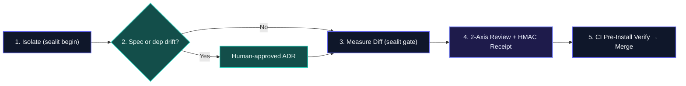

<div align="center">
  <picture>
    <source media="(prefers-color-scheme: dark)" srcset="./docs/logo-dark.svg" />
    <source media="(prefers-color-scheme: light)" srcset="./docs/logo-light.svg" />
    
  </picture>

  <p><strong>AI coding agents love saying <em>"all tests pass."</em> <code>sealit</code> makes them prove it before merge.</strong></p>

  <p>
    <a href="https://github.com/fmatar/sealit/actions/workflows/sealit-quality-gate.yml"></a>
    <a href="https://nodejs.org">= 22" /></a>
    <a href="./package.json"></a>
    <a href="./LICENSE"></a>
    <a href="https://sealit.dev"></a>
  </p>
</div>

---

`sealit` is a zero-dependency verification CLI and agent skill suite for **Claude Code**, **Cursor**, **Codex**, **Antigravity**, and **GitHub Copilot**. It wraps AI-authored pull requests in mechanical checks and seals every verified branch with an HMAC-SHA256 merge receipt that CI validates **before** `npm ci` or untrusted PR code ever runs.

## What `sealit` Enforces

- **Protected branches stay clean** — Git hooks block direct commits or pushes to `main` and `develop` and isolate concurrent agent sessions across branches and git worktrees.
- **Specs, dependencies, and contracts don't drift silently** — Edits to `PRODUCT.md`, `docs/specs/*`, dependency manifests, schemas, OpenAPI specs, or optional layer boundary rules require a human-approved ADR before the gate passes.
- **Diffs are actually tested, not rubber-stamped** — Parses fresh coverage and diff-scoped mutation reports directly on changed hunks, failing closed on stale reports, unimported `0%` files, shell metacharacters, or leaked secrets.
- **Every PR carries a cryptographic merge receipt** — Signs `HEAD`, the content tree hash, spec/ADR hashes, measured diff coverage & mutation scores, and reviewer sign-off into an append-only hash chain (`docs/AUDIT_CHAIN.jsonl`) that survives Squash, `--no-ff`, and fast-forward merges.

---

## How a Pull Request Gets Sealed



1. **Isolate** — The agent starts an isolated branch or worktree session (`sealit begin`).
2. **Align** — If specs, dependencies, or contracts changed, `sealit drift` pauses until a human approves an ADR (`sealit adr`).
3. **Measure** — `sealit gate` runs secret scanning, lint, build, unit tests, diff line coverage, and diff-scoped mutation testing in a single pass.
4. **Seal** — Two fresh-context reviewers audit Spec Fidelity and Architecture/Security, and `sealit` appends a signed HMAC-SHA256 receipt to `docs/AUDIT_CHAIN.jsonl`.
5. **Verify in CI** — GitHub Actions extracts the trusted verifier from the base branch and validates the receipt **before** installing dependencies or executing PR code.

---

## Quickstart

Requires **Node.js `>= 22`** and **Git `>= 2.38`**.

### 1. Initialize your repository (one-time)

```bash
npx --yes github:fmatar/sealit init
```

The interactive setup detects your language stack, scaffolds `.agent/sealit-config.json`, installs Git hooks and `.github/workflows/sealit-quality-gate.yml`, configures skills for your selected coding agents, and generates `.agent/.receipt-key` (gitignored).

Upload the signing key to GitHub Actions once so CI can verify receipts:

```bash
tr -d '\r\n' < .agent/.receipt-key | gh secret set SEALIT_RECEIPT_KEY
```

> [!IMPORTANT]
> Only the first initialization creates `.agent/.receipt-key`. Teammates cloning an already-initialized repo should place the shared team key in `.agent/.receipt-key` or `.env`—do not overwrite `SEALIT_RECEIPT_KEY` in CI with a new key.

### 2. Ship a feature (with your agent or CLI)

In Claude Code, Cursor, Codex, Antigravity, or Copilot, run **`/sealit-flow`** and let the agent drive the branch end-to-end—or run the underlying CLI directly:

```bash
# Start a feature branch & session
npx sealit begin --title "add rate limiter" --type feat --checkout

# ... write tests and implementation ...

# Run drift check, secret scan, lint, tests, diff coverage, and diff mutation
npx sealit gate

# Record review approval, sign the merge receipt, commit, and verify
npx sealit review record --verdict approve --reviewer "@you" --notes "LGTM"
git add docs/AUDIT_CHAIN.jsonl && git commit -m "chore: seal PR receipt"
npx sealit verify
```

### Skills-only mode (no hooks or CI gate)

If you want the spec, ADR, and TDD agent workflows without adding hooks or CI to a repository:

```bash
npx skills add fmatar/sealit        # current project (.agents/skills)
npx skills add fmatar/sealit -g     # global across all coding agents
```

---

## Agent Skills

All 6 skills ship in `.agent/skills/` (with Codex `agents/openai.yaml` metadata and Claude Code `.claude-plugin/plugin.json` support):

| Skill | What it does (with `sealit init`) | Standalone (`npx skills` only) |
| :--- | :--- | :--- |
| `/sealit-flow` | Orchestrates a feature or fix end-to-end: `begin` → `drift` → `tdd` → `gate` → 2-axis review → signed receipt → `pr-body` | Stops and offers `sealit init` |
| `/sealit-spec` | Resolves ambiguous requirements, updates `GLOSSARY.md`, and writes pure-Markdown `PRODUCT.md` & `docs/specs/*` contracts | Authors specs & `GLOSSARY.md` using repo conventions |
| `/sealit-adr` | Drafts an ADR when specs, dependencies, or contracts change and pauses for human approval | Authors MADR `docs/adr/NNNN-slug.md` with human sign-off |
| `/sealit-tdd` | Drives Red-Green-Refactor TDD at public module seams and checks diff coverage & mutation scores | Runs Red-Green TDD with the repo's native test runner |
| `/sealit-gate` | Spawns two cold read-only reviewers (Spec Fidelity + Architecture & Security), runs `sealit gate`, and signs the receipt | Stops and offers `sealit init` |
| `/sealit` | Explicit user-invoked 1:1 slash router for every CLI command in the reference table below | Runs `init` and `doctor`; prompts `init` for repo commands |

---

## Command Reference (`npx sealit <command>` or `/sealit <command>`)

Every command supports `--json` for structured machine output. In Claude Code, read/measure commands are allowlisted while approval, signing, exemption, and setup commands always prompt a human.

### Setup & Repository Health

| Command | What it does | Common flags |
| :--- | :--- | :--- |
| `init` | Scaffolds `.agent/sealit-config.json`, Git hooks, CI workflow, agent skills, and initial `.agent/.receipt-key` | `--agents`, `--global`, `--yes`, `--force` |
| `doctor` | Audits Node/Git versions, config validity, `.gitignore`, hooks, CI workflow, receipt key, skills, and ledger continuity | `--fix` (repairs & migrates in place) |
| `config check` | Validates `.agent/sealit-config.json` schema, thresholds, shell-free commands, and path confinement | `--json` |
| `skill-audit` | Checks all 6 canonical skills for frontmatter rules, line budgets, pinned `npx` packages, and plugin version parity | `--json` |

### Branch Sessions & Spec Alignment

| Command | What it does | Common flags |
| :--- | :--- | :--- |
| `begin` | Starts a tracked session and creates/checks out a feature, fix, or chore branch (or linked git worktree) | `--title`, `--type`, `--issue`, `--base`, `--checkout`, `--worktree` |
| `status` | Shows active branch, session ticket, diff classification (`docs-only` vs `code`), drift status, and receipt readiness | `--json` |
| `drift` | Verifies that changes to specs, manifests, schemas, contracts, or layer rules are covered by an approved ADR | `--base <branch>` |
| `adr` | Lists ADRs (`adr list`), scaffolds a pending ADR (`adr create`), or records human approval/rejection (`adr decide`) | `--title`, `--scope`, `--id`, `--status approve\|reject`, `--reviewer` |
| `end` | Closes a completed session after merge and prunes clean linked worktrees without touching unsaved files | `--issue <id>` |

### Testing, Quality Gate & Signed Receipts

| Command | What it does | Common flags |
| :--- | :--- | :--- |
| `test` | Runs configured module test suites, or only unit tests mapped to modified files | `--affected-only` |
| `coverage` | Executes the coverage command and calculates line coverage strictly across changed diff hunks | `--no-cache` |
| `mutation` | Runs diff-scoped mutation testing on modified lines (or the full module) and evaluates the kill score | `--full`, `--no-cache` |
| `exemption` | Lists (`exemption list`) or records (`exemption add`) an audited waiver for an equivalent mutant (active only after merge) | `--mutant`, `--file`, `--reason` |
| `gate` | Executes drift, secret scan, lint, build, tests, diff coverage, and diff mutation in one pass and updates session state | `--no-cache`, `--online` |
| `review` | Emits 2-axis cold reviewer prompts (`review plan`) or records review sign-off and signs the receipt (`review record`) | `--verdict approve\|request-changes`, `--reviewer`, `--pr` |
| `pr-body` | Generates a structured PR description with measured coverage/mutation proof and One-Way vs. Two-Way door blast radius | `--base <branch>` |
| `receipt` | Signs a standalone HMAC-SHA256 merge receipt into `docs/AUDIT_CHAIN.jsonl` (e.g., for `docs-only` branches) | `--docs-only` |
| `verify` | Verifies `docs/AUDIT_CHAIN.jsonl` hash continuity and validates the HMAC-SHA256 merge receipt for `HEAD` or a target commit | `--sha`, `--branch`, `--chain-only` |

---

## Language & Runner Support

`sealit init` auto-detects your stack from repository manifests and parses native coverage and mutation reports with zero plugins:

| Ecosystem | Manifests Detected | Coverage Formats | Mutation Formats |
| :--- | :--- | :--- | :--- |
| **JavaScript / TypeScript** | `package.json`, `tsconfig.json` | LCOV (`lcov.info`), `coverage-summary.json` | Stryker (`mutation.json`) |
| **Python** | `pyproject.toml`, `requirements.txt` | Cobertura (`coverage.xml`), `lcov.info` | `mutmut` (`.mutmut-results.json`, `.txt`) |
| **Go** | `go.mod` | `go test -coverprofile` (`cover.out`) | `go-mutesting` (`go-mutesting.txt`) |
| **Rust** | `Cargo.toml` | LCOV (`lcov.info`), Cobertura XML | `cargo-mutants` (`outcomes.json`) |
| **Java / Kotlin** | `pom.xml`, `build.gradle(.kts)` | JaCoCo (`jacoco.xml`, `jacoco.csv`) | PITest (`mutations.xml`) |

**Monotonic PR policy**: Raising coverage or mutation thresholds in `.agent/sealit-config.json` takes effect immediately on that PR. Lowering thresholds, altering gate commands, narrowing mutation globs, or adding mutant exemptions is evaluated against the base branch's floor until reviewed and merged, preventing an agent from weakening its own gate. Optional architectural layer rules can also be configured in `.archlens/policy.json` when desired.

---

## Documentation & License

- **Website**: [sealit.dev](https://sealit.dev)
- **Contributing**: [CONTRIBUTING.md](./CONTRIBUTING.md)
- **Product Specification & ADR Index**: [PRODUCT.md](./PRODUCT.md)
- **LLM Context Map**: [llms.txt](./llms.txt)
- **License**: [Apache-2.0](./LICENSE)
