<div align="center">
  <h1>⚡ Agentic SDLC Framework</h1>
  <p><b>Turn AI Coding Assistants into a Disciplined Software Engineering Team</b></p>

  [](./CHANGELOG.md)
  [](./wiki/Skills-Reference.md)
  [](#-quick-install-npx)
  [](#-polyglot-stack-support)
  [](./LICENSE)
</div>

---

## 💡 Why Agentic SDLC?

AI coding agents are fast—until they push untested code directly to `main`, violate your architecture layers, silently break API contracts, or forget what they were building mid-session.

**Agentic SDLC Framework** gives your AI agent (**Gemini / Antigravity**, **Claude Code**, **Cursor**, **Grok**, **Windsurf**, or **GitHub Copilot**) a deterministic engineering workflow backed by a zero-dependency Node.js engine (`sdlc-engine.mjs`) and physical Git hooks:

| Without Agentic SDLC ❌ | With Agentic SDLC Framework ✅ |
| :--- | :--- |
| Edits code directly on `main` or `develop` | **4-Layer Git Guard** blocks commits on `main` and requires an active feature branch & ticket session |
| Writes implementation first and skips tests (or fakes passing tests) | **Robert Martin TDD** enforces a failing Red test first + real report parsing (**≥ 85%** coverage, **≥ 80%** mutation) |
| Imports database/HTTP adapters directly inside domain core | **Concentric Clean Architecture** validates imports against `.archlens/policy.json` on every diff |
| Changes dependencies, DB schemas, or APIs without documentation | **Spec-Drift Sentinel** blocks undeclared drift unless linked to an accepted `docs/adr/ADR-00X.md` |
| Single agent grades its own homework | **Parallel Fork-Join Review** spawns independent read-only subagents to audit diffs before PR merge |

---

## 🚀 Quick Install (`npx`)

Run inside any repository (requires **Node.js ≥ 18**):

```bash
npx github:fmatar/agentic-sdlc-framework install
```

This launches the interactive **Multi-Agent Setup Wizard**:

```text
╔══════════════════════════════════════════════════════════════════════╗
║  ⚡ AGENTIC SDLC FRAMEWORK — MULTI-AGENT INSTALLER WIZARD (v0.1.0)   ║
╚══════════════════════════════════════════════════════════════════════╝

? Select AI Coding Agents & IDEs to configure: (Use ↑/↓, Space to toggle, 'a' for all, Enter)
  ❯ ◉ Gemini / Google Antigravity (.agent/skills/, .agent/scripts/, AGENTS.md)
    ◉ Claude Code (CLAUDE.md, .claude/skills/, .claude/commands/)
    ◉ Cursor (.cursor/rules/*.mdc, .cursorrules)
    ◉ Grok (xAI) (GROK.md, .grok/skills/, .grok/rules/)
    ◯ Windsurf (.windsurf/rules/, .windsurf/workflows/)
    ◯ GitHub Copilot / Codex (.github/copilot-instructions.md, .github/prompts/)

? Select Installation Scope:
  ❯ ● Local Project Workspace (Installs into ./ current repository)
    ○ Global User Configuration (Installs into ~/.gemini, ~/.claude, ~/.grok, ~/.cursor)

? Select SDLC Governance & Automation Add-ons:
  ❯ ◉ Auto-Detect Project Stack (Generates .agent/sdlc-config.json)
    ◉ 4-Layer Git Guard Hooks (Installs pre-commit, pre-merge-commit, pre-push)
    ◉ Archlens Concentric Ring Policy (Scaffolds .archlens/policy.json)
    ◯ GitHub Actions Quality Gate CI (Scaffolds .github/workflows/sdlc-quality-gate.yml)
```

### Non-Interactive & Global Install Flags

```bash
# Non-interactive install for specific AI tools + Archlens + Git hooks:
npx github:fmatar/agentic-sdlc-framework install --agents gemini,claude,cursor,grok --with-archlens --with-hooks --yes

# Configure ALL 6 supported AI tools + GitHub Actions CI:
npx github:fmatar/agentic-sdlc-framework install --agents all --with-archlens --with-hooks --with-ci --yes

# Install globally across your machine (~/.gemini, ~/.claude, ~/.grok, ~/.cursor):
npx github:fmatar/agentic-sdlc-framework install --global --agents gemini,claude,grok,cursor --yes

# Alternative: Skills-only install via Vercel Labs skills.sh CLI:
npx skills add fmatar/agentic-sdlc-framework -y
```

<details>
<summary><b>📂 Click to view exact files created per AI Coding Tool (Local vs. Global)</b></summary>

<br/>

| AI Coding Tool | `--agents` ID | Local Project Files | Global Config (`--global`) |
| :--- | :--- | :--- | :--- |
| **Gemini / Antigravity** | `gemini` | `.agent/skills/<skill>/SKILL.md`, `.agent/scripts/`, `AGENTS.md` | `~/.gemini/config/skills/<skill>/SKILL.md` |
| **Claude Code** | `claude` | `CLAUDE.md`, `.claude/skills/<skill>/SKILL.md`, `.claude/commands/<skill>.md` | `~/.claude/CLAUDE.md`, `~/.claude/skills/`, `~/.claude/commands/` |
| **Cursor** | `cursor` | `.cursor/rules/agentic-sdlc.mdc`, `.cursor/rules/<skill>.mdc`, `.cursorrules` | `~/.cursor/rules/agentic-sdlc.mdc`, `~/.cursor/rules/<skill>.mdc` |
| **Grok (xAI)** | `grok` | `GROK.md`, `.grok/skills/<skill>/SKILL.md`, `.grok/rules/agentic-sdlc.md` | `~/.grok/GROK.md`, `~/.grok/skills/<skill>/SKILL.md` |
| **Windsurf** | `windsurf` | `.windsurf/rules/agentic-sdlc.md`, `.windsurf/workflows/<skill>.md`, `.windsurfrules` | `~/.codeium/windsurf/memories/global_rules.md` |
| **GitHub Copilot** | `copilot` | `.github/copilot-instructions.md`, `.github/prompts/<skill>.prompt.md` | `~/.github/copilot-instructions.md`, `~/.github/prompts/` |

*(Upgrading an older installation automatically prunes deprecated pre-`v0.1.0` `sdlc-*` skill folders while preserving your custom skills).*

</details>

---

## ⏱️ Your First 5 Minutes (Day-1 Workflow)

Once installed, drive the entire engineering lifecycle directly from your AI chat prompt:

### Step 1: Define Your Product or Feature (`/sdlc-product`)
> **Prompt**: `"/sdlc-product Create a PRODUCT.md constitution and functional specs for a multi-tenant JWT authentication service, and plan the execution waves."`
* Creates `PRODUCT.md` (`CAP-XX` capabilities, `INV-XX` invariants), writes `docs/specs/*.md`, computes the topological execution DAG, and provisions tracked tickets.

### Step 2: Implement with TDD & Clean Architecture (`/sdlc-flow`)
> **Prompt**: `"/sdlc-flow Implement ticket #1: Add multi-tenant JWT token rotation with rate limiting."`
* **Under the hood**:
  1. **`stage begin`**: Creates & checks out `feature/issue-#1-jwt-rotation`, locks `.agent/.sdlc-session.json`, and marks the ticket `in-progress`.
  2. **`/sdlc-tdd`**: Writes a failing Red test first, implements minimal Green domain code, and verifies **≥ 85% coverage** and zero inner-to-outer ring imports against `.archlens/policy.json`.
  3. **`stage pre-pr`**: Verifies zero undeclared spec drift, updates `docs/DECISION_MAP.md` and `docs/ARCH_TRACE.md`, signs the cryptographic **SHA-256 Merkle Gate Receipt**, and launches the live **Architecture Diff UI**.

### Step 3: Parallel Peer Review & Merge (`/sdlc-review-gate`)
> **Prompt**: `"/sdlc-review-gate Audit the diff and merge to main."`
* Spawns two parallel read-only subagents (`PR Peer Reviewer` + `Quality Gate Auditor`) to inspect the diff for Robert Martin test smells, security leaks, and layer violations, posts the review verdict, merges the PR, and runs `stage complete`.

---

## 🗺️ How the Lifecycle Pipeline Works

```mermaid
flowchart LR
    classDef spec fill:#1e1b4b,stroke:#6366f1,stroke-width:2px,color:#eef2ff;
    classDef stage fill:#0284c7,stroke:#0369a1,stroke-width:1.5px,color:#ffffff;
    classDef tdd fill:#0d9488,stroke:#0f766e,stroke-width:1.5px,color:#ffffff;
    classDef gate fill:#7c3aed,stroke:#6d28d9,stroke-width:1.5px,color:#ffffff;
    classDef done fill:#16a34a,stroke:#15803d,stroke-width:2px,color:#ffffff,font-weight:bold;

    P["🏛️ /sdlc-product<br/>• PRODUCT.md & Specs<br/>• ADR & DAG Waves"]:::spec
    B["1. stage begin<br/>• Provision Ticket #id<br/>• Checkout feature/issue-#id<br/>• Lock .sdlc-session.json"]:::stage
    T["2. /sdlc-tdd<br/>• Failing Red Test First<br/>• Minimal Green Code<br/>• ≥85% Cov / ≥80% Mut"]:::tdd
    PR["3. stage pre-pr<br/>• Drift & Archlens Check<br/>• Sync DECISION_MAP.md<br/>• Sign SHA-256 Gate Receipt"]:::stage
    RG["4. /sdlc-review-gate<br/>• Parallel Subagent Audit<br/>• Security & Contract Gate<br/>• Post Verdict to PM"]:::gate
    C["5. stage complete<br/>• Squash Merge PR<br/>• Transition status:done<br/>• Release Session Lock"]:::done

    P --> B --> T --> PR --> RG --> C
```



---

## 🧠 The 6 Canonical Skills (`ADR-002`)

Instead of dozens of fragmented prompts, the framework is organized into **6 focused skills**:

| Skill / Command | Role | When to Use It | Primary CLI Backing |
| :--- | :--- | :--- | :--- |
| **`/sdlc-init`** | **Bootstrap & Doctor** | Setting up a repo, auto-detecting stacks, installing Git hooks, or healing missing config | `sdlc-engine install` / `doctor --fix` |
| **`/sdlc-product`** | **Product & Spec Architect** | Turning raw ideas into `PRODUCT.md`, PRDs/SRS (`docs/specs/`), C4 diagrams, ADRs, and DAG waves | `sdlc-engine product <init\|plan>` |
| **`/sdlc-flow`** | **Master Orchestrator** | Implementing a feature, bug fix, or hotfix end-to-end from branch creation to PR merge | `sdlc-engine stage <begin\|pre-pr\|complete>` |
| **`/sdlc-tdd`** | **TDD & Dual-Gate Runner** | Writing Red-Green-Refactor unit tests, running affected tests, and checking coverage/mutation scores | `sdlc-engine test` / `coverage` / `mutation` |
| **`/sdlc-review-gate`** | **Parallel PR Gatekeeper** | Running concurrent subagent code reviews, security/CVE audits, and strict pre-merge gates | `sdlc-engine gate --strict` |
| **`/sdlc-release`** | **Docs Sync & Release** | Syncing `README.md`/`CHANGELOG.md`/`wiki/`, bumping SemVer manifests, and probing live canaries | `sdlc-engine release <patch\|minor\|major>` |

---

## 🖥️ Visual Architecture Diff & Decision Workbench UI

Every `stage begin`, `stage pre-pr`, and `ui-snapshot` automatically updates the interactive **Architecture Diff & Decision Lineage Workbench**:
- **Inline in Antigravity Chat**: Renders directly inside your conversation via `<agent-embed>`.
- **Full-Screen Browser UI (`http://localhost:4120`)**:
  ```bash
  node .agent/scripts/sdlc-engine.mjs serve --port 4120
  ```
  Inspect **Concentric Ring Boundaries (`Core → UseCase → Adapter`)**, **Mermaid AST Graph Diffs**, **Causal Decision Lineage (`CAP-XX → SPEC-XX → Ticket → ADR`)**, and the **Architecture Time-Machine Slider**.

---

## 🌐 Polyglot Stack Support

`sdlc-engine detect` inspects your repository manifests and configures native test, coverage, and mutation runners automatically:

| Language / Ecosystem | Detected Manifest | Single-Test & Suite Runner | Real Coverage Parser | Mutation Engine |
| :--- | :--- | :--- | :--- | :--- |
| **Node.js / TypeScript** | `package.json` | `node --test` / Vitest / Jest | `coverage-summary.json`, `lcov.info` | Stryker (`mutation.json`) |
| **Java / Kotlin** | `pom.xml`, `build.gradle` | `mvn test -Dtest=Class` / `./gradlew test` | JaCoCo (`jacoco.csv`, `jacoco.xml`) | PITest (`mutations.xml`) |
| **Python** | `pyproject.toml`, `pytest.ini` | `pytest path/to/test.py` | Cobertura (`coverage.xml`), `lcov.info` | `mutmut` / Cosmic Ray |
| **Go** | `go.mod` | `go test ./pkg/... -run TestName` | Go Coverprofile (`coverage.out`) | `go-mutesting` |
| **Rust** | `Cargo.toml` | `cargo test test_name` | `cargo-tarpaulin` / `lcov.info` | `cargo-mutants` |

---

## 💬 Copy-Paste Prompt Playbook

### Bug Fix with Mandatory Failing Reproduction Test
> `"/sdlc-flow Fix bug #205: Checkout throws NullPointerException when user billing address is null."`
* Runs `sdlc-engine reproduce --error "NullPointerException..."` to generate a failing test in `.java`, `.py`, `.go`, `.rs`, or `.mjs` **before** any production code is modified.

### Architecture Refactoring & Ring Audit
> `"Extract payment tax calculation into Domain Core and verify zero inner-to-outer ring imports."`
* Enforces Dependency Inversion (DIP) and verifies 0 violations via `sdlc-engine arch diff`.

### Architecture Decision Record (ADR) for Stack / API Changes
> `"/sdlc-product Create an ADR to migrate session storage from Postgres to Redis and update PRODUCT.md."`
* Mints `docs/adr/ADR-00X-*.md`, links it to `PRODUCT.md`, and satisfies `sdlc-engine drift check`.

<details>
<summary><b>⚡ Click to expand more prompts (Hotfix Worktrees, Flake Audits, Contract Drift, Canary Watchdog)</b></summary>

<br/>

- **Urgent Hotfix in Isolated Git Worktree**:
  > `"Urgent hotfix: Stripe webhook payload breaks checkout. Isolate in a git worktree so my current branch stays untouched."`
- **API Breaking Contract Drift Check**:
  > `"Check our OpenAPI and GraphQL schemas for breaking changes before opening the PR."` (`sdlc-engine contract check`)
- **Flaky Test & Race Condition Elimination**:
  > `"Run a 20-iteration flake check on OrderProcessor.test.mjs and fix the race condition."` (`sdlc-engine flake-check --runs 20`)
- **Cryptographic Audit Trail Verification**:
  > `"Verify that our SHA-256 Merkle delivery ledger in docs/AUDIT_CHAIN.jsonl has zero tampering."` (`sdlc-engine audit verify`)
- **Production Canary Rollback Watchdog**:
  > `"Probe https://api.example.com/health and trigger rollback if the error rate exceeds 2%."` (`sdlc-engine watchdog --live`)

</details>

---

## 📁 Repository Anatomy

```text
your-project/
├── PRODUCT.md                         # Constitutional capabilities (CAP-XX), invariants (INV-XX) & ADR index
├── AGENTS.md / CLAUDE.md / GROK.md    # Synchronized multi-agent governance instructions
├── .archlens/
│   └── policy.json                    # Concentric Clean Architecture ring definitions (Core → UseCase → Adapter)
├── .agent/
│   ├── sdlc-config.json               # Auto-detected polyglot stack & test/coverage/mutation commands
│   ├── skills/                        # The 6 canonical skills (sdlc-init, sdlc-product, sdlc-flow, sdlc-tdd, sdlc-review-gate, sdlc-release)
│   └── scripts/
│       ├── sdlc-engine.mjs            # Universal zero-dependency CLI engine
│       └── lib/                       # Modular domain libraries (installer, session, git-guard, adr-drift, product-dag, workbench-server, ...)
└── docs/
    ├── specs/                         # Functional specifications (cap-XX-*.md) & C4 diagrams
    ├── adr/                           # Architecture Decision Records (ADR-00X-*.md)
    ├── KANBAN.md                      # Living Kanban board & 7-layer Traceability Matrix
    ├── DECISION_MAP.md                # Auto-synced Causal Decision Lineage graph
    ├── ARCH_TRACE.md                  # Immutable Mermaid AST diff & architecture mutation log
    └── AUDIT_CHAIN.jsonl              # Tamper-evident SHA-256 Merkle audit ledger
```

---

## 🛠️ CLI Quick Reference (`sdlc-engine.mjs`)

| Category | Command | Purpose |
| :--- | :--- | :--- |
| **Setup & Interop** | `npx github:fmatar/agentic-sdlc-framework install` | Launch interactive multi-agent installer wizard |
| | `node .agent/scripts/sdlc-engine.mjs detect` | Auto-detect stack and write `.agent/sdlc-config.json` |
| | `node .agent/scripts/sdlc-engine.mjs doctor --fix` | Verify toolchain and auto-heal hooks, policy, and Kanban |
| | `node .agent/scripts/sdlc-engine.mjs interop export --agent all` | Regenerate rules for Gemini, Claude, Cursor, Grok, Windsurf, Copilot |
| **Lifecycle Stages** | `node .agent/scripts/sdlc-engine.mjs stage begin --title "<t>" --checkout` | Create ticket, checkout feature branch, start session lock |
| | `node .agent/scripts/sdlc-engine.mjs stage pre-pr --issue <id>` | Run drift check, sync docs, sign Stage 7 Merkle receipt, build UI |
| | `node .agent/scripts/sdlc-engine.mjs stage complete --issue <id>` | Mark ticket `done`, sync `docs/KANBAN.md`, release session lock |
| **Product & ADRs** | `node .agent/scripts/sdlc-engine.mjs product <init\|plan\|status>` | Initialize `PRODUCT.md` and schedule topological DAG waves |
| | `node .agent/scripts/sdlc-engine.mjs adr <create\|list\|decide>` | Create or approve/reject Architecture Decision Records |
| | `node .agent/scripts/sdlc-engine.mjs drift check` | Block undeclared dependency, schema, C4, or API contract drift |
| **TDD & Quality Gate** | `node .agent/scripts/sdlc-engine.mjs test [--affected-only]` | Run full or diff-affected unit tests |
| | `node .agent/scripts/sdlc-engine.mjs coverage` / `mutation` | Parse coverage (**≥ 85%**) and mutation (**≥ 80%**) reports |
| | `node .agent/scripts/sdlc-engine.mjs reproduce --error "<trace>"` | Scaffold failing Red reproduction test from stack trace |
| | `node .agent/scripts/sdlc-engine.mjs gate --strict` | Run all 9 quality, architecture, security, and Merkle gates |
| **Workbench & Release** | `node .agent/scripts/sdlc-engine.mjs serve [--port 4120]` | Start live Architecture Diff & Decision Workbench server |
| | `node .agent/scripts/sdlc-engine.mjs ui-snapshot` | Generate standalone HTML widget for inline `<agent-embed>` |
| | `node .agent/scripts/sdlc-engine.mjs release <patch\|minor\|major>` | Bump SemVer manifest, update `CHANGELOG.md`, and tag release |

---

## 📖 Further Reading

- **[Product Constitution (`PRODUCT.md`)](./PRODUCT.md)**
- **[Canonical Skills Reference (`wiki/Skills-Reference.md`)](./wiki/Skills-Reference.md)**
- **[Operations & Robert Martin TDD Guide (`docs/SDLC_AGENTIC_OPERATIONS_GUIDE.md`)](./docs/SDLC_AGENTIC_OPERATIONS_GUIDE.md)**
- **[Architecture Decision Records (`docs/adr/`)](./docs/adr/)**
- **[Changelog (`CHANGELOG.md`)](./CHANGELOG.md)**

## 📄 License

Licensed under the [Apache 2.0 License](./LICENSE).
