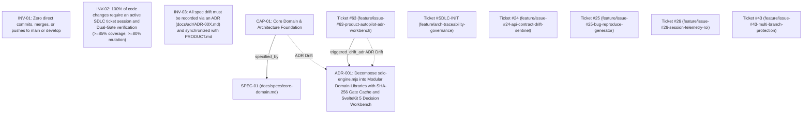

# 🗺️ Causal Decision Graph & Architecture Lineage (`DECISION_MAP.md`)

> **Auto-Generated by Agentic SDLC Engine**: Tracks how product capabilities (`PRODUCT.md`), specifications, tickets, and Spec-Drift ADRs evolved into the current system state.

---

## 🧬 Causal Decision Lineage Graph

---

## ⚡ Spec Drift & ADR Pivot Ledger

| ADR ID | Decision Title | Scope | Status | Triggered By | Supersedes / Amends |
| :--- | :--- | :--- | :--- | :--- | :--- |
| **ADR-001** | Decompose sdlc-engine.mjs into Modular Domain Libraries with SHA-256 Gate Cache and SvelteKit 5 Decision Workbench | `technical` | `accepted` | #63 | CAP-01 |

---

## 🎯 Product Capability Realization Matrix

| Capability ID | Description | Current Status |
| :--- | :--- | :--- |
| **CAP-01** | Core Domain & Architecture Foundation | `PLANNED` |
