# 🗺️ Causal Decision Graph & Architecture Lineage (`DECISION_MAP.md`)

> **Auto-Generated by Agentic SDLC Engine**: Tracks how product capabilities (`PRODUCT.md`), specifications, tickets, and Spec-Drift ADRs evolved into the current system state.

---

## 🧬 Causal Decision Lineage Graph

```mermaid
flowchart TD
  INV_01["INV-01: Zero direct commits, merges, or pushes to main or develop"]
  INV_02["INV-02: Changes require an active SDLC session and risk-proportional Dual-Gate verification (`trivial`, `standard`, or `full` lane) meeting the coverage, mutation, and peer-review thresholds configured in `.agent/sdlc-config.json`"]
  INV_03["INV-03: All spec drift must be recorded via an ADR (docs/adr/ADR-00X.md) and synchronized with PRODUCT.md"]
  INV_04["INV-04: Zero shell command interpolation of untrusted user/markdown inputs in PM, Git, or test runner execution paths"]
  CAP_01["CAP-01: Core Domain & Architecture Foundation"]
  SPEC_01["SPEC-01 (docs/specs/cap-01-composite-stage-session.md)"]
  CAP_02["CAP-02: Shell Injection Remediation & Polyglot Test Runners (#69)"]
  SPEC_02["SPEC-02 (docs/specs/cap-02-security-polyglot-runners.md)"]
  CAP_03["CAP-03: Real Coverage/Mutation Parsers & Policy ArchDiff (#70)"]
  SPEC_03["SPEC-03 (docs/specs/cap-03-real-dual-gate-archdiff.md)"]
  CAP_04["CAP-04: Live Canary Watchdog, Real Proofs & Polyglot Reproduce (#71)"]
  SPEC_04["SPEC-04 (docs/specs/cap-04-live-probes-reproduce.md)"]
  CAP_05["CAP-05: Consolidate 14 Skills into 6 Schema-Valid Core Skills (#72)"]
  SPEC_05["SPEC-05 (docs/specs/cap-05-skill-consolidation.md)"]
  CAP_06["CAP-06: Dogfooding Configuration, Docs Sync & Full Test Suite (#73)"]
  SPEC_06["SPEC-06 (docs/specs/cap-06-dogfood-docs-tests.md)"]
  CAP_07["CAP-07: Native `npx` Multi-Agent Interactive Installer & Legacy Installer Removal (#75)"]
  SPEC_07["SPEC-07 (docs/specs/cap-07-npx-multi-agent-installer.md)"]
  CAP_08["CAP-08: `/sdlc` Universal Command Router & 9 Verb-Driven Skills (#81)"]
  SPEC_08["SPEC-08 (docs/specs/cap-08-command-verb-skills-router.md)"]
  CAP_09["CAP-09: Two-Tier PRD & IEEE 29148 SRS Specification Engine (#84)"]
  SPEC_09["SPEC-09 (docs/specs/cap-09-prd-srs-specification-engine.md)"]
  CAP_10["CAP-10: Unified Multi-Provider Ticket Engine & Issue Templates (#86)"]
  SPEC_10["SPEC-10 (docs/specs/cap-10-unified-multi-provider-ticket-engine-issue-templ.md)"]
  CAP_11["CAP-11: Technical Writer Skill (`sdlc-wiki`) & Archlens AST-to-Wiki Sync (#90)"]
  SPEC_11["SPEC-11 (docs/specs/cap-11-technical-writer-archlens-wiki-sync.md)"]
  ADR_009["ADR-009: Align README, Wiki, PRD and SRS Documentation with v0.4.0 Architecture and Archlens Links"]
  _114["Ticket #114 (feature/issue-#114-refresh-readme-md-wiki-srs-documentation)"]
  ADR_010["ADR-010: Standardize on 10 Canonical SDLC Skills, Neutralize Engineering Terminology, and Compact README Workflow Diagram"]
  _116["Ticket #116 (feature/issue-#116-standardize-10-skills-and-workflow-diagram)"]
  ADR_011["ADR-011: Strict sdlc Namespace Isolation and Decoupling from Standalone Coding-Persona Skills"]
  _118["Ticket #118"]
  ADR_COMPACT_v0_3_0["Compacted 8 ADR(s) into SRS.md (v0.3.0)"]
  createdAt__2026_11_03T18_52_42_656Z["createdAt: 2026-11-03T18:52:42.656Z"]
  ADR_COMPACT_v0_4_0["Compacted 6 ADR(s) into SRS.md (v0.4.0)"]
  createdAt__2026_11_12T18_08_28_446Z["createdAt: 2026-11-12T18:08:28.446Z"]
  _SDLC_INIT["Ticket #SDLC-INIT (feature/arch-traceability-governance)"]
  _24["Ticket #24 (feature/issue-#24-api-contract-drift-sentinel)"]
  _25["Ticket #25 (feature/issue-#25-bug-reproduce-generator)"]
  _26["Ticket #26 (feature/issue-#26-session-telemetry-roi)"]
  _43["Ticket #43 (feature/issue-#43-multi-branch-protection)"]
  _63["Ticket #63 (feature/issue-#63-product-autopilot-adr-workbench)"]
  _68["Ticket #68 (feature/issue-#68-framework-hardening-v0-1)"]
  _75["Ticket #75 (feature/issue-#75-npx-multi-agent-installer)"]
  _77["Ticket #77 (feature/issue-#77-readme-overhaul)"]
  _79["Ticket #79 (feature/issue-#79-readme-dx-redesign)"]
  _81["Ticket #81 (feature/issue-#81-command-verb-skills-router)"]
  _84["Ticket #84 (feature/issue-#84-two-tier-prd-srs-specification-engine)"]
  _86["Ticket #86 (feature/issue-#86-multi-provider-ticket-engine-and-templat)"]
  _88["Ticket #88 (feature/issue-#88-skillspector-zero-findings-and-skill-aud)"]
  _90["Ticket #90 (feature/issue-#90-skillspector-security-audit)"]
  _91["Ticket #91 (feature/issue-91-harden-gates)"]
  _94["Ticket #94 (feature/issue-#94-fix-claude-cowork-skill-provisioning-non)"]
  _95["Ticket #95 (feature/issue-#95-implement-adr-lifecycle-compaction-and-f)"]
  _97["Ticket #97 (feature/issue-#97-fix-claude-desktop-skills)"]
  _99["Ticket #99 (feature/issue-#99-publish-consolidated-peer-review-quality)"]
  _100["Ticket #100 (feature/issue-#100-10-30-90-readme-template-engine)"]
  _103["Ticket #103 (feature/issue-#103-truthful-cli-telemetry-hook-drift-doctor)"]
  _105["Ticket #105 (feature/issue-#105-github-actions-quality-gate-ci-configura)"]
  _107["Ticket #107 (feature/issue-#107-risk-proportional-execution-lanes-and-sp)"]
  _109["Ticket #109 (feature/issue-#109-right-size-all-sdlc-skills-and-upgrade-c)"]
  _111["Ticket #111 (feature/issue-#111-slim-npm-package-retire-duplicate-svelte)"]
  CAP_01 -->|specified_by| SPEC_01
  CAP_02 -->|specified_by| SPEC_02
  CAP_03 -->|specified_by| SPEC_03
  CAP_03 -->|depends_on| CAP_01
  CAP_03 -->|depends_on| CAP_02
  CAP_04 -->|specified_by| SPEC_04
  CAP_04 -->|depends_on| CAP_02
  CAP_05 -->|specified_by| SPEC_05
  CAP_05 -->|depends_on| CAP_03
  CAP_05 -->|depends_on| CAP_04
  CAP_06 -->|specified_by| SPEC_06
  CAP_06 -->|depends_on| CAP_05
  CAP_07 -->|specified_by| SPEC_07
  CAP_07 -->|depends_on| CAP_06
  CAP_08 -->|specified_by| SPEC_08
  CAP_08 -->|depends_on| CAP_05
  CAP_08 -->|depends_on| CAP_07
  CAP_09 -->|specified_by| SPEC_09
  CAP_09 -->|depends_on| CAP_05
  CAP_09 -->|depends_on| CAP_08
  CAP_10 -->|specified_by| SPEC_10
  CAP_10 -->|depends_on| CAP_02
  CAP_10 -->|depends_on| CAP_09
  CAP_11 -->|specified_by| SPEC_11
  CAP_11 -->|depends_on| CAP_03
  CAP_11 -->|depends_on| CAP_05
  CAP_11 -->|depends_on| CAP_08
  _114 -->|triggered_drift_adr| ADR_009
  CAP_06 -.->|ADR Drift| ADR_009
  CAP_11 -.->|ADR Drift| ADR_009
  _116 -->|triggered_drift_adr| ADR_010
  CAP_05 -.->|ADR Drift| ADR_010
  CAP_07 -.->|ADR Drift| ADR_010
  CAP_08 -.->|ADR Drift| ADR_010
  CAP_11 -.->|ADR Drift| ADR_010
  _118 -->|triggered_drift_adr| ADR_011
  CAP_05 -.->|ADR Drift| ADR_011
  CAP_07 -.->|ADR Drift| ADR_011
  CAP_08 -.->|ADR Drift| ADR_011
  ADR_010 -.->|ADR Drift| ADR_011
  CAP_01 -->|realized_by| ADR_COMPACT_v0_3_0
  CAP_02 -->|realized_by| ADR_COMPACT_v0_3_0
  CAP_03 -->|realized_by| ADR_COMPACT_v0_3_0
  CAP_04 -->|realized_by| ADR_COMPACT_v0_3_0
  CAP_05 -->|realized_by| ADR_COMPACT_v0_3_0
  CAP_06 -->|realized_by| ADR_COMPACT_v0_3_0
  CAP_07 -->|realized_by| ADR_COMPACT_v0_3_0
  CAP_08 -->|realized_by| ADR_COMPACT_v0_3_0
  CAP_09 -->|realized_by| ADR_COMPACT_v0_3_0
  CAP_10 -->|realized_by| ADR_COMPACT_v0_3_0
  CAP_11 -->|realized_by| ADR_COMPACT_v0_3_0
  createdAt__2026_11_03T18_52_42_656Z -->|realized_by| ADR_COMPACT_v0_3_0
  CAP_11 -->|realized_by| ADR_COMPACT_v0_4_0
  CAP_03 -->|realized_by| ADR_COMPACT_v0_4_0
  CAP_06 -->|realized_by| ADR_COMPACT_v0_4_0
  createdAt__2026_11_12T18_08_28_446Z -->|realized_by| ADR_COMPACT_v0_4_0
  CAP_01 -->|realized_by| ADR_COMPACT_v0_4_0
  CAP_05 -->|realized_by| ADR_COMPACT_v0_4_0
  CAP_07 -->|realized_by| ADR_COMPACT_v0_4_0
  CAP_08 -->|realized_by| ADR_COMPACT_v0_4_0
```

---

## ⚡ Spec Drift & ADR Pivot Ledger

| ADR ID | Decision Title | Scope | Status | Triggered By | Supersedes / Amends |
| :--- | :--- | :--- | :--- | :--- | :--- |
| **ADR-009** | Align README, Wiki, PRD and SRS Documentation with v0.4.0 Architecture and Archlens Links | `technical` | `accepted` | #114 | CAP-06, CAP-11 |
| **ADR-010** | Standardize on 10 Canonical SDLC Skills, Neutralize Engineering Terminology, and Compact README Workflow Diagram | `technical` | `accepted` | #116 | CAP-05, CAP-07, CAP-08, CAP-11 |
| **ADR-011** | Strict sdlc Namespace Isolation and Decoupling from Standalone Coding-Persona Skills | `technical` | `accepted` | #118 | CAP-05, CAP-07, CAP-08, ADR-010 |

---

## 🎯 Product Capability Realization Matrix

| Capability ID | Description | Current Status |
| :--- | :--- | :--- |
| **CAP-01** | Core Domain & Architecture Foundation | `PLANNED` |
| **CAP-02** | Shell Injection Remediation & Polyglot Test Runners (#69) | `AMENDED (ADR-006)` |
| **CAP-03** | Real Coverage/Mutation Parsers & Policy ArchDiff (#70) | `AMENDED (ADR-004)` |
| **CAP-04** | Live Canary Watchdog, Real Proofs & Polyglot Reproduce (#71) | `AMENDED (ADR-002)` |
| **CAP-05** | Consolidate 14 Skills into 6 Schema-Valid Core Skills (#72) | `AMENDED (ADR-011)` |
| **CAP-06** | Dogfooding Configuration, Docs Sync & Full Test Suite (#73) | `AMENDED (ADR-009)` |
| **CAP-07** | Native `npx` Multi-Agent Interactive Installer & Legacy Installer Removal (#75) | `AMENDED (ADR-011)` |
| **CAP-08** | `/sdlc` Universal Command Router & 9 Verb-Driven Skills (#81) | `AMENDED (ADR-011)` |
| **CAP-09** | Two-Tier PRD & IEEE 29148 SRS Specification Engine (#84) | `PLANNED` |
| **CAP-10** | Unified Multi-Provider Ticket Engine & Issue Templates (#86) | `PLANNED` |
| **CAP-11** | Technical Writer Skill (`sdlc-wiki`) & Archlens AST-to-Wiki Sync (#90) | `AMENDED (ADR-010)` |
