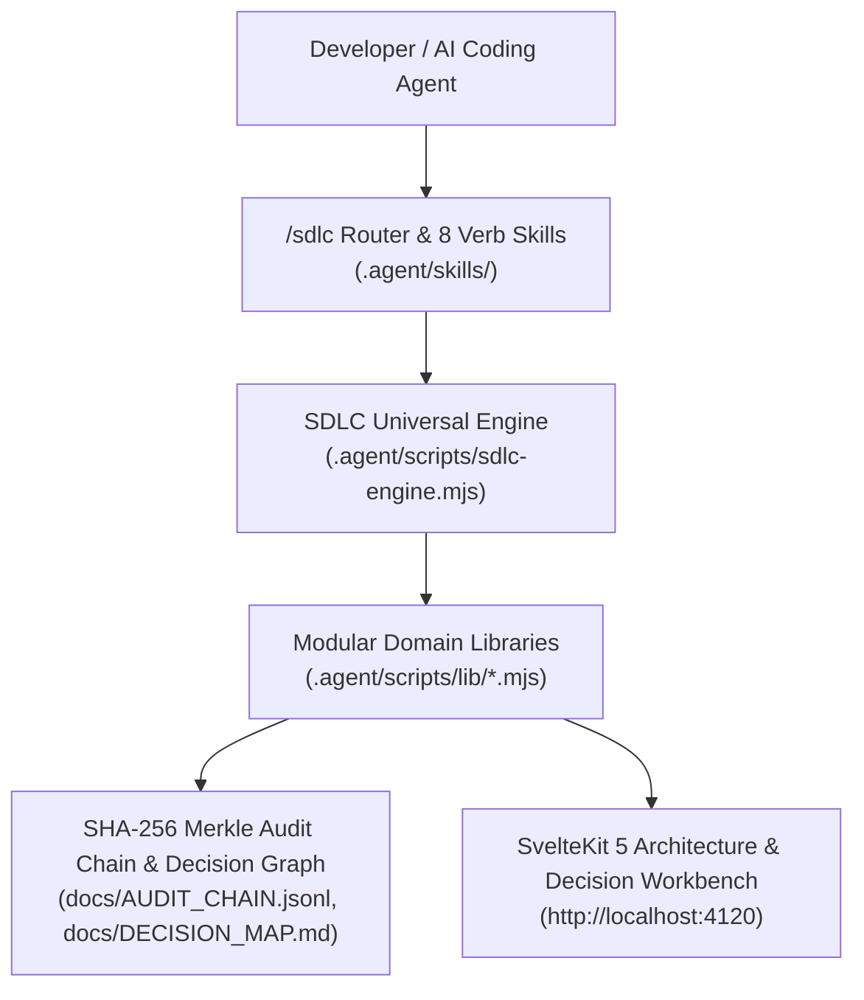

# Software Requirements Specification (SRS): Agentic SDLC Framework

*Based on IEEE 29148 Standard*

## 1. Introduction
### 1.1 Purpose
This Software Requirements Specification (SRS) defines the system-level functional interfaces, architectural boundaries, non-functional requirements (NFRs), and capability traceability matrix for **Agentic SDLC Framework**.
### 1.2 Scope
End-to-end spec-driven autonomous software development lifecycle, Spec-Drift ADR engine, 4-Layer Git Lockdown, real polyglot Dual-Gate verification, and SvelteKit 5 Causal Decision Workbench governed by 6 focused agentic skills.
### 1.3 References & Traceability Matrix
- **Product Constitution**: [`PRODUCT.md`](../PRODUCT.md)
- **Product Requirements Document**: [`docs/PRD.md`](./PRD.md)
- **Causal Decision Graph**: [`docs/DECISION_MAP.md`](./DECISION_MAP.md)

| Capability ID | Capability Title | Detailed Functional Spec | Depends On | Status |
| :--- | :--- | :--- | :--- | :--- |
| `CAP-01` | Composite Stage CLI & Session Hygiene (#68) | [`docs/specs/cap-01-composite-stage-session.md`](../docs/specs/cap-01-composite-stage-session.md) | `None` | `AMENDED (ADR-002)` |
| `CAP-02` | Shell Injection Remediation & Polyglot Test Runners (#69) | [`docs/specs/cap-02-security-polyglot-runners.md`](../docs/specs/cap-02-security-polyglot-runners.md) | `None` | `AMENDED (ADR-002)` |
| `CAP-03` | Real Coverage/Mutation Parsers & Policy ArchDiff (#70) | [`docs/specs/cap-03-real-dual-gate-archdiff.md`](../docs/specs/cap-03-real-dual-gate-archdiff.md) | `CAP-01, CAP-02` | `AMENDED (ADR-002)` |
| `CAP-04` | Live Canary Watchdog, Real Proofs & Polyglot Reproduce (#71) | [`docs/specs/cap-04-live-probes-reproduce.md`](../docs/specs/cap-04-live-probes-reproduce.md) | `CAP-02` | `AMENDED (ADR-002)` |
| `CAP-05` | Consolidate 14 Skills into 6 Schema-Valid Core Skills (#72) | [`docs/specs/cap-05-skill-consolidation.md`](../docs/specs/cap-05-skill-consolidation.md) | `CAP-03, CAP-04` | `AMENDED (ADR-004)` |
| `CAP-06` | Dogfooding Configuration, Docs Sync & Full Test Suite (#73) | [`docs/specs/cap-06-dogfood-docs-tests.md`](../docs/specs/cap-06-dogfood-docs-tests.md) | `CAP-05` | `AMENDED (ADR-002)` |
| `CAP-07` | Native `npx` Multi-Agent Interactive Installer & Legacy Installer Removal (#75) | [`docs/specs/cap-07-npx-multi-agent-installer.md`](../docs/specs/cap-07-npx-multi-agent-installer.md) | `CAP-06` | `AMENDED (ADR-004)` |
| `CAP-08` | `/sdlc` Universal Command Router & 8 Verb-Driven Skills (#81) | [`docs/specs/cap-08-command-verb-skills-router.md`](../docs/specs/cap-08-command-verb-skills-router.md) | `CAP-05, CAP-07` | `AMENDED (ADR-004)` |
| `CAP-09` | Two-Tier PRD & IEEE 29148 SRS Specification Engine (#84) | [`docs/specs/cap-09-prd-srs-specification-engine.md`](../docs/specs/cap-09-prd-srs-specification-engine.md) | `CAP-05, CAP-08` | `AMENDED (ADR-005)` |

## 2. Overall Description & C4 System Architecture
### 2.1 Product Perspective (C4 Container View)

### 2.2 Operating Environment & Constraints
- **Runtime**: Node.js `>= 18.0.0` (ES Modules), Git `>= 2.30`, polyglot project stacks (TypeScript/JS, Java/Kotlin, Python, Rust, Go).
- **Architectural Policy**: Governed by `.archlens/policy.json` concentric Clean Architecture rings.

## 3. Specific Requirements (IEEE 29148)
### 3.1 External Interface Requirements
- **3.1.1 Agent Slash-Command Interface**: 1 Universal Router (`/sdlc`) + 8 Verb Skills (`/sdlc-flow`, `/sdlc-product`, `/sdlc-doctor`, `/sdlc-status`, `/sdlc-tdd`, `/sdlc-gate`, `/sdlc-adr`, `/sdlc-release`).
- **3.1.2 CLI & NPX Interface**: `npx github:fmatar/agentic-sdlc-framework install` interactive ANSI TUI wizard and `node .agent/scripts/sdlc-engine.mjs <command>`.
- **3.1.3 HTTP & Visual Workbench Interface**: Local HTTP server (`http://localhost:4120`) serving `/api/arch-diff`, `/widget`, and inline `<agent-embed>` snapshots.

### 3.2 Functional Requirements by Capability (`CAP-XX`)
#### CAP-01: Composite Stage CLI & Session Hygiene (#68)
- **Specification Contract**: [`docs/specs/cap-01-composite-stage-session.md`](../docs/specs/cap-01-composite-stage-session.md)
- **Inputs**: Validated CLI/API parameters and repository state for `CAP-01`.
- **Processing**: Deterministic domain execution enforcing Clean Architecture rings and `INV-XX` invariants.
- **Outputs**: Verifiable state transitions, updated artifacts, and SHA-256 audit chain records.

#### CAP-02: Shell Injection Remediation & Polyglot Test Runners (#69)
- **Specification Contract**: [`docs/specs/cap-02-security-polyglot-runners.md`](../docs/specs/cap-02-security-polyglot-runners.md)
- **Inputs**: Validated CLI/API parameters and repository state for `CAP-02`.
- **Processing**: Deterministic domain execution enforcing Clean Architecture rings and `INV-XX` invariants.
- **Outputs**: Verifiable state transitions, updated artifacts, and SHA-256 audit chain records.

#### CAP-03: Real Coverage/Mutation Parsers & Policy ArchDiff (#70)
- **Specification Contract**: [`docs/specs/cap-03-real-dual-gate-archdiff.md`](../docs/specs/cap-03-real-dual-gate-archdiff.md)
- **Inputs**: Validated CLI/API parameters and repository state for `CAP-03`.
- **Processing**: Deterministic domain execution enforcing Clean Architecture rings and `INV-XX` invariants.
- **Outputs**: Verifiable state transitions, updated artifacts, and SHA-256 audit chain records.

#### CAP-04: Live Canary Watchdog, Real Proofs & Polyglot Reproduce (#71)
- **Specification Contract**: [`docs/specs/cap-04-live-probes-reproduce.md`](../docs/specs/cap-04-live-probes-reproduce.md)
- **Inputs**: Validated CLI/API parameters and repository state for `CAP-04`.
- **Processing**: Deterministic domain execution enforcing Clean Architecture rings and `INV-XX` invariants.
- **Outputs**: Verifiable state transitions, updated artifacts, and SHA-256 audit chain records.

#### CAP-05: Consolidate 14 Skills into 6 Schema-Valid Core Skills (#72)
- **Specification Contract**: [`docs/specs/cap-05-skill-consolidation.md`](../docs/specs/cap-05-skill-consolidation.md)
- **Inputs**: Validated CLI/API parameters and repository state for `CAP-05`.
- **Processing**: Deterministic domain execution enforcing Clean Architecture rings and `INV-XX` invariants.
- **Outputs**: Verifiable state transitions, updated artifacts, and SHA-256 audit chain records.

#### CAP-06: Dogfooding Configuration, Docs Sync & Full Test Suite (#73)
- **Specification Contract**: [`docs/specs/cap-06-dogfood-docs-tests.md`](../docs/specs/cap-06-dogfood-docs-tests.md)
- **Inputs**: Validated CLI/API parameters and repository state for `CAP-06`.
- **Processing**: Deterministic domain execution enforcing Clean Architecture rings and `INV-XX` invariants.
- **Outputs**: Verifiable state transitions, updated artifacts, and SHA-256 audit chain records.

#### CAP-07: Native `npx` Multi-Agent Interactive Installer & Legacy Installer Removal (#75)
- **Specification Contract**: [`docs/specs/cap-07-npx-multi-agent-installer.md`](../docs/specs/cap-07-npx-multi-agent-installer.md)
- **Inputs**: Validated CLI/API parameters and repository state for `CAP-07`.
- **Processing**: Deterministic domain execution enforcing Clean Architecture rings and `INV-XX` invariants.
- **Outputs**: Verifiable state transitions, updated artifacts, and SHA-256 audit chain records.

#### CAP-08: `/sdlc` Universal Command Router & 8 Verb-Driven Skills (#81)
- **Specification Contract**: [`docs/specs/cap-08-command-verb-skills-router.md`](../docs/specs/cap-08-command-verb-skills-router.md)
- **Inputs**: Validated CLI/API parameters and repository state for `CAP-08`.
- **Processing**: Deterministic domain execution enforcing Clean Architecture rings and `INV-XX` invariants.
- **Outputs**: Verifiable state transitions, updated artifacts, and SHA-256 audit chain records.

#### CAP-09: Two-Tier PRD & IEEE 29148 SRS Specification Engine (#84)
- **Specification Contract**: [`docs/specs/cap-09-prd-srs-specification-engine.md`](../docs/specs/cap-09-prd-srs-specification-engine.md)
- **Inputs**: Validated CLI/API parameters and repository state for `CAP-09`.
- **Processing**: Deterministic domain execution enforcing Clean Architecture rings and `INV-XX` invariants.
- **Outputs**: Verifiable state transitions, updated artifacts, and SHA-256 audit chain records.

### 3.3 Non-Functional Requirements & System Invariants (`INV-XX`)
- **3.3.1 Verification & Test Quality**: Minimum `85%` diff test coverage and `80%` mutation score enforced prior to PR merge.
- **3.3.2 Security & Process Isolation**: Zero shell string interpolation of untrusted inputs; all external CLI calls use `execFileSync` argument arrays.
- **3.3.3 Hard Constitutional Invariants**:
- **INV-01**: Zero direct commits, merges, or pushes to main or develop
- **INV-02**: 100% of code changes require an active SDLC ticket session and Dual-Gate verification (>=85% coverage, >=80% mutation)
- **INV-03**: All spec drift must be recorded via an ADR (docs/adr/ADR-00X.md) and synchronized with PRODUCT.md
- **INV-04**: Zero shell command interpolation of untrusted user/markdown inputs in PM, Git, or test runner execution paths
