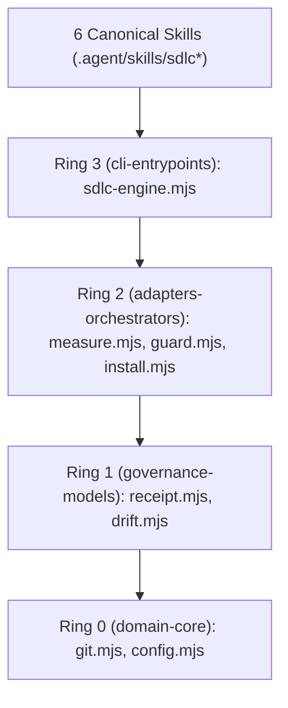

# Software Requirements Specification (SRS): `@fmatar/agentic-sdlc` (v0.1.0)

*Based on IEEE 29148 Standard*

## 1. Introduction
### 1.1 Purpose
Defines the functional interfaces, 4-ring Concentric Clean Architecture boundaries, non-functional requirements, and capability traceability matrix for `@fmatar/agentic-sdlc` v0.1.0.

### 1.2 Scope
An 8-module, zero-dependency Node.js (`>= 22.0.0`) Alignment and Proof Kernel paired with 6 canonical `sdlc*` agent skills enforcing Git Flow session locks, spec/ADR drift checks, [Archlens](https://github.com/fmatar/archlens) concentric ring boundaries, measured diff coverage and mutation gates, and HMAC-SHA256 Stage 7 merge receipts.

### 1.3 References & Traceability Matrix
- **Product Constitution**: [`PRODUCT.md`](../PRODUCT.md)
- **Product Requirements Document**: [`docs/PRD.md`](./PRD.md)
- **Active Architectural Decision**: [`docs/adr/ADR-019-v0-1-0-alignment-and-proof-kernel-simplification.md`](./adr/ADR-019-v0-1-0-alignment-and-proof-kernel-simplification.md)
- **Clean Architecture Policy**: [`.archlens/policy.json`](../.archlens/policy.json)

| Capability ID | Capability Title | Detailed Functional Spec | Governing Ring & Module | Status |
| :--- | :--- | :--- | :--- | :--- |
| `CAP-01` | Git Flow, Linked-Worktree Hygiene & 4-Layer Guard | [`docs/specs/cap-01-git-and-worktree-guard.md`](./specs/cap-01-git-and-worktree-guard.md) | Ring 0 `git.mjs`, Ring 2 `guard.mjs` | `ACTIVE (ADR-019)` |
| `CAP-02` | Schema-Validated Configuration & Shell-Free Execution | [`docs/specs/cap-02-config-and-shell-free-execution.md`](./specs/cap-02-config-and-shell-free-execution.md) | Ring 0 `config.mjs`, `git.mjs` | `ACTIVE (ADR-019)` |
| `CAP-03` | Spec, ADR & Concentric Ring Alignment | [`docs/specs/cap-03-spec-adr-and-ring-alignment.md`](./specs/cap-03-spec-adr-and-ring-alignment.md) | Ring 1 `drift.mjs` | `ACTIVE (ADR-019)` |
| `CAP-04` | Single-Path Measured Quality Gate | [`docs/specs/cap-04-single-path-measured-gate.md`](./specs/cap-04-single-path-measured-gate.md) | Ring 2 `measure.mjs`, `guard.mjs` | `ACTIVE (ADR-019)` |
| `CAP-05` | Cryptographic HMAC-SHA256 Merge Receipts & Audit Chain | [`docs/specs/cap-05-cryptographic-merge-receipts.md`](./specs/cap-05-cryptographic-merge-receipts.md) | Ring 1 `receipt.mjs` | `ACTIVE (ADR-019)` |
| `CAP-06` | Canonical 6-Skill Suite, Multi-Agent Installer & Doctor | [`docs/specs/cap-06-canonical-skills-and-installer.md`](./specs/cap-06-canonical-skills-and-installer.md) | Ring 2 `install.mjs`, Ring 3 `sdlc-engine.mjs` | `ACTIVE (ADR-019)` |

## 2. Overall Description & Concentric Ring Architecture
### 2.1 System Architecture (4 Concentric Rings, 8 Modules)

### 2.2 Operating Environment & Constraints
- **Runtime**: Node.js `>= 22.0.0` (ES Modules), Git `>= 2.30`.
- **Persisted State**: Exactly 3 files: git-tracked `docs/AUDIT_CHAIN.jsonl`, gitignored `.agent/.sdlc-session.json` (`0600`), and gitignored `.agent/.receipt-key` (`0600`).
- **Module Complexity Cap**: Every file under `.agent/scripts/` stays `<= 850` lines of code with zero outward ring imports and zero circular dependencies.

## 3. Specific Requirements (IEEE 29148)
### 3.1 External Interfaces
- **3.1.1 CLI Interface (`sdlc-engine.mjs`)**: Declarative command registry supporting `init`, `doctor`, `config`, `hooks`, `protect`, `begin`, `status`, `end`, `drift`, `adr`, `test`, `coverage`, `mutation`, `gate`, `review`, `receipt`, `verify`, `skill-audit`, and `help` (`--json` supported across commands; unknown commands exit `2`; failing checks exit `1`).
- **3.1.2 Agent Skills Interface (`.agent/skills/`)**: 6 canonical skills (`sdlc`, `sdlc-spec`, `sdlc-adr`, `sdlc-tdd`, `sdlc-gate`, `sdlc-flow`), isolated to the `sdlc*` namespace and adapted at install time for Antigravity, Claude Code, Cursor, Codex, and GitHub Copilot.

### 3.2 Non-Functional & Security Requirements (`INV-01` .. `INV-04`)
- **INV-01**: Protected branch lock on `main` and `develop`; PRs to `main` originate exclusively from `develop`.
- **INV-02**: Single-path measured verification (`docs-only` vs `code`) bound to `HEAD` (`headSha`, `treeSha`, `specHash`, `adrHashes`).
- **INV-03**: Universal human approval (`accepted`) required for all spec, policy, dependency, schema, and OpenAPI drift ADRs.
- **INV-04**: Shell-free `execFileSync` command execution (`parseCommandArgv` / `runConfiguredCommand`), symlink-safe installer writes, and timing-safe HMAC-SHA256 verification.

## Compacted Architectural Decisions

| ID | Title | Scope | Ticket | Supersedes | Compacted In Release | Decision |
| :--- | :--- | :--- | :--- | :--- | :--- | :--- |
| `ADR-001` | Decompose sdlc-engine.mjs into Modular Domain Libraries with SHA-256 Gate Cache and SvelteKit 5 Decision Workbench | `technical` | #63 | CAP-01 | `0.0.1` | Split engine into 11 domain modules under .agent/scripts/lib/*.mjs, add SHA-256 git-tree gate cache, 4-layer git guard with Stage 7 Merkle Gate Receipts, sdlc-product skill, and SvelteKit 5 Runes workbench. |
| `ADR-002` | Consolidate 14 Skills into 6 Schema-Valid Skills, Add Composite Stage CLI, and Enforce Real Dual-Gate Verification | `architectural` | #68 | CAP-01, CAP-02, CAP-03, CAP-04, CAP-05, CAP-06 | `0.0.1` | 1. Introduce `sdlc-engine stage <begin/pre-pr/complete>` (`executeCompositeStage` in `session.mjs`) and ignore `.agent/.sdlc-session.json` and `.agent/.cache/` in `.gitignore`. |
| `ADR-003` | Replace Legacy Shell/Java Installers with Native npx Interactive Multi-Agent Installer Wizard | `architectural` | #75 | CAP-06, CAP-07 | `0.0.1` | 1. Delete `install.sh` and `install.java`. |
| `ADR-004` | Introduce /sdlc Universal Router and 8 Verb-Driven Command Skills | `architectural` | #81 | CAP-05, CAP-07, CAP-08 | `0.0.1` | 1. **1 Universal Router + 8 Verb Skills (9 Canonical Skills)**: |
| `ADR-005` | Adopt Two-Tier PRD and IEEE 29148 SRS Specification Governance in sdlc-product | `architectural` | #84 | CAP-05, CAP-08, CAP-09 | `0.0.1` | Adopt a **Two-Tier Specification Hierarchy** inside `/sdlc-product` and `sdlc-engine.mjs`: |
| `ADR-006` | Unified Multi-Provider Ticket Engine and Canonical Issue Templates | `technical` | N/A | CAP-02, CAP-09, CAP-10 | `0.0.1` | Adopt a 4-template canonical issue suite (.github/ISSUE_TEMPLATE/{feature_request,bug_report,hotfix_incident,architecture_spike}.md + pull_request_template.md) and implement full 4-operation parity (createTicket, transitionPMState, postPMComment, syncKanbanBoard) across GitHub (gh CLI + Projects v2), Linear (GraphQL API), and Jira (REST API v3) with local docs/KANBAN.md mirroring. |
| `ADR-007` | Introduce sdlc-wiki Technical Writer Skill and Deterministic Archlens AST-to-Wiki Synchronization Engine | `architectural` | #90 | CAP-05, CAP-06, CAP-08, CAP-11 | `0.0.1` | 1. **Dedicated `/sdlc-wiki` Skill (1 Router + 9 Verb Skills = 10 Canonical Skills)**: |
| `ADR-008` | Fail-closed enforcement: exit codes, signed measured receipts, authenticated workbench | `technical` | #91 | None | `0.0.1` | 1) The CLI exit status mirrors result.success; unknown commands exit 2; hooks rely on set -e. 2) Engine code never builds shell strings from filenames or refs; git/test invocations use execFileSync argv arrays, and a test bans execSync template literals with interpolation. 3) Gate receipts are issued only from values measured into the session manifest (coverage, mutation or explicit not-configured, recorded reviewer verdict, drift result) and are HMAC-SHA256 signed with a local key (.agent/.receipt-key, gitignored) or SDLC_RECEIPT_KEY; the ledger is described as a hash chain, not a Merkle tree. 4) Missing or stale coverage/mutation reports fail the gate and are never cached; gate parses coverage against thresholds. 5) The workbench binds 127.0.0.1, requires a per-run random token for every request, accepts only same-origin Origin/Host, and is no longer auto-spawned. |
| `ADR-001` | 10-30-90 Developer Landing Page README Template and Deterministic README Engine | `technical` | #100 | CAP-11 | `0.0.1` | Add docs/templates/README_TEMPLATE.md with cli/sdk/platform archetype blocks, implement Ring 1 .agent/scripts/lib/readme-sync.mjs (readme init & tiered readme audit), wire /sdlc readme across sdlc, sdlc-wiki, sdlc-product, and sdlc-release, and enforce hard README anti-patterns in gate --strict. |
| `ADR-002` | Config-Driven Dual-Gate Thresholds, Verifiable CLI Telemetry, and SHA-256 Hook Drift Detection | `technical` | #103 | CAP-03, CAP-06 | `0.0.1` | Make .agent/sdlc-config.json the single source of truth for Dual-Gate coverage and mutation thresholds, widen Stryker mutation scope to core enforcement modules (audit-chain.mjs, git-guard.mjs), verify installed Git hook SHA-256 digests in doctor, fix CLI output formatters and full help registry, and align .archlens/policy.json concentric rings with .agent/scripts/lib. |
| `ADR-003` | Shell-Free Command Execution, Least-Privilege Self-Hosted CI, and Bundled Config Schema | `technical` | #105 | None | `0.0.1` | Execute configured commands strictly via execFileSync (parseCommandArgv/runConfiguredCommand), enforce permissions: contents: read and mktemp/repo-local git config on workflows, and include .agent/schemas in package.json files. |
| `ADR-004` | Risk-Proportional Execution Lanes, Instant Pre-Commit Guard, and Spec-Drift Precision | `technical` | #107 | CAP-01, CAP-03 | `0.0.1` | Introduce deterministic 3-tier execution lanes (trivial, standard, full) via triageChange and sdlc-engine triage with automatic diff re-triage escalation, lane-aware Stage 7 HMAC receipts, opt-in --ui workbench snapshots, an instant (<100ms) pre-commit guard, and structural JSON AST diffing for package.json alongside PRODUCT.md and docs/specs/*.md drift protection. |
| `ADR-005` | Right-Size Canonical Skills Suite and Native Claude and Cursor Skill Packaging | `technical` | #109 | CAP-05, CAP-07, CAP-08 | `0.0.1` | Standardize canonical SDLC skills on <=200-char Use-when/Not-for descriptions, risk-proportional lane tables, confirmation gates, blocker-derived review verdicts, and repo-agnostic wiki rules; remove duplicate .claude/commands/*.md in favor of .claude/skills/<id>/SKILL.md, derive .claude-plugin/plugin.json version from package.json, and provision native .cursor/skills/<id>/SKILL.md alongside .cursor/rules/. |
| `ADR-006` | Slim npm package (<250 KB), untrack third-party design binaries, and consolidate on zero-dependency workbench-server | `technical` | #111 | CAP-06, CAP-08 | `0.0.1` | Scope package.json files whitelist to the canonical SDLC skills, scripts, schemas, and templates (<250 KB), untrack the 4x17.7 MB impeccable binaries via .gitignore, and remove the duplicate abandoned SvelteKit workbench/ prototype in favor of .agent/scripts/lib/workbench-server.mjs. |
| `ADR-009` | Align README, Wiki, PRD and SRS Documentation with v0.4.0 Architecture and Archlens Links | `technical` | #114 | CAP-06, CAP-11 | `v0.0.2` | Link https://github.com/fmatar/archlens across README.md, llms.txt, CONTRIBUTING.md, wiki/*.md, docs/PRD.md, and docs/SRS.md; align wiki/Architecture.md 1:1 with .archlens/policy.json rings; upgrade README.md with live CI badge, proportional workflow examples, and 11-skill disclosure; update docs/PRD.md and docs/SRS.md to v0.4.0; and remove obsolete docs/SDLC_AGENTIC_OPERATIONS_GUIDE.md and docs/SDLC_COMPLIANCE_REPORT.md. |
| `ADR-010` | Standardize on 10 Canonical SDLC Skills, Neutralize Engineering Terminology, and Compact README Workflow Diagram | `technical` | #116 | CAP-05, CAP-07, CAP-08, CAP-11 | `v0.0.2` | 1) Consolidate CANONICAL_SDLC_SKILLS to 10 SDLC skills and prune retired skill exports across local and global agent directories; 2) Replace author-specific phrasing across code, skills, specs, wiki, and README with neutral TDD and concentric Clean Architecture terminology; 3) Remove Archlens links from wiki/_Footer.md and README.md footer sections while keeping inline architecture references; 4) Replace the wide horizontal flowchart LR in README.md and wiki/Traceability.md with compact vertical flowchart TD diagrams. |
| `ADR-011` | Strict sdlc Namespace Isolation and Decoupling from Standalone Coding-Persona Skills | `technical` | #118 | CAP-05, CAP-07, CAP-08, ADR-010 | `v0.0.2` | Restrict both CANONICAL_SDLC_SKILLS (10 skills) and DEPRECATED_SDLC_SKILLS (14 legacy sdlc-* skills) exclusively to the sdlc* namespace. Ensure provisionAgentIntegrations, pruneDeprecatedSkills, auditSkills, and auditWiki ignore all non-sdlc* skills in local and global agent directories so standalone coding-persona and design skills coexist untouched alongside the SDLC suite. |
| `ADR-012` | Reset Package, Plugin, and Documentation Version Baseline to 0.0.1 | `technical` | #120 | CAP-06, ADR-009 | `v0.0.2` | Set package.json, package-lock.json, .claude-plugin/plugin.json, installer.mjs fallback version, README.md version badge, PRODUCT.md/SRS.md compacted release metadata, and CHANGELOG.md to a clean 0.0.1 baseline, and remove legacy docs/proofs/proof-v0-*.md files. |
| `ADR-013` | Harden Release Gate, Opt-In Issue Creation, Universal ADR Approval, Diff Review Plans, and Node 24 CI Actions | `technical` | L-122000 | CAP-01, CAP-03, CAP-06 | `v0.0.2` | Require non-protected branch, gate --strict, and fail-closed git commit/tag in executeRelease; require explicit --issue, --local, --lane trivial, or --create-issue in stage begin; initialize all ADR scopes in pending_approval; embed unified git diff in generateReviewPlan; and upgrade GitHub Actions to Node 24 v7 on local-archlens. |
| `ADR-014` | Canonical Git Flow: Enforce Merges to Develop, Block Direct PRs to Main, and Automate Production Releases on Develop Merge | `technical` | L-124000 | CAP-01, CAP-04, CAP-06 | `v0.0.2` | 1. Standardize on canonical Git Flow across the framework: |
| `ADR-015` | Harden Stage 7 Gate Receipts, Ring 0 Primitives, and Git Flow Verification | `technical` | L-128000 | CAP-01, CAP-04 | `v0.0.2` | Consolidate shared Ring 0 safety, atomic I/O, session/product/ADR parsers, memoized base-branch resolution, and single-pass unified diff primitives into `core.mjs` and `decision-graph.mjs`; enforce `.agent/sdlc-config.json` thresholds inside `issueGateReceipt`; restrict post-receipt commit allowlists; verify `MERGE_HEAD` against `develop` on merges to `main`; verify Stage 7 receipts in CI; prevent ADR compaction data loss and accept both `approve`/`accept` verbs; escape server-rendered Workbench HTML and consolidate the widget UI; and update `.github/workflows/*.yml`, `docs/templates/C4_ARCHITECTURE_TEMPLATE.md`, and regression tests. |
| `ADR-016` | Break Ring 2 Cycles, Decompose quality-gate.mjs, Enforce Whole-Graph Cycle Detection in checkArchDiff, and Align Archlens Policy Schema | `technical` | #134 | CAP-02, CAP-03 | `v0.0.2` | Decompose quality-gate.mjs into focused modules (coverage-mutation.mjs, security-audit.mjs, doctor-ci.mjs, triage-review.mjs) while preserving all public named exports on quality-gate.mjs and sdlc-engine.mjs; extract shared Ring 0/1 constants and invert arch-trace <-> session coupling to break all Ring 2 cycles; extend checkArchDiff to detect whole-graph and intra-ring cycles plus dynamic imports; align .archlens/policy.json and scaffoldArchlensPolicy with Archlens MCP levels/order/src/lang schema alongside layer rules; and remove execCommand/execAsync from Ring 0 core.mjs after migrating callers to execFile-based helpers. |
| `ADR-017` | Externalize Workbench Assets, Harden CSP Headers, Clean Dialect Hygiene, and Ensure Global CLI Portability | `technical` | #135 | CAP-03, CAP-07, CAP-08, CAP-10, CAP-11 | `v0.0.2` | Extract workbench assets into .agent/scripts/workbench-assets/ and omit them from .archlens/policy.json backend module checks, add per-request CSP nonces and strict security headers, unify skill dialect translation and marked rules blocks across runtimes, copy scripts to ~/.agentic-sdlc/scripts on --global installs, and remove stale SvelteKit/template copy. |
| `ADR-018` | Expand Stryker Mutation Scope, Polyglot Mutation Parsers, Hash-Chain Terminology, and Test Isolation | `technical` | #136 | CAP-03, CAP-04, CAP-06, CAP-11 | `v0.0.2` | Expand stryker.config.json mutate scope across all 8 core governance modules executed via @stryker-mutator/tap-runner (perTest coverage analysis, forceBail) against fast modular unit suites tests/unit/*.test.mjs (with tests/governance-unit.test.mjs covering full integration & contracts) with break threshold >= 52 and pinned @stryker-mutator/tap-runner devDependency; implement cargo mutants, mutmut, and go-mutesting parsers in parseMutationReport with structured fail-closed diagnostics; standardize linear SHA-256 hash-chain and Stage 7 Gate Receipt terminology across code, UI, wiki, specs, and templates while preserving backward-compatible merkleRoot JSON alias and GitHub branch protection check name; and decouple in-process workbench handler tests from dedicated live TCP loopback round-trip integration tests. |
