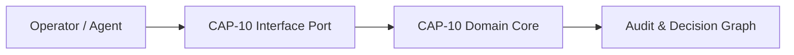

# SPEC-10: Unified Multi-Provider Ticket Engine & Issue Templates (#86)

- **Linked Capability**: `CAP-10`
- **Specification ID**: `SPEC-10`
- **Parent Product Docs**: `PRODUCT.md`, `docs/PRD.md`, `docs/SRS.md`
- **Depends On**: `CAP-02, CAP-09`
- **Status**: `ACTIVE`

## 1. PRD Slice: Problem Alignment & Scope
- **Problem Statement & User Value**: Deliver Unified Multi-Provider Ticket Engine & Issue Templates (#86) with deterministic governance, Clean Architecture isolation, and zero manual plumbing.
- **In Scope**:
  - Core domain logic, interface ports, and automated Dual-Gate test suite for `CAP-10`.
- **Out of Scope (Non-Goals)**:
  - Unrelated cross-capability mutations not declared in `PRODUCT.md`.
- **User Experience & Flows**:
  - **Happy Path**: Operator or agent invokes `CAP-10` workflow and receives deterministic, verifiable output.
  - **Edge Cases & Error Handling**: Invalid inputs fail fast with structured diagnostic remediation.

## 2. Functional Requirements (IEEE 29148 SRS)
- **Inputs**: Validated domain parameters, CLI arguments, or configuration state for CAP-10.
- **Processing**: Execute pure Ring 0/1 domain transformations and enforce invariant checks for Unified Multi-Provider Ticket Engine & Issue Templates (#86).
- **Outputs**: Structured result payload, updated state artifacts, and audit ledger events.

## 3. Domain Contract & Acceptance Criteria
- Enforce Clean Architecture concentric ring boundaries (`.archlens/policy.json`) and Robert C. Martin TDD.
- Achieve Dual-Gate verification (`>= 85%` diff line coverage and `>= 80%` mutation score).
- Zero shell command interpolation of untrusted inputs (`INV-04`).

## 4. C4 Component & Sequence Architecture

