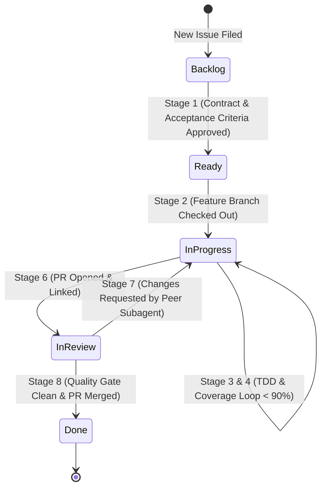
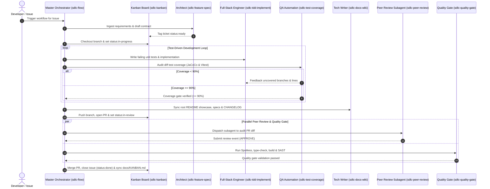

# 🏛️ Agentic SDLC Architecture

The **Agentic SDLC Framework** orchestrates an autonomous, multi-agent engineering lifecycle. Coding agents are structured into specialized roles governed by strict engineering contracts, continuous test-coverage enforcement ($\ge 90\%$), parallel subagent peer reviews, and automated release deployment.

---

## ⚡ The 8-Stage Autonomous Lifecycle

```mermaid
flowchart TD
    classDef startNode fill:#1E293B,stroke:#3B82F6,stroke-width:2px,color:#F8FAFC
    classDef intakeNode fill:#1E1B4B,stroke:#6366F1,stroke-width:2px,color:#EEF2FF
    classDef devNode fill:#064E3B,stroke:#10B981,stroke-width:2px,color:#ECFDF5
    classDef reviewNode fill:#701A75,stroke:#D946EF,stroke-width:2px,color:#FDF4FF
    classDef releaseNode fill:#78350F,stroke:#F59E0B,stroke-width:2px,color:#FEF3C7

    Issue["GitHub Issue / User Intent"]:::startNode --> S1

    subgraph IntakePhase ["📋 Phase 1: Intake & Contract Specification"]
        S1["1. Intake & Contract Specification<br/>sdlc-feature-spec • status:ready"]:::intakeNode
        S2["2. Branch & Kanban Automation<br/>sdlc-kanban • status:in-progress"]:::intakeNode
        S1 --> S2
    end

    subgraph EngineeringPhase ["🛠️ Phase 2: TDD & Coverage Loop"]
        S3["3. Clean-Room TDD Implementation<br/>sdlc-tdd-implement<br/>Svelte 5 Runes & Quarkus Java 25"]:::devNode
        S4{"4. Coverage Gate<br/>sdlc-test-coverage<br/>Diff Coverage >= 90%?"}:::devNode
        S3 --> S4
        S4 -- "Missing Tests" --> S3
    end

    S2 --> S3

    subgraph ShowcasePhase ["📚 Phase 3: Showcase & PR Publication"]
        S5["5. Documentation, Showcase & Changelog<br/>sdlc-docs-wiki<br/>5-Min Quickstart, BYOA & Specs"]:::devNode
        S6["6. Pull Request Creation<br/>create_pull_request • status:in-review"]:::reviewNode
        S5 --> S6
    end

    S4 -- "Coverage >= 90%" --> S5

    subgraph ReviewPhase ["⚡ Phase 4: Parallel Peer Review & Quality Gate"]
        direction LR
        S7["7. Subagent Peer Review<br/>invoke_subagent: sdlc-peer-review<br/>Diff Audit & Code Verification"]:::reviewNode
        S8["8. Quality Gate & Security<br/>sdlc-quality-gate<br/>Spotless, svelte-check, Port 0, SAST"]:::reviewNode
    end

    S6 --> ReviewPhase

    Done["Release & Done<br/>sdlc-release-changelog • status:done<br/>SemVer Tag, Docker Container & Helm Deploy"]:::releaseNode
    ReviewPhase --> Done
```

---

## 🔄 5-Stage Kanban State Machine

The lifecycle coordinates with GitHub Projects v2 and repository issue boards through deterministic label transitions:

---

## ⚡ Multi-Agent Fork-Join Execution

---

## 📋 Detailed Stage Breakdown

### Stage 1: Intake & Contract Specification (`sdlc-feature-spec`)
* Reads user story and technical scope via `issue_read`.
* Produces SVPG PRD, IEEE 29148 SRS, C4 architecture schemas, and Gherkin acceptance scenarios.
* Labels ticket with `status:ready`.

### Stage 2: Branch & Kanban Automation (`sdlc-kanban`)
* Creates feature branch: `feature/issue-#<id>-<kebab-title>`.
* Updates ticket to `status:in-progress` and refreshes living [`docs/KANBAN.md`](../docs/KANBAN.md).
* Enforces WIP limit (max 3–5 tickets in progress).

### Stage 3: Clean-Room TDD Implementation (`sdlc-tdd-implement`)
* Strict Test-Driven Development: writes failing unit tests before implementation code.
* Frontend: Modern Svelte 5 Runes (`$state`, `$derived`, `$props`).
* Backend: Quarkus Java 25 reactive streams (Mutiny `Uni`/`Multi`, Hibernate Reactive Panache).

### Stage 4: Test & Coverage Enforcement (`sdlc-test-coverage`)
* Executes unit and integration test suites:
  * Backend: `./mvnw clean test jacoco:report`
  * Frontend: `npm run test:coverage`
* Computes coverage strictly against the git diff (`git diff --name-only main`).
* **Threshold**: $\ge 90\%$ line and branch coverage required. Automatically authors missing tests until the gate passes.

### Stage 5: Documentation, Showcase & Changelog Sync (`sdlc-docs-wiki`)
* **Developer Showcase Invariant**: Updates the root `README.md` with a frictionless **5-Minute Developer Quickstart** (< 5 min time-to-first-run) and Bring Your Own App (BYOA) contract.
* Synchronizes `docs/specs/`, `CHANGELOG.md` under `[Unreleased]`, and wiki deep-dives.

### Stage 6: Pull Request Publication (`sdlc-kanban`)
* Pushes branch to remote and calls `create_pull_request` linking `Fixes #<id>`.
* Transitions issue to `status:in-review`.

### Stage 7: Parallel Subagent Peer Review (`sdlc-peer-review`)
* Spawns an independent peer reviewer subagent via `invoke_subagent`.
* Audits PR diff for reactive patterns, security hygiene, coverage compliance, and quickstart validity.
* Posts structured review comments and calls `pull_request_review_write` (`APPROVE` / `REQUEST_CHANGES`).

### Stage 8: Quality Gate & Release (`sdlc-quality-gate` & `sdlc-release-changelog`)
* Pre-merge quality verification: Spotless formatting, SvelteKit static typing, test port isolation (`quarkus.http.test-port=0`), and SAST scanning.
* Increments Semantic Versioning (SemVer 2.0.0), builds Docker container images, and updates Kubernetes/Helm releases.
* Marks ticket `status:done` and regenerates living [`docs/KANBAN.md`](../docs/KANBAN.md).
