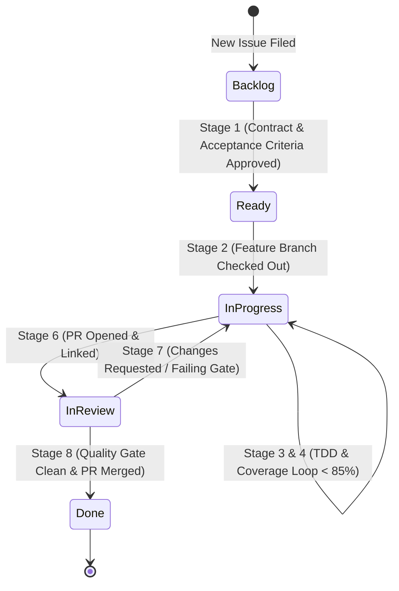
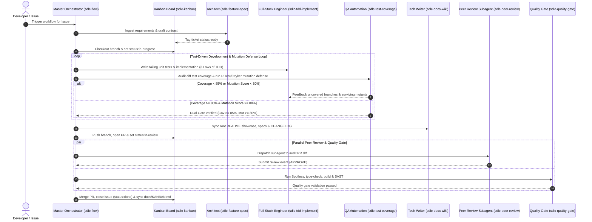

# 🏛️ Agentic SDLC Architecture

The **Agentic SDLC Framework** orchestrates an autonomous, multi-agent engineering lifecycle. Coding agents are structured into specialized roles governed by strict engineering contracts, Robert C. Martin (Uncle Bob) TDD craftsmanship, continuous Dual-Gate test and mutation defense ($\ge 85\%$ diff coverage, $\ge 80\%$ mutation score), parallel subagent peer reviews, and automated release deployment.

---

## ⚡ The 8-Stage Autonomous Lifecycle

```mermaid
flowchart TD
    %% Styling and Theme Definitions
    classDef trigger fill:#1e1e2f,stroke:#6366f1,stroke-width:2px,color:#f8fafc,rx:8,ry:8;
    classDef decision fill:#312e81,stroke:#a855f7,stroke-width:2px,color:#f3e8ff,rx:6,ry:6;
    classDef gate0 fill:#3b0764,stroke:#d946ef,stroke-width:2px,color:#fae8ff,rx:8,ry:8;
    classDef stage fill:#0f172a,stroke:#38bdf8,stroke-width:2px,color:#e0f2fe,rx:8,ry:8;
    classDef stageHighlight fill:#1e293b,stroke:#06b6d4,stroke-width:2.5px,color:#ecfeff,rx:8,ry:8;
    classDef subagent fill:#111827,stroke:#10b981,stroke-width:2px,color:#ecfdf5,rx:8,ry:8;
    classDef failure fill:#450a0a,stroke:#ef4444,stroke-width:2px,color:#fee2e2,rx:8,ry:8;
    classDef circuit fill:#701a75,stroke:#f43f5e,stroke-width:2.5px,color:#ffe4e6,rx:8,ry:8;
    classDef success fill:#064e3b,stroke:#22c55e,stroke-width:2.5px,color:#dcfce7,rx:8,ry:8;
    classDef fallback fill:#1c1917,stroke:#f59e0b,stroke-width:2px,color:#fef3c7,rx:8,ry:8;

    %% Entry Points
    UserReq(["🎯 Incoming User Request\n(Feature • Bug Fix • Hotfix • Spike)"]):::trigger

    %% Gate 0: Mandatory Ticket Invariant
    subgraph Gate0 ["🛑 Gate 0: Mandatory Ticket Invariant & Classification"]
        direction TB
        HasTicket{"Ticket ID #ID\nProvided?"}:::decision
        AutoClassify["🤖 Auto-Classifier\n• feat / fix / hotfix / spike\n• Problem scope analysis"]:::gate0
        ProvTicket["🎫 Auto-Provision Tracking Ticket\n(node .agent/scripts/sdlc-engine.mjs ticket create)\n• GitHub Issues / Jira / Linear / KANBAN.md\n• Set status:ready"]:::gate0
    end

    UserReq --> HasTicket
    HasTicket -->|No Ticket #| AutoClassify
    AutoClassify --> ProvTicket
    HasTicket -->|Ticket # Exists| PreFlightGuard
    ProvTicket --> PreFlightGuard

    %% Stage 0: Pre-Flight Concurrency & Intent Guard
    subgraph Stage0 ["🚦 Stage 0: Concurrency & Intent Routing (sdlc-engine session status)"]
        direction TB
        PreFlightGuard{"Active Session\nStatus?"}:::decision
        FastPath["⚡ Ad-Hoc Fast Path\n• Append Task to Ticket #<id>\n• Affected-only Test Runner\n• Direct TDD remediation"]:::stageHighlight
        WorktreeFork["🌿 Worktree Isolation / Branch Subagent\n(git worktree add ../worktree-issue-<id>)\n• Concurrent flow without clobbering"]:::fallback
        InitLock["🔒 Acquire Session Concurrency Lock\n(sdlc-engine session start --issue <id>)\n• Write .agent/.sdlc-session.json"]:::stageHighlight
    end

    PreFlightGuard -->|Sub-task on Active Ticket| FastPath
    PreFlightGuard -->|New Urgent Request while Active| WorktreeFork
    PreFlightGuard -->|Clean / No Active Session| InitLock

    %% Stage 1 to 6: Core Sequential Pipeline
    subgraph Pipeline ["⚙️ Stages 1 - 6: Specification, TDD & Showcase Engine"]
        direction TB

        %% Stage 1
        subgraph S1_Intake ["1️⃣ Stage 1: Intake & Architecture Contract"]
            direction TB
            DetectStack["Stack Auto-Detection\n(sdlc-engine detect)"]:::stage
            ArchPrompt{"Archlens Policy\nPresent?"}:::decision
            ScaffoldArch["Scaffold Concentric Policy\n(sdlc-engine archlens scaffold)"]:::fallback
            FetchReqs["Formulate Contract & Spec\n• Gherkin Acceptance Criteria\n• RFC / ADR / C4 Architecture\n• Tag: status:ready"]:::stage
        end

        %% Stage 2
        subgraph S2_Branch ["2️⃣ Stage 2: Branch & Kanban Sync"]
            direction TB
            CreateBranch["Git Checkout Branch\n(feature/issue-#<id>-<slug>)\n• Transition: status:in-progress\n• Update Session Stage 2"]:::stage
        end

        %% Stage 3
        subgraph S3_TDD ["3️⃣ Stage 3: Clean-Room TDD Implementation"]
            direction TB
            BugReproCheck{"Is Bug / Fix?"}:::decision
            ReproHarness[" author Failing Reproduction Test\n• Verify harness fails first"]:::failure
            UncleBobTDD["Uncle Bob's 3 Laws of TDD & TPP\n• Degenerate failing tests first\n• Clean domain logic & port isolation\n• Fast loop: sdlc-engine test --affected-only"]:::stageHighlight
        end

        %% Stage 4
        subgraph S4_Gate ["4️⃣ Stage 4: Dual-Gate & Mutation Testing"]
            direction TB
            RunDualGate["Universal Dual-Gate Audits\n• sdlc-engine coverage (>= 85% Line/Branch)\n• sdlc-engine mutation (>= 80% Kill Score)\n• sdlc-engine archlens diff (0 Inversions)"]:::stageHighlight
            MutantCheck{"Surviving\nMutants?"}:::decision
            StrengthenMutant["Auto-Strengthen Boundary Tests\n(sdlc-engine strengthen)"]:::stage
            ExemptionLedger["Register Benign Exemption\n(.agent/sdlc-exemptions.json)"]:::fallback
        end

        %% Stage 5
        subgraph S5_Showcase ["5️⃣ Stage 5: Documentation & Showcase Hygiene"]
            direction TB
            SyncDocs["Developer Showcase Sync\n• Root README.md 5-Min Quickstart\n• Architecture specs in docs/specs/\n• CHANGELOG.md under [Unreleased]"]:::stage
        end

        %% Stage 6
        subgraph S6_PR ["6️⃣ Stage 6: Pull Request Opening"]
            direction TB
            OpenPR["Generate PR Summary & Push\n(sdlc-engine pr-summary --issue <id>)\n• Tag: status:in-review\n• UI Ephemeral screenshot previews"]:::stage
        end
    end

    InitLock --> DetectStack
    DetectStack --> ArchPrompt
    ArchPrompt -->|No Policy Found| ScaffoldArch
    ArchPrompt -->|Policy Configured| FetchReqs
    ScaffoldArch --> FetchReqs
    FetchReqs --> CreateBranch
    CreateBranch --> BugReproCheck
    BugReproCheck -->|Yes| ReproHarness
    BugReproCheck -->|No| UncleBobTDD
    ReproHarness --> UncleBobTDD
    UncleBobTDD --> RunDualGate
    RunDualGate --> MutantCheck
    MutantCheck -->|Surviving Mutants| StrengthenMutant
    StrengthenMutant --> RunDualGate
    MutantCheck -->|Benign Compiler Quirk| ExemptionLedger
    MutantCheck -->|Dual-Gate Met| SyncDocs
    ExemptionLedger --> SyncDocs
    SyncDocs --> OpenPR

    %% Stage 7: Parallel Fork-Join Review
    subgraph ForkJoinReview ["⚡ Stage 7: Supervisor Fork-Join Parallel Review (invoke_subagent)"]
        direction TB
        PlanReview["Review Dispatch Plan\n(sdlc-engine review plan)"]:::stageHighlight
        
        subgraph SubagentsPool ["Concurrently Dispatched Subagents"]
            direction LR
            SubReviewer["🕵️ PR Peer Reviewer\n• Uncle Bob Test Smell Detection\n• Diff Audit & DIP Check\n• Formal PR Review Comments"]:::subagent
            SubGatekeeper["🛡️ Quality Gatekeeper\n• Full sdlc-engine gate --strict\n• Flake stability check (3 runs)\n• Secret & package CVE audits"]:::subagent
            SubArchAuditor["🏛️ Architectural Auditor\n(Triggered on HIGH/CRITICAL Risk)\n• Concentric boundary proof\n• ADR alignment"]:::subagent
        end
        
        EvalResults{"Audit & Gate\nPassed?"}:::decision
    end

    OpenPR --> PlanReview
    PlanReview --> SubReviewer
    PlanReview --> SubGatekeeper
    PlanReview --> SubArchAuditor
    SubReviewer --> EvalResults
    SubGatekeeper --> EvalResults
    SubArchAuditor --> EvalResults

    %% Circuit Breaker & Remediation
    subgraph CircuitBreaker ["🔄 Circuit Breaker & Auto-Remediation Loop"]
        direction TB
        RemediationCount{"Remediation\nCount < 3?"}:::circuit
        LoopBack["Rollback Session to Stage 3\n• Tag: status:in-progress\n• session update --stage 3 --remediate"]:::failure
        InteractiveIntervention["⚠️ Circuit Breaker Tripped!\n(Interactive ask_question Modal)\n1. Grant Exemption & Record Ledger\n2. Extend Budget (+2 retries)\n3. Abort & Rollback to Main"]:::fallback
    end

    EvalResults -->|Changes Requested or Gate Failed| RemediationCount
    RemediationCount -->|Budget Available| LoopBack
    LoopBack --> UncleBobTDD
    RemediationCount -->|3 Consecutive Failures| InteractiveIntervention
    InteractiveIntervention -->|Extend Budget| UncleBobTDD

    %% Stage 8: Done & Release
    subgraph Stage8 ["🏁 Stage 8: Final Gate & Teardown (sdlc-release-changelog)"]
        direction TB
        PollRemoteCI["Remote CI/CD Polling\n(sdlc-engine check-ci <pr-id>)"]:::stage
        MergePR["Squash & Merge PR\n• Tag SemVer Release\n• Deploy Containers / Artifacts"]:::stage
        CloseTicket["Final Kanban State Sync\n• Tag status:done & close issue\n• kanban-sync.sh"]:::stage
        ReleaseLock["🔓 Release Session Concurrency Lock\n(sdlc-engine session release)"]:::success
    end

    EvalResults -->|All Approved & Strict Green| PollRemoteCI
    PollRemoteCI --> MergePR
    MergePR --> CloseTicket
    CloseTicket --> ReleaseLock

    %% Worktree / FastPath convergence
    FastPath -.-> RunDualGate
    WorktreeFork -.-> DetectStack
```

---

## 🔄 5-Stage Kanban State Machine

The lifecycle coordinates with GitHub Projects v2 and repository issue boards through deterministic label transitions:

---

## ⚡ Multi-Agent Fork-Join Execution

---

## 📋 Detailed Stage Breakdown

### Stage 1: Intake & Contract Specification (`sdlc-feature-spec`)
* **Gate 0 Invariant**: Guarantees ticket #ID exists or auto-provisions via `sdlc-engine ticket create` (`feat`, `bug`, `hotfix`, `spike`).
* Reads user story and technical scope via `issue_read`.
* **Archlens Inquiry**: Proactively prompts for Archlens Clean Architecture governance if `.archlens/policy.json` is missing.
* Produces SVPG PRD, IEEE 29148 SRS, C4 architecture schemas, and Gherkin acceptance scenarios.
* Labels ticket with `status:ready`.

### Stage 2: Branch & Kanban Automation (`sdlc-kanban`)
* Creates feature branch: `feature/issue-#<id>-<kebab-title>`.
* Updates ticket to `status:in-progress` and refreshes living [`docs/KANBAN.md`](../docs/KANBAN.md).
* Enforces WIP limit (max 3–5 tickets in progress).

### Stage 3: Clean-Room TDD Implementation (`sdlc-tdd-implement`)
* Strictly enforces **Uncle Bob's Three Laws of TDD** and the **Transformation Priority Premise (TPP)**.
* **Mandatory Bug Reproduction Test**: For bug/fix tickets, authors failing reproduction tests *first* before modifying application code.
* Writes failing unit tests for degenerate cases before writing production code.
* Frontend: Modern Svelte 5 Runes (`$state`, `$derived`, `$props`).
* Backend: Quarkus Java 25 reactive streams (Mutiny `Uni`/`Multi`, Hibernate Reactive Panache).
* Eliminates test smells: no trivial getter tests, no testing third-party framework plumbing, no mock abuse.
* Fast loop: `node .agent/scripts/sdlc-engine.mjs test --affected-only`.

### Stage 4: Dual-Gate Test & Mutation Enforcement (`sdlc-test-coverage`)
* Executes unit and integration test suites:
  * Backend: `./mvnw clean test jacoco:report` and `./mvnw test-compile org.pitest:pitest-maven:mutationCoverage`
  * Frontend: `npm run test:coverage` and `npx stryker run`
* Computes coverage strictly against the git diff (`git diff --name-only main`).
* **Dual-Gate Threshold**: $\ge 85\%$ line and branch coverage on diff AND $\ge 80\%$ mutation kill score on modified classes. Automatically authors missing tests and kills surviving mutants until the gate passes.
* **Clean Architecture Diff**: `sdlc-engine archlens diff` ensures zero concentric ring layer inversions.
* **Benign Exemption Ledger**: Unkillable compiler bytecode quirks or shutdown hooks registered in `.agent/sdlc-exemptions.json`.

### Stage 5: Documentation, Showcase & Changelog Sync (`sdlc-docs-wiki`)
* **Developer Showcase Invariant**: Updates the root `README.md` with a frictionless **5-Minute Developer Quickstart** (< 5 min time-to-first-run) and Bring Your Own App (BYOA) contract.
* Synchronizes `docs/specs/`, `CHANGELOG.md` under `[Unreleased]`, and wiki deep-dives.

### Stage 6: Pull Request Publication (`sdlc-kanban`)
* Generates structured markdown description via `node .agent/scripts/sdlc-engine.mjs pr-summary --issue <id>`.
* Pushes branch to remote and calls `create_pull_request` linking `Fixes #<id>`.
* Transitions issue to `status:in-review`.

### Stage 7: Fork-Join Parallel Review & Quality Gate (`invoke_subagent`)
* Generates review plan via `node .agent/scripts/sdlc-engine.mjs review plan`.
* Concurrently dispatches read-only auditor subagents via `invoke_subagent`:
  * **Peer Reviewer (`sdlc-peer-review`)**: Audits PR diff for reactive patterns, security hygiene, Dual-Gate metrics, and Uncle Bob test smells. Posts structured review comments (`APPROVE` / `REQUEST_CHANGES`).
  * **Quality Gatekeeper (`sdlc-quality-gate`)**: Executes universal strict quality gate (`sdlc-engine.mjs gate --strict`), Spotless formatting, svelte-check, test port isolation, WCAG a11y, flake stability check (3 runs), and secret/CVE security audits.
  * **Architectural Auditor**: Dispatched conditionally for `HIGH`/`CRITICAL` risk changes.
* **Circuit Breaker Protocol**: Auto-remediates up to 3 times. On 3rd failure, pauses and prompts human review via `ask_question` (exemption, budget extension, or rollback).

### Stage 8: Quality Gate Passed, Release & Lock Release (`sdlc-release-changelog` & `sdlc-kanban`)
* **Remote CI Polling**: Verifies GitHub Actions matrix is green (`sdlc-engine check-ci <pr-id>`).
* Merges PR into base branch.
* Increments Semantic Versioning (SemVer 2.0.0), builds Docker container images, and updates Kubernetes/Helm releases.
* Marks ticket `status:done`, regenerates living [`docs/KANBAN.md`](../docs/KANBAN.md), and releases the session lock (`node .agent/scripts/sdlc-engine.mjs session release`).
