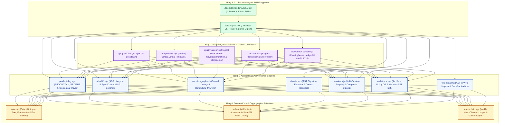
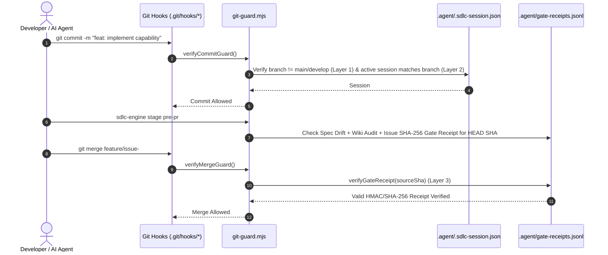

# 🏗️ System Architecture & Concentric Ring Design

This document provides the deep architectural explanation of the **Agentic SDLC Framework**, detailing how `.agent/scripts/sdlc-engine.mjs` and its **12 modular domain libraries** (`.agent/scripts/lib/*.mjs`) are organized into **Archlens Concentric Clean Architecture Rings** (`.archlens/policy.json`), how the **4-Layer Git Lockdown** and **SHA-256 Gate Cache** operate, and how causal lineage flows from `PRODUCT.md` to `docs/DECISION_MAP.md`.

> For the auto-generated AST symbol inventory and line-number mapping across all modules, see **[Codebase-Map.md](Codebase-Map.md)**.

---

## 1. Archlens Concentric Clean Architecture Rings

In accordance with Robert C. Martin's **Clean Architecture** and `ADR-001` / `ADR-007`, the engine is partitioned into four concentric rings where all source code dependencies point strictly inward toward **Ring 0**:

### Concentric Ring Responsibilities (`.agent/scripts/lib/*.mjs`)

| Ring | Module Path | Core Architectural Responsibility | Key Exported Primitives |
| :--- | :--- | :--- | :--- |
| **Ring 0** | `.agent/scripts/lib/core.mjs` | Zero-dependency I/O, async worker pool, YAML frontmatter parser, Archlens/PM probes. | `fileExists`, `readFileSafe`, `execAsync`, `runParallelTasks`, `parseFrontmatter`, `inspectArchlens` |
| **Ring 0** | `.agent/scripts/lib/cache.mjs` | Content-addressable SHA-256 workspace tree hashing and gate cache (`coverage`, `mutation`, `gate`). | `computeTreeHash`, `getGateCacheHit`, `recordGateCache`, `getGateCacheStats`, `clearGateCache` |
| **Ring 0** | `.agent/scripts/lib/audit-chain.mjs` | Immutable SHA-256 Merkle hash-chained ledger (`docs/AUDIT_CHAIN.jsonl`) and Stage 7 Gate Receipts. | `calculateRecordHash`, `appendAuditRecord`, `verifyAuditChain`, `issueGateReceipt`, `verifyGateReceipt` |
| **Ring 1** | `.agent/scripts/lib/product-dag.mjs` | Parses/synthesizes `PRODUCT.md`, `docs/PRD.md`, IEEE 29148 `docs/SRS.md`, and Kahn's algorithm DAG waves. | `initProductConstitution`, `scaffoldCapabilitySpec`, `parseProductMarkdown`, `planProductDAG`, `deconstructEpic` |
| **Ring 1** | `.agent/scripts/lib/adr-drift.mjs` | Manages ADR lifecycle (`docs/adr/ADR-*.md`), compacts ADRs into `docs/SRS.md`, detects undeclared spec drift, and audits OpenAPI/GraphQL contracts. | `createADR`, `listADRs`, `decideADR`, `compactADRs`, `checkSpecDrift`, `auditContractDrift` |
| **Ring 1** | `.agent/scripts/lib/decision-graph.mjs` | Builds the causal graph (`INV-XX`, `CAP-XX`, `SPEC-XX`, `ADR-00X`, tickets) and renders `docs/DECISION_MAP.md`. | `appendDecisionEvent`, `buildDecisionGraph`, `syncDecisionMapMarkdown` |
| **Ring 1** | `.agent/scripts/lib/dossier.mjs` | Extracts polyglot AST export signatures and compiles compact subagent context dossiers (`.agent/dossiers/`). | `extractExportSignatures`, `generateTicketDossier` |
| **Ring 1** | `.agent/scripts/lib/session.mjs` | Multi-session registry (`.agent/.sdlc-session.json`), mutant exemptions, ROI telemetry, and Composite Stage CLI. | `startSession`, `updateSession`, `executeCompositeStage`, `recordExemption`, `calculateSessionStats` |
| **Ring 1** | `.agent/scripts/lib/arch-trace.mjs` | Enforces `.archlens/policy.json` ring rules on Git diffs, diffs Mermaid ASTs, and appends `docs/ARCH_TRACE.md`. | `checkArchDiff`, `parseMermaidDiagram`, `diffMermaidGraphs`, `recordArchTrace`, `scaffoldArchlensPolicy` |
| **Ring 1** | `.agent/scripts/lib/wiki-sync.mjs` | Maps AST exports and Archlens rings to `wiki/Codebase-Map.md` and audits `wiki/*.md` for drift or dead paths. | `inspectSourceModule`, `resolveArchlensRing`, `buildWikiCodeMap`, `auditWiki`, `syncWiki` |
| **Ring 2** | `.agent/scripts/lib/git-guard.mjs` | Enforces the 4-Layer Git Lockdown (`pre-commit`, `pre-merge-commit`, `pre-push`) and branch protection. | `verifyCommitGuard`, `verifyMergeGuard`, `verifyPushGuard`, `installHooks`, `applyBranchProtection` |
| **Ring 2** | `.agent/scripts/lib/pm-provider.mjs` | Unified 4-operation ticket adapter across **GitHub Issues**, **Linear GraphQL**, **Jira REST v3**, and `docs/KANBAN.md`. | `createTicket`, `transitionPMState`, `postPMComment`, `syncKanbanBoard`, `scaffoldIssueTemplates` |
| **Ring 2** | `.agent/scripts/lib/quality-gate.mjs` | Polyglot stack discovery, real coverage/mutation report parsers, regression proofs, canary watchdog, and SkillSpector audit. | `detectStackInDir`, `parseCoverageReport`, `parseMutationReport`, `runDoctor`, `auditSkills` |
| **Ring 2** | `.agent/scripts/lib/installer.mjs` | Provisions local/global skills and rules across Gemini, Claude Code, Cursor, Grok, Windsurf, and Copilot. | `installFramework`, `provisionAgentIntegrations`, `pruneDeprecatedSkills`, `runInstallerCLI` |
| **Ring 2** | `.agent/scripts/lib/workbench-server.mjs` | Serves the Mission Control Clearinghouse Ledger UI (`http://localhost:4120`) and generates `.agent/workbench/index.html`. | `createWorkbenchServer`, `renderWorkbenchHTML`, `generateArchitectureWidget`, `buildArchDiffPayload` |
| **Ring 3** | `.agent/scripts/sdlc-engine.mjs` | Universal CLI dispatcher and public ES module barrel export. | `runCLI`, `executeRelease` |

---

## 2. The 4-Layer Git Lockdown & Cryptographic Gate Receipts

To guarantee `INV-01` (*Zero direct commits, merges, or pushes to `main` or `develop`*) and `INV-02` (*100% session & Dual-Gate verification*), `.agent/scripts/lib/git-guard.mjs` and `.agent/scripts/lib/audit-chain.mjs` enforce four concentric defense layers:

1. **Layer 1 (`LAYER_1_PROTECTED_BRANCH`)**: Blocks direct commits on `main`, `master`, or `develop`.
2. **Layer 2 (`LAYER_2_SESSION_REQUIRED`)**: Blocks commits on feature branches unless `.agent/.sdlc-session.json` has an active ticket session bound to that branch.
3. **Layer 3 (`MISSING_STAGE_7_GATE_RECEIPT`)**: Blocks merges into `main`/`develop` unless `.agent/gate-receipts.jsonl` contains a valid cryptographic receipt matching the source branch `HEAD` SHA-256 digest.
4. **Layer 4 (`pre-push` & CI Gate Workflow)**: Blocks direct pushes to protected branches and verifies the Merkle audit chain (`docs/AUDIT_CHAIN.jsonl`) in `.github/workflows/sdlc-quality-gate.yml`.

---

## 3. Causal Decision Graph & Spec-Drift Sentinel

Every architectural evolution in the repository is tracked as a directed acyclic graph (`docs/DECISION_MAP.md` and `.agent/decision-graph.jsonl`) managed by `.agent/scripts/lib/decision-graph.mjs` and `.agent/scripts/lib/adr-drift.mjs`:

- **Constitutional Nodes**: Hard Invariants (`INV-01..INV-04`) and Product Capabilities (`CAP-01..CAP-11`) in `PRODUCT.md`.
- **Specification Nodes**: Two-tier PRD (`docs/PRD.md`), IEEE 29148 SRS (`docs/SRS.md`), and per-capability specs (`docs/specs/cap-*.md`).
- **Spec-Drift Detection (`checkSpecDrift`)**: Whenever a branch modifies `package.json` dependencies, OpenAPI/GraphQL/Protobuf schemas, `docs/PRD.md`, `docs/SRS.md`, or Mermaid architecture diagrams without a linked `ADR-00X` for the active ticket, `checkSpecDrift` flags `UNDECLARED_SPEC_DRIFT` and blocks `stage pre-pr`.
- **Two-Speed ADR Governance (`createADR` & `decideADR`)**:
  - `scope: 'technical'` or `'architectural'` ADRs auto-accept and patch `PRODUCT.md` immediately.
  - `scope: 'product'` or `'contract'` ADRs enter `pending_approval` until approved via `sdlc-engine.mjs adr decide <ADR-ID> approve` or the Mission Control UI (`POST /api/adr/decide`).

---

## 4. Mission Control Clearinghouse Ledger UI (`workbench-server.mjs`)

Running `node .agent/scripts/sdlc-engine.mjs serve --port 4120` (or `/sdlc status` / `/sdlc ui`) launches a zero-dependency HTTP server and generates a standalone interactive widget (`.agent/workbench/index.html`):

- **Aesthetic Direction (`DESIGN.md`)**: *THE ROLL — Double-Entry Clearinghouse Ledger* (`#F6F3EC` audit sheet ivory paper, `#141413` iron-gall ink, `#1E3A8A` cobalt ledger ink, tabular monospace telemetry).
- **Live Bidirectional Endpoints**:
  - `GET /api/state`: Full session status, 8-stage progress, ROI metrics, Archlens ring diff, and audit trail.
  - `GET /api/decision-graph` & `GET /api/product`: Live causal lineage graph and `PRODUCT.md` capabilities.
  - `POST /api/adr/decide`: Approve or reject pending ADRs directly from the browser.
  - `POST /api/dag/control`: Pause, resume, or trigger topological DAG execution waves.
