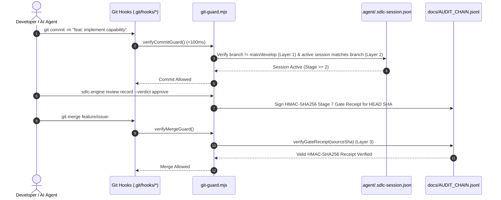

# 🏗️ System Architecture & Concentric Ring Design

This document provides the deep architectural explanation of the **Agentic SDLC Framework**, detailing how `.agent/scripts/sdlc-engine.mjs` and its **16 modular domain libraries** (`.agent/scripts/lib/*.mjs`) are organized into **[Archlens](https://github.com/fmatar/archlens) Concentric Clean Architecture Rings** (`.archlens/policy.json`), how the **4-Layer Git Lockdown** and **SHA-256 Gate Cache** operate, and how causal lineage flows from `PRODUCT.md` to `docs/DECISION_MAP.md`.

> For the auto-generated AST symbol inventory and line-number mapping across all 17 modules, see **[Codebase-Map.md](Codebase-Map.md)**.

---

## 1. Archlens Concentric Clean Architecture Rings

In accordance with Robert C. Martin's **Clean Architecture**, [Archlens](https://github.com/fmatar/archlens) (`.archlens/policy.json`), and `ADR-002`, the engine is partitioned into four concentric rings (`domain-core` ← `governance-models` ← `adapters-orchestrators` ← `cli-entrypoints`) where all source code dependencies point strictly inward toward **Ring 0**:

```mermaid
flowchart TD
    classDef r0 fill:#fef3c7,stroke:#b45309,stroke-width:2px,color:#78350f
    classDef r1 fill:#eff6ff,stroke:#1d4ed8,stroke-width:2px,color:#1e3a8a
    classDef r2 fill:#f3e8ff,stroke:#6d28d9,stroke-width:2px,color:#4c1d95
    classDef r3 fill:#dcfce7,stroke:#15803d,stroke-width:2px,color:#14532d

    subgraph Ring3 ["Ring 3: cli-entrypoints"]
      CLI["sdlc-engine.mjs (Universal CLI Router & Barrel Export)"]:::r3
      SKILLS[".agent/skills/*/SKILL.md (11 Canonical Skills)"]:::r3
    end

    subgraph Ring2 ["Ring 2: adapters-orchestrators"]
      ARCH["arch-trace.mjs (Archlens Ring Diff & Mermaid AST)"]:::r2
      INST["installer.mjs (6-Agent Provisioner & Skill Pruner)"]:::r2
      WIKI["wiki-sync.mjs (AST-to-Wiki Mapper & Zero-Rot Auditor)"]:::r2
      WB["workbench-server.mjs (Loopback Clearinghouse UI :4120)"]:::r2
      GATE["quality-gate.mjs (Triage, Coverage/Mutation & SkillSpector)"]:::r2
      SESS["session.mjs (Session Registry, Lanes & Composite Stages)"]:::r2
    end

    subgraph Ring1 ["Ring 1: governance-models"]
      PM["pm-provider.mjs (GitHub, Linear, Jira & Templates)"]:::r1
      ADR["adr-drift.mjs (ADR Lifecycle, SRS Compaction & Drift Sentinel)"]:::r1
      DAG["product-dag.mjs (PRODUCT.md, PRD/SRS & Topological Waves)"]:::r1
      DOSS["dossier.mjs (AST Signature Extractor & Context Dossiers)"]:::r1
      README["readme-sync.mjs (10-30-90 README Scaffold & Auditor)"]:::r1
      GUARD["git-guard.mjs (4-Layer Git Guard & SHA-256 Hook Templates)"]:::r1
    end

    subgraph Ring0 ["Ring 0: domain-core"]
      CORE["core.mjs (Shell-Free Exec, Safe I/O & Git Diff Probes)"]:::r0
      CACHE["cache.mjs (Content-Addressable SHA-256 Gate Cache)"]:::r0
      AUDIT["audit-chain.mjs (Merkle Hash-Chained Ledger & HMAC Receipts)"]:::r0
      DG["decision-graph.mjs (Causal Lineage & DECISION_MAP.md)"]:::r0
    end

    SKILLS --> CLI
    CLI --> ARCH & INST & WIKI & WB & GATE & SESS
    CLI --> PM & ADR & DAG & DOSS & README & GUARD
    ARCH & INST & WIKI & WB & GATE & SESS --> PM & ADR & DAG & DOSS & README & GUARD
    PM & ADR & DAG & DOSS & README & GUARD --> CORE & CACHE & AUDIT & DG
```



### Concentric Ring Responsibilities (`.archlens/policy.json`)

| Ring (`policy.json` Layer) | Module Path | Core Architectural Responsibility | Key Exported Primitives |
| :--- | :--- | :--- | :--- |
| **Ring 0 (`domain-core`)** | `.agent/scripts/lib/core.mjs` | Shell-free `execFileSync` execution (`parseCommandArgv`), safe I/O, async worker pool, YAML frontmatter parser, and Git diff helpers. | `fileExists`, `readFileSafe`, `runConfiguredCommand`, `gitDiffForFile`, `parseFrontmatter`, `inspectArchlens` |
| **Ring 0 (`domain-core`)** | `.agent/scripts/lib/cache.mjs` | Content-addressable SHA-256 workspace tree hashing and gate cache (`coverage`, `mutation`, `gate`). | `computeTreeHash`, `getGateCacheHit`, `recordGateCache`, `getGateCacheStats`, `clearGateCache` |
| **Ring 0 (`domain-core`)** | `.agent/scripts/lib/audit-chain.mjs` | Immutable SHA-256 hash-chained ledger (`docs/AUDIT_CHAIN.jsonl`) and lane-aware HMAC-SHA256 Stage 7 Gate Receipts. | `calculateRecordHash`, `appendAuditRecord`, `verifyAuditChain`, `issueGateReceipt`, `verifyGateReceipt` |
| **Ring 0 (`domain-core`)** | `.agent/scripts/lib/decision-graph.mjs` | Builds the causal graph (`INV-XX`, `CAP-XX`, `SPEC-XX`, `ADR-00X`, tickets) and renders `docs/DECISION_MAP.md`. | `appendDecisionEvent`, `buildDecisionGraph`, `syncDecisionMapMarkdown` |
| **Ring 1 (`governance-models`)** | `.agent/scripts/lib/pm-provider.mjs` | Unified 4-operation ticket adapter across **GitHub Issues**, **Linear GraphQL**, **Jira REST v3**, and `docs/KANBAN.md`. | `createTicket`, `transitionPMState`, `postPMComment`, `syncKanbanBoard`, `scaffoldIssueTemplates` |
| **Ring 1 (`governance-models`)** | `.agent/scripts/lib/adr-drift.mjs` | Manages monotonic ADR lifecycle (`docs/adr/ADR-*.md`), compacts ADRs into `docs/SRS.md`, detects structural spec/manifest drift, and audits contracts. | `createADR`, `listADRs`, `decideADR`, `compactADRs`, `checkSpecDrift`, `auditContractDrift` |
| **Ring 1 (`governance-models`)** | `.agent/scripts/lib/product-dag.mjs` | Parses/synthesizes `PRODUCT.md`, `docs/PRD.md`, IEEE 29148 `docs/SRS.md`, and Kahn's algorithm DAG waves. | `initProductConstitution`, `scaffoldCapabilitySpec`, `parseProductMarkdown`, `planProductDAG`, `deconstructEpic` |
| **Ring 1 (`governance-models`)** | `.agent/scripts/lib/dossier.mjs` | Extracts polyglot AST export signatures and compiles compact subagent context dossiers (`.agent/dossiers/`). | `extractExportSignatures`, `generateTicketDossier` |
| **Ring 1 (`governance-models`)** | `.agent/scripts/lib/readme-sync.mjs` | Scaffolds and audits 10–30–90 `README.md` landing pages (`docs/templates/README_TEMPLATE.md`) and `llms.txt`. | `detectReadmeArchetype`, `renderLlmsTxt`, `scaffoldReadme`, `auditReadme` |
| **Ring 1 (`governance-models`)** | `.agent/scripts/lib/git-guard.mjs` | Enforces the 4-Layer Git Lockdown (`pre-commit`, `pre-merge-commit`, `pre-push`), SHA-256 hook verification, and GitHub branch protection. | `verifyCommitGuard`, `verifyMergeGuard`, `verifyPushGuard`, `inspectHooksHealth`, `installHooks`, `applyBranchProtection` |
| **Ring 2 (`adapters-orchestrators`)** | `.agent/scripts/lib/arch-trace.mjs` | Enforces `.archlens/policy.json` ring rules on Git diffs, diffs Mermaid ASTs, and appends `docs/ARCH_TRACE.md`. | `checkArchDiff`, `parseMermaidDiagram`, `diffMermaidGraphs`, `recordArchTrace`, `scaffoldArchlensPolicy` |
| **Ring 2 (`adapters-orchestrators`)** | `.agent/scripts/lib/installer.mjs` | Provisions local/global skills, Claude Cowork `.zip` bundles, `.cursor/skills/`, and rules across 6 AI coding tools. | `installFramework`, `provisionAgentIntegrations`, `pruneDeprecatedSkills`, `runInstallerCLI` |
| **Ring 2 (`adapters-orchestrators`)** | `.agent/scripts/lib/wiki-sync.mjs` | Maps AST exports and [Archlens](https://github.com/fmatar/archlens) rings to `wiki/Codebase-Map.md` and audits `wiki/*.md` for drift or dead paths. | `inspectSourceModule`, `resolveArchlensRing`, `buildWikiCodeMap`, `auditWiki`, `syncWiki` |
| **Ring 2 (`adapters-orchestrators`)** | `.agent/scripts/lib/workbench-server.mjs` | Serves the authenticated loopback Clearinghouse Ledger UI (`http://127.0.0.1:4120`) and opt-in `.agent/workbench/index.html` snapshot. | `createWorkbenchServer`, `renderWorkbenchHTML`, `generateArchitectureWidget`, `buildArchDiffPayload` |
| **Ring 2 (`adapters-orchestrators`)** | `.agent/scripts/lib/quality-gate.mjs` | Deterministic 3-lane triage (`triageChange`), stack discovery, real coverage/mutation parsers, regression proofs, canary watchdog, and SkillSpector audit. | `triageChange`, `detectStackInDir`, `parseCoverageReport`, `parseMutationReport`, `runDoctor`, `auditSkills` |
| **Ring 2 (`adapters-orchestrators`)** | `.agent/scripts/lib/session.mjs` | Multi-session registry (`.agent/.sdlc-session.json`), automatic diff lane escalation, mutant exemptions, estimated stats, and Composite Stage CLI. | `startSession`, `updateSession`, `reconcileSessionLaneWithDiff`, `executeCompositeStage`, `calculateSessionStats` |
| **Ring 3 (`cli-entrypoints`)** | `.agent/scripts/sdlc-engine.mjs` | Universal CLI dispatcher and public ES module barrel export. | `runCLI`, `formatCLIResult`, `executeRelease` |

### Archlens Visual Workbench & MCP Companion

While `sdlc-engine.mjs` enforces `.archlens/policy.json` statically in `< 50 ms` on every Git diff (`archlens diff` / `gate --strict`), the companion **[Archlens Dynamic Clean Architecture Workbench](https://github.com/fmatar/archlens)** provides interactive visual exploration, fitness functions, and MCP refactoring dossiers:

```bash
# Install Archlens skills across your coding agents:
npx skills add fmatar/archlens

# Scaffold or update .archlens/policy.json and launch the visual workbench on http://localhost:8088:
npx @fmatar/archlens-skill@1.2.0 --path . --yes
npx @fmatar/archlens-skill@1.2.0 start --open
```

- **Bidirectional Mailbox IPC**: The visual canvas at `http://localhost:8088` dispatches `REGEN`, `APPLY_PROPOSAL`, and `REFRESH_CRAP` commands to `.archlens/to-agent.json` and hot-reloads upon receiving acknowledgments in `.archlens/to-viewer.json` (`AGENTS.md`).
- **MCP Server Integration**: Exposes `inspectArchitecture`, `exportLlmDossier`, `evaluateFitness`, `proposeScreamingMigration`, and `listSnapshots` directly to MCP-capable agents.

---

## 2. The 4-Layer Git Lockdown & Cryptographic Gate Receipts

To guarantee `INV-01` (*Zero direct commits, merges, or pushes to `main` or `develop`*) and `INV-02` (*Proportional session & Dual-Gate verification*), `.agent/scripts/lib/git-guard.mjs` and `.agent/scripts/lib/audit-chain.mjs` enforce four concentric defense layers:



1. **Layer 1 (`LAYER_1_PROTECTED_BRANCH`)**: Blocks direct commits on `main`, `master`, or `develop`.
2. **Layer 2 (`LAYER_2_SESSION_REQUIRED`)**: Blocks commits on feature branches unless `.agent/.sdlc-session.json` has an active ticket session bound to that branch (`< 100 ms` fast-path hook).
3. **Layer 3 (`MISSING_STAGE_7_GATE_RECEIPT`)**: Blocks merges into `main`/`develop` unless `docs/AUDIT_CHAIN.jsonl` contains a valid HMAC-SHA256 receipt matching the source branch `HEAD` SHA-256 digest and re-triaged risk lane.
4. **Layer 4 (`pre-push` & GitHub Branch Protection)**: Blocks direct pushes to protected branches and enforces `.github/workflows/sdlc-quality-gate.yml` on GitHub (`enforce_admins: true`).

---

## 3. Causal Decision Graph & Spec-Drift Sentinel

Every architectural evolution in the repository is tracked as a directed acyclic graph (`docs/DECISION_MAP.md` and `.agent/decision-graph.jsonl`) managed by `.agent/scripts/lib/decision-graph.mjs` and `.agent/scripts/lib/adr-drift.mjs`:

- **Constitutional Nodes**: Hard Invariants (`INV-01..INV-04`) and Product Capabilities (`CAP-01..CAP-11`) in `PRODUCT.md`.
- **Specification Nodes**: Two-tier PRD (`docs/PRD.md`), IEEE 29148 SRS (`docs/SRS.md`), and per-capability specs (`docs/specs/cap-*.md`).
- **Precision Spec-Drift Detection (`checkSpecDrift`)**: Flags `UNDECLARED_SPEC_DRIFT` whenever `PRODUCT.md`, `docs/specs/*.md`, `docs/PRD.md`, `docs/SRS.md`, `.archlens/policy.json`, OpenAPI/GraphQL/Protobuf schemas, or structural dependency keys in `package.json` (`dependencies`, `peerDependencies`, `bin`, `exports`) change without a linked `ADR-00X` (while exempting routine `"version"` or `"scripts"` edits per `ADR-004`).
- **Two-Speed ADR Governance & Release Compaction (`createADR`, `decideADR`, `compactADRs`)**:
  - `scope: 'technical'` ADRs auto-accept and patch `PRODUCT.md` immediately; `scope: 'product'` or `'contract'` ADRs await human approval.
  - On release (`sdlc-release`), `compactADRs` consolidates in-flight `docs/adr/ADR-*.md` files into `docs/SRS.md` (`## Compacted Architectural Decisions`) while preserving all prior release rows, and `createADR` advances ADR numbering monotonically past compacted IDs.

---

## 4. Mission Control Clearinghouse Ledger UI (`workbench-server.mjs`)

Running `node .agent/scripts/sdlc-engine.mjs serve --port 4120` (or `/sdlc serve` / `/sdlc ui`) launches a zero-dependency, token-authenticated loopback HTTP server (`127.0.0.1` only) or generates an opt-in static snapshot (`.agent/workbench/index.html`):

- **Security Model**: Binds exclusively to `127.0.0.1`, generates a 192-bit random bearer token per run, and enforces strict same-origin `Origin`/`Host` validation.
- **Live Bidirectional Endpoints**:
  - `GET /api/state`: Full session status, 8-stage progress, estimated telemetry, [Archlens](https://github.com/fmatar/archlens) ring diff, and audit trail.
  - `GET /api/decision-graph` & `GET /api/product`: Live causal lineage graph and `PRODUCT.md` capabilities.
  - `POST /api/adr/decide`: Approve or reject pending ADRs directly from the browser.
  - `POST /api/dag/control`: Pause, resume, or trigger topological DAG execution waves.
