# 🗺️ Codebase-to-Wiki Traceability & Archlens Ring Map

> **Deterministic AST & Clean Architecture Inventory**  
> Generated and verified by `node .agent/scripts/sdlc-engine.mjs wiki sync` (`sdlc-wiki`) and governed by [Archlens](https://github.com/fmatar/archlens) (`.archlens/policy.json`).  
> Every module, exported symbol, concentric ring boundary, skill, capability (`CAP-XX`), and decision record (`ADR-00X`) is mapped below.

---

## 1. Archlens Concentric Ring Dependency Graph

In accordance with Concentric **Clean Architecture** and [Archlens](https://github.com/fmatar/archlens) (`.archlens/policy.json`), dependencies point strictly inward toward **Ring 0: domain-core**.

- **Afferent Coupling ($Ca$)**: Number of modules that depend on this module (inward stability).
- **Efferent Coupling ($Ce$)**: Number of modules this module depends on (outward fan-out).
- **Instability ($I = \frac{Ce}{Ca + Ce}$)**: `0.00` indicates a maximally stable core module; `1.00` indicates a pure outer entrypoint/adapter.

```mermaid
flowchart TD
  subgraph Ring0 ["Ring 0: domain-core"]
    M__agent_scripts_lib_audit_chain_mjs["audit-chain.mjs (12 exports, I=0.13)"]
    M__agent_scripts_lib_cache_mjs["cache.mjs (6 exports, I=0.5)"]
    M__agent_scripts_lib_core_mjs["core.mjs (32 exports, I=0)"]
    M__agent_scripts_lib_decision_graph_mjs["decision-graph.mjs (7 exports, I=0.17)"]
  end
  subgraph Ring1 ["Ring 1: governance-models"]
    M__agent_scripts_lib_adr_drift_mjs["adr-drift.mjs (5 exports, I=0.3)"]
    M__agent_scripts_lib_dossier_mjs["dossier.mjs (2 exports, I=0.75)"]
    M__agent_scripts_lib_git_guard_mjs["git-guard.mjs (8 exports, I=0.5)"]
    M__agent_scripts_lib_pm_provider_mjs["pm-provider.mjs (16 exports, I=0.17)"]
    M__agent_scripts_lib_product_dag_mjs["product-dag.mjs (8 exports, I=0.44)"]
    M__agent_scripts_lib_readme_sync_mjs["readme-sync.mjs (9 exports, I=0.67)"]
  end
  subgraph Ring2 ["Ring 2: adapters-orchestrators"]
    M__agent_scripts_lib_arch_trace_mjs["arch-trace.mjs (5 exports, I=0.25)"]
    M__agent_scripts_lib_installer_mjs["installer.mjs (26 exports, I=0.57)"]
    M__agent_scripts_lib_quality_gate_mjs["quality-gate.mjs (30 exports, I=0.8)"]
    M__agent_scripts_lib_session_mjs["session.mjs (16 exports, I=0.69)"]
    M__agent_scripts_lib_wiki_sync_mjs["wiki-sync.mjs (6 exports, I=0.71)"]
    M__agent_scripts_lib_workbench_server_mjs["workbench-server.mjs (7 exports, I=0.78)"]
  end
  subgraph Ring3 ["Ring 3: cli-entrypoints"]
    M__agent_scripts_sdlc_engine_mjs["sdlc-engine.mjs (4 exports, I=1)"]
  end
  M__agent_scripts_sdlc_engine_mjs --> M__agent_scripts_lib_core_mjs
  M__agent_scripts_sdlc_engine_mjs --> M__agent_scripts_lib_cache_mjs
  M__agent_scripts_sdlc_engine_mjs --> M__agent_scripts_lib_audit_chain_mjs
  M__agent_scripts_sdlc_engine_mjs --> M__agent_scripts_lib_decision_graph_mjs
  M__agent_scripts_sdlc_engine_mjs --> M__agent_scripts_lib_product_dag_mjs
  M__agent_scripts_sdlc_engine_mjs --> M__agent_scripts_lib_adr_drift_mjs
  M__agent_scripts_sdlc_engine_mjs --> M__agent_scripts_lib_dossier_mjs
  M__agent_scripts_sdlc_engine_mjs --> M__agent_scripts_lib_git_guard_mjs
  M__agent_scripts_sdlc_engine_mjs --> M__agent_scripts_lib_pm_provider_mjs
  M__agent_scripts_sdlc_engine_mjs --> M__agent_scripts_lib_installer_mjs
  M__agent_scripts_sdlc_engine_mjs --> M__agent_scripts_lib_session_mjs
  M__agent_scripts_sdlc_engine_mjs --> M__agent_scripts_lib_arch_trace_mjs
  M__agent_scripts_sdlc_engine_mjs --> M__agent_scripts_lib_quality_gate_mjs
  M__agent_scripts_sdlc_engine_mjs --> M__agent_scripts_lib_workbench_server_mjs
  M__agent_scripts_sdlc_engine_mjs --> M__agent_scripts_lib_wiki_sync_mjs
  M__agent_scripts_sdlc_engine_mjs --> M__agent_scripts_lib_readme_sync_mjs
  M__agent_scripts_lib_adr_drift_mjs --> M__agent_scripts_lib_core_mjs
  M__agent_scripts_lib_adr_drift_mjs --> M__agent_scripts_lib_decision_graph_mjs
  M__agent_scripts_lib_adr_drift_mjs --> M__agent_scripts_lib_audit_chain_mjs
  M__agent_scripts_lib_arch_trace_mjs --> M__agent_scripts_lib_core_mjs
  M__agent_scripts_lib_arch_trace_mjs --> M__agent_scripts_lib_session_mjs
  M__agent_scripts_lib_audit_chain_mjs --> M__agent_scripts_lib_core_mjs
  M__agent_scripts_lib_cache_mjs --> M__agent_scripts_lib_core_mjs
  M__agent_scripts_lib_decision_graph_mjs --> M__agent_scripts_lib_core_mjs
  M__agent_scripts_lib_dossier_mjs --> M__agent_scripts_lib_core_mjs
  M__agent_scripts_lib_dossier_mjs --> M__agent_scripts_lib_product_dag_mjs
  M__agent_scripts_lib_dossier_mjs --> M__agent_scripts_lib_adr_drift_mjs
  M__agent_scripts_lib_git_guard_mjs --> M__agent_scripts_lib_core_mjs
  M__agent_scripts_lib_git_guard_mjs --> M__agent_scripts_lib_audit_chain_mjs
  M__agent_scripts_lib_git_guard_mjs --> M__agent_scripts_lib_adr_drift_mjs
  M__agent_scripts_lib_installer_mjs --> M__agent_scripts_lib_core_mjs
  M__agent_scripts_lib_installer_mjs --> M__agent_scripts_lib_arch_trace_mjs
  M__agent_scripts_lib_installer_mjs --> M__agent_scripts_lib_git_guard_mjs
  M__agent_scripts_lib_installer_mjs --> M__agent_scripts_lib_pm_provider_mjs
  M__agent_scripts_lib_pm_provider_mjs --> M__agent_scripts_lib_core_mjs
  M__agent_scripts_lib_product_dag_mjs --> M__agent_scripts_lib_core_mjs
  M__agent_scripts_lib_product_dag_mjs --> M__agent_scripts_lib_pm_provider_mjs
  M__agent_scripts_lib_product_dag_mjs --> M__agent_scripts_lib_decision_graph_mjs
  M__agent_scripts_lib_product_dag_mjs --> M__agent_scripts_lib_audit_chain_mjs
  M__agent_scripts_lib_quality_gate_mjs --> M__agent_scripts_lib_core_mjs
  M__agent_scripts_lib_quality_gate_mjs --> M__agent_scripts_lib_session_mjs
  M__agent_scripts_lib_quality_gate_mjs --> M__agent_scripts_lib_pm_provider_mjs
  M__agent_scripts_lib_quality_gate_mjs --> M__agent_scripts_lib_audit_chain_mjs
  M__agent_scripts_lib_quality_gate_mjs --> M__agent_scripts_lib_adr_drift_mjs
  M__agent_scripts_lib_quality_gate_mjs --> M__agent_scripts_lib_git_guard_mjs
  M__agent_scripts_lib_quality_gate_mjs --> M__agent_scripts_lib_arch_trace_mjs
  M__agent_scripts_lib_quality_gate_mjs --> M__agent_scripts_lib_installer_mjs
  M__agent_scripts_lib_readme_sync_mjs --> M__agent_scripts_lib_core_mjs
  M__agent_scripts_lib_readme_sync_mjs --> M__agent_scripts_lib_product_dag_mjs
  M__agent_scripts_lib_session_mjs --> M__agent_scripts_lib_core_mjs
  M__agent_scripts_lib_session_mjs --> M__agent_scripts_lib_pm_provider_mjs
  M__agent_scripts_lib_session_mjs --> M__agent_scripts_lib_adr_drift_mjs
  M__agent_scripts_lib_session_mjs --> M__agent_scripts_lib_decision_graph_mjs
  M__agent_scripts_lib_session_mjs --> M__agent_scripts_lib_arch_trace_mjs
  M__agent_scripts_lib_session_mjs --> M__agent_scripts_lib_audit_chain_mjs
  M__agent_scripts_lib_session_mjs --> M__agent_scripts_lib_quality_gate_mjs
  M__agent_scripts_lib_session_mjs --> M__agent_scripts_lib_workbench_server_mjs
  M__agent_scripts_lib_session_mjs --> M__agent_scripts_lib_wiki_sync_mjs
  M__agent_scripts_lib_wiki_sync_mjs --> M__agent_scripts_lib_core_mjs
  M__agent_scripts_lib_wiki_sync_mjs --> M__agent_scripts_lib_product_dag_mjs
  M__agent_scripts_lib_wiki_sync_mjs --> M__agent_scripts_lib_adr_drift_mjs
  M__agent_scripts_lib_wiki_sync_mjs --> M__agent_scripts_lib_arch_trace_mjs
  M__agent_scripts_lib_wiki_sync_mjs --> M__agent_scripts_lib_installer_mjs
  M__agent_scripts_lib_workbench_server_mjs --> M__agent_scripts_lib_core_mjs
  M__agent_scripts_lib_workbench_server_mjs --> M__agent_scripts_lib_session_mjs
  M__agent_scripts_lib_workbench_server_mjs --> M__agent_scripts_lib_decision_graph_mjs
  M__agent_scripts_lib_workbench_server_mjs --> M__agent_scripts_lib_product_dag_mjs
  M__agent_scripts_lib_workbench_server_mjs --> M__agent_scripts_lib_adr_drift_mjs
  M__agent_scripts_lib_workbench_server_mjs --> M__agent_scripts_lib_audit_chain_mjs
  M__agent_scripts_lib_workbench_server_mjs --> M__agent_scripts_lib_arch_trace_mjs
```



---

## 2. Source Modules by Concentric Ring

### 🏛️ Ring 0: domain-core

| Source Module | Lines | $Ca$ / $Ce$ | Instability ($I$) | Exported AST Symbols (Line #) | Wiki Coverage |
| :--- | :--- | :--- | :--- | :--- | :--- |
| `.agent/scripts/lib/audit-chain.mjs` | 495 | 7 / 1 | `0.13` | `AUDIT_LEDGER_FILE` (L7), `GENESIS_HASH` (L8), `calculateRecordHash` (L10), `appendAuditRecord` (L53), `verifyAuditChain` (L99), `RECEIPT_KEY_FILE` (L191), `loadReceiptKey` (L199), `signReceiptPayload` (L241) +4 more | `wiki/Architecture.md`, `wiki/Codebase-Map.md`, `wiki/Skills-Reference.md`, `wiki/Traceability.md` |
| `.agent/scripts/lib/cache.mjs` | 171 | 1 / 1 | `0.5` | `getGateCachePath` (L9), `computeTreeHash` (L18), `getGateCacheHit` (L105), `recordGateCache` (L119), `getGateCacheStats` (L152), `clearGateCache` (L162) | `wiki/Architecture.md`, `wiki/Codebase-Map.md`, `wiki/Skills-Reference.md` |
| `.agent/scripts/lib/core.mjs` | 808 | 16 / 0 | `0` | `loadEnv` (L10), `fileExists` (L40), `readFileSafe` (L48), `normalizeTicketId` (L56), `parseTicketId` (L63), `resolveInsideRepo` (L69), `writeFileAtomic` (L84), `loadConfig` (L99) +24 more | `wiki/Architecture.md`, `wiki/Codebase-Map.md` |
| `.agent/scripts/lib/decision-graph.mjs` | 449 | 5 / 1 | `0.17` | `DECISION_GRAPH_FILE` (L5), `DECISION_MAP_MD` (L6), `parseProductMarkdown` (L8), `listADRs` (L82), `appendDecisionEvent` (L122), `buildDecisionGraph` (L153), `syncDecisionMapMarkdown` (L374) | `wiki/Architecture.md`, `wiki/Codebase-Map.md`, `wiki/Skills-Reference.md`, `wiki/Traceability.md` |

### 🏛️ Ring 1: governance-models

| Source Module | Lines | $Ca$ / $Ce$ | Instability ($I$) | Exported AST Symbols (Line #) | Wiki Coverage |
| :--- | :--- | :--- | :--- | :--- | :--- |
| `.agent/scripts/lib/adr-drift.mjs` | 853 | 7 / 3 | `0.3` | `createADR` (L86), `decideADR` (L206), `compactADRs` (L291), `checkSpecDrift` (L536), `auditContractDrift` (L730) | `wiki/Architecture.md`, `wiki/Codebase-Map.md`, `wiki/Skills-Reference.md`, `wiki/Traceability.md` |
| `.agent/scripts/lib/dossier.mjs` | 130 | 1 / 3 | `0.75` | `extractExportSignatures` (L7), `generateTicketDossier` (L23) | `wiki/Architecture.md`, `wiki/Codebase-Map.md`, `wiki/Skills-Reference.md` |
| `.agent/scripts/lib/git-guard.mjs` | 419 | 3 / 3 | `0.5` | `verifyCommitGuard` (L24), `verifyMergeGuard` (L82), `verifyPushGuard` (L157), `buildHookTemplates` (L191), `inspectHooksHealth` (L259), `installHooks` (L305), `DEFAULT_QUALITY_GATE_CHECK` (L340), `applyBranchProtection` (L346) | `wiki/Architecture.md`, `wiki/Codebase-Map.md`, `wiki/Skills-Reference.md`, `wiki/Traceability.md` |
| `.agent/scripts/lib/pm-provider.mjs` | 1540 | 5 / 1 | `0.17` | `CANONICAL_ISSUE_TEMPLATES` (L90), `scaffoldIssueTemplates` (L192), `loadIssueTemplate` (L214), `formatTemplatedIssue` (L268), `updateLocalKanbanState` (L345), `transitionPMState` (L433), `createTicket` (L755), `resolveOpenPRNumber` (L968) +8 more | `wiki/Architecture.md`, `wiki/Codebase-Map.md`, `wiki/Skills-Reference.md`, `wiki/Traceability.md` |
| `.agent/scripts/lib/product-dag.mjs` | 815 | 5 / 4 | `0.44` | `renderCapabilitySpecMarkdown` (L32), `renderProductPrdMarkdown` (L85), `renderProductSrsMarkdown` (L136), `initProductConstitution` (L213), `scaffoldCapabilitySpec` (L416), `planProductDAG` (L596), `controlProductDAG` (L675), `deconstructEpic` (L729) | `wiki/Architecture.md`, `wiki/Codebase-Map.md`, `wiki/Skills-Reference.md`, `wiki/Traceability.md` |
| `.agent/scripts/lib/readme-sync.mjs` | 911 | 1 / 2 | `0.67` | `escapeXml` (L105), `slugifyHeadingAnchor` (L114), `detectReadmeArchetype` (L137), `stripArchetypeBlocks` (L182), `renderThemeWordmarkSvg` (L199), `renderVhsDemoTape` (L223), `renderLlmsTxt` (L249), `scaffoldReadme` (L446) +1 more | `wiki/Architecture.md`, `wiki/Codebase-Map.md`, `wiki/Skills-Reference.md`, `wiki/Traceability.md` |

### 🏛️ Ring 2: adapters-orchestrators

| Source Module | Lines | $Ca$ / $Ce$ | Instability ($I$) | Exported AST Symbols (Line #) | Wiki Coverage |
| :--- | :--- | :--- | :--- | :--- | :--- |
| `.agent/scripts/lib/arch-trace.mjs` | 492 | 6 / 2 | `0.25` | `checkArchDiff` (L16), `parseMermaidDiagram` (L191), `diffMermaidGraphs` (L268), `recordArchTrace` (L292), `scaffoldArchlensPolicy` (L431) | `wiki/Architecture.md`, `wiki/Codebase-Map.md`, `wiki/Skills-Reference.md`, `wiki/Traceability.md` |
| `.agent/scripts/lib/installer.mjs` | 1513 | 3 / 4 | `0.57` | `DEPRECATED_SDLC_SKILLS` (L10), `CANONICAL_SDLC_SKILLS` (L27), `ARCHLENS_SKILL_PACKAGE` (L40), `DEFAULT_GITIGNORE_ENTRIES` (L42), `upsertGitignore` (L52), `pinArchlensMcpConfigs` (L66), `SUPPORTED_AGENTS` (L82), `getFrameworkVersion` (L150) +18 more | `wiki/Architecture.md`, `wiki/Codebase-Map.md`, `wiki/Skills-Reference.md` |
| `.agent/scripts/lib/quality-gate.mjs` | 2982 | 2 / 8 | `0.8` | `validateConfigFile` (L34), `runDoctor` (L216), `generateRegressionProof` (L342), `monitorCanaryHealthAndWatchdog` (L526), `installCIWorkflow` (L639), `exportAgentRules` (L1066), `scaffoldReproductionTest` (L1083), `assessRisk` (L1209) +22 more | `wiki/Architecture.md`, `wiki/Codebase-Map.md`, `wiki/Skills-Reference.md` |
| `.agent/scripts/lib/session.mjs` | 918 | 4 / 9 | `0.69` | `getSessionPath` (L26), `getSessionStatus` (L30), `startSession` (L47), `updateSession` (L130), `switchSession` (L215), `listSessions` (L238), `renderDashboard` (L262), `resumeSession` (L299) +8 more | `wiki/Architecture.md`, `wiki/Codebase-Map.md`, `wiki/Home.md`, `wiki/Skills-Reference.md` |
| `.agent/scripts/lib/wiki-sync.mjs` | 801 | 2 / 5 | `0.71` | `inspectSourceModule` (L97), `resolveArchlensRing` (L149), `buildWikiCodeMap` (L183), `auditWiki` (L371), `renderCodebaseMapMarkdown` (L571), `syncWiki` (L729) | `wiki/Architecture.md`, `wiki/Codebase-Map.md`, `wiki/Skills-Reference.md`, `wiki/Traceability.md` |
| `.agent/scripts/lib/workbench-server.mjs` | 2749 | 2 / 7 | `0.78` | `parseKanbanMarkdown` (L94), `parseArchTraceMarkdown` (L175), `buildArchDiffPayload` (L209), `generateArchitectureWidget` (L286), `renderWorkbenchHTML` (L901), `ensureWorkbenchRunning` (L2491), `createWorkbenchServer` (L2529) | `wiki/Architecture.md`, `wiki/Codebase-Map.md` |

### 🏛️ Ring 3: cli-entrypoints

| Source Module | Lines | $Ca$ / $Ce$ | Instability ($I$) | Exported AST Symbols (Line #) | Wiki Coverage |
| :--- | :--- | :--- | :--- | :--- | :--- |
| `.agent/scripts/sdlc-engine.mjs` | 2864 | 0 / 16 | `1` | `executeRelease` (L439), `runCLI` (L720), `formatCLIResult` (L2577), `cliExitCode` (L2841) | `wiki/Architecture.md`, `wiki/Codebase-Map.md`, `wiki/Home.md`, `wiki/Skills-Reference.md`, `wiki/Traceability.md` |


---

## 3. Canonical SDLC Skills (`.agent/skills/`)

| Skill Name | Skill Definition Path | Purpose & Trigger | Documented In |
| :--- | :--- | :--- | :--- |
| `sdlc` | `.agent/skills/sdlc/SKILL.md` | Use when running an explicit /sdlc {{args}} command in chat. Not for multi-stage autonomous delivery (use sdlc-flow). Routes 1:1 to sdlc-engine.mjs. | `wiki/Architecture.md`, `wiki/Codebase-Map.md`, `wiki/Home.md`, `wiki/Skills-Reference.md`, `wiki/Traceability.md`, `wiki/_Sidebar.md` |
| `sdlc-adr` | `.agent/skills/sdlc-adr/SKILL.md` | Use when changing PRODUCT.md, docs/specs/, dependencies, schemas, or API contracts, or when drift check fails. Not for routine code edits without spec or dependency drift. | `wiki/Codebase-Map.md`, `wiki/Home.md`, `wiki/Skills-Reference.md` |
| `sdlc-doctor` | `.agent/skills/sdlc-doctor/SKILL.md` | Use when onboarding a repo, diagnosing hook or session errors, or installing SDLC skills across AI agents. Not for feature coding. Runs detect, doctor, and install. | `wiki/Codebase-Map.md`, `wiki/Home.md`, `wiki/Skills-Reference.md` |
| `sdlc-flow` | `.agent/skills/sdlc-flow/SKILL.md` | Use when implementing a feature, bug fix, or hotfix end-to-end across branches and PRs. Not for read-only questions or status checks. Drives proportional SDLC lanes. | `wiki/Codebase-Map.md`, `wiki/Home.md`, `wiki/Skills-Reference.md` |
| `sdlc-gate` | `.agent/skills/sdlc-gate/SKILL.md` | Use when reviewing a branch or PR, running strict quality gates, or signing a Stage 7 receipt. Not for writing feature code. Runs review plan, gate, and review record. | `wiki/Codebase-Map.md`, `wiki/Home.md`, `wiki/Skills-Reference.md` |
| `sdlc-product` | `.agent/skills/sdlc-product/SKILL.md` | Use when bootstrapping PRODUCT.md from a raw spec, authoring CAP-XX specs, or planning DAG ticket waves. Not for implementing a single existing ticket (use sdlc-flow). | `wiki/Codebase-Map.md`, `wiki/Home.md`, `wiki/Skills-Reference.md` |
| `sdlc-release` | `.agent/skills/sdlc-release/SKILL.md` | Use when cutting a SemVer release, compacting ADRs, generating regression proofs, or running canary health checks. Not for routine per-ticket feature commits. | `wiki/Architecture.md`, `wiki/Codebase-Map.md`, `wiki/Home.md`, `wiki/Skills-Reference.md` |
| `sdlc-status` | `.agent/skills/sdlc-status/SKILL.md` | Use when inspecting the active SDLC session, 8-stage progress, spec drift, or audit chain health. Not for modifying code, sessions, or artifacts (strictly read-only). | `wiki/Codebase-Map.md`, `wiki/Home.md`, `wiki/Skills-Reference.md` |
| `sdlc-tdd` | `.agent/skills/sdlc-tdd/SKILL.md` | Use when writing tests, reproducing bugs, or checking coverage and mutation gates. Not for pure prose edits. Enforces Red-Green-Refactor TDD using sdlc-config.json bars. | `wiki/Codebase-Map.md`, `wiki/Home.md`, `wiki/Skills-Reference.md` |
| `sdlc-wiki` | `.agent/skills/sdlc-wiki/SKILL.md` | Use when scaffolding or auditing README.md, llms.txt, or wiki/*.md architecture docs. Not for routine code changes with no public API, CLI, or architecture impact. | `wiki/Codebase-Map.md`, `wiki/Home.md`, `wiki/Skills-Reference.md`, `wiki/Traceability.md`, `wiki/_Sidebar.md` |

---

## 4. Product Capabilities (`PRODUCT.md`)

| Capability ID | Title | Functional Spec | Status | Depends On |
| :--- | :--- | :--- | :--- | :--- |
| **CAP-01** | Composite Stage CLI & Session Hygiene (#68) | `docs/specs/cap-01-composite-stage-session.md` | `AMENDED (ADR-015)` | None |
| **CAP-02** | Shell Injection Remediation & Polyglot Test Runners (#69) | `docs/specs/cap-02-security-polyglot-runners.md` | `AMENDED (ADR-006)` | None |
| **CAP-03** | Real Coverage/Mutation Parsers & Policy ArchDiff (#70) | `docs/specs/cap-03-real-dual-gate-archdiff.md` | `AMENDED (ADR-013)` | CAP-01, CAP-02 |
| **CAP-04** | Live Canary Watchdog, Real Proofs & Polyglot Reproduce (#71) | `docs/specs/cap-04-live-probes-reproduce.md` | `AMENDED (ADR-015)` | CAP-02 |
| **CAP-05** | Consolidate 14 Skills into 6 Schema-Valid Core Skills (#72) | `docs/specs/cap-05-skill-consolidation.md` | `AMENDED (ADR-011)` | CAP-03, CAP-04 |
| **CAP-06** | Dogfooding Configuration, Docs Sync & Full Test Suite (#73) | `docs/specs/cap-06-dogfood-docs-tests.md` | `AMENDED (ADR-014)` | CAP-05 |
| **CAP-07** | Native `npx` Multi-Agent Interactive Installer & Legacy Installer Removal (#75) | `docs/specs/cap-07-npx-multi-agent-installer.md` | `AMENDED (ADR-011)` | CAP-06 |
| **CAP-08** | `/sdlc` Universal Command Router & 9 Verb-Driven Skills (#81) | `docs/specs/cap-08-command-verb-skills-router.md` | `AMENDED (ADR-011)` | CAP-05, CAP-07 |
| **CAP-09** | Two-Tier PRD & IEEE 29148 SRS Specification Engine (#84) | `docs/specs/cap-09-prd-srs-specification-engine.md` | `AMENDED (ADR-006)` | CAP-05, CAP-08 |
| **CAP-10** | Unified Multi-Provider Ticket Engine & Issue Templates (#86) | `docs/specs/cap-10-unified-multi-provider-ticket-engine-issue-templ.md` | `AMENDED (ADR-006)` | CAP-02, CAP-09 |
| **CAP-11** | Technical Writer Skill (`sdlc-wiki`) & Archlens AST-to-Wiki Sync (#90) | `docs/specs/cap-11-technical-writer-archlens-wiki-sync.md` | `AMENDED (ADR-010)` | CAP-03, CAP-05, CAP-08 |

---

## 5. Architecture Decision Records (`docs/adr/`)

| ADR ID | Decision Title | Scope | Status | Amends / Supersedes |
| :--- | :--- | :--- | :--- | :--- |
| **ADR-009** | Align README, Wiki, PRD and SRS Documentation with v0.4.0 Architecture and Archlens Links | `technical` | `accepted` | CAP-06, CAP-11 |
| **ADR-010** | Standardize on 10 Canonical SDLC Skills, Neutralize Engineering Terminology, and Compact README Workflow Diagram | `technical` | `accepted` | CAP-05, CAP-07, CAP-08, CAP-11 |
| **ADR-011** | Strict sdlc Namespace Isolation and Decoupling from Standalone Coding-Persona Skills | `technical` | `accepted` | CAP-05, CAP-07, CAP-08, ADR-010 |
| **ADR-012** | Reset Package, Plugin, and Documentation Version Baseline to 0.0.1 | `technical` | `accepted` | CAP-06, ADR-009 |
| **ADR-013** | Harden Release Gate, Opt-In Issue Creation, Universal ADR Approval, Diff Review Plans, and Node 24 CI Actions | `technical` | `accepted` | CAP-01, CAP-03, CAP-06 |
| **ADR-014** | Canonical Git Flow: Enforce Merges to Develop, Block Direct PRs to Main, and Automate Production Releases on Develop Merge | `technical` | `accepted` | CAP-01, CAP-04, CAP-06 |
| **ADR-015** | Harden Stage 7 Gate Receipts, Ring 0 Primitives, and Git Flow Verification | `technical` | `accepted` | CAP-01, CAP-04 |

---

## 6. Verification & Zero-Rot Commands

```bash
# 1. Rebuild AST-to-Wiki Codebase Map and synchronize tables
node .agent/scripts/sdlc-engine.mjs wiki sync

# 2. Audit all wiki/*.md files for broken paths, deprecated skills, or unmapped modules
node .agent/scripts/sdlc-engine.mjs wiki audit --strict

# 3. Inspect JSON Codebase Map & Archlens Ring Instability Metrics
node .agent/scripts/sdlc-engine.mjs wiki map
```
