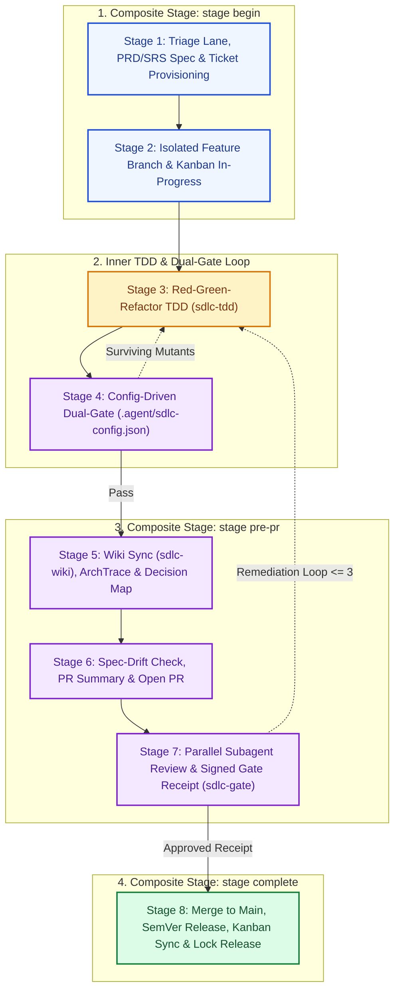

# 🏛️ Welcome to the Agentic SDLC Framework Wiki

**Risk-Proportional Software Development Lifecycle Governance, Spec-Driven Autopilot, [Archlens](https://github.com/fmatar/archlens) Concentric Ring Enforcement & Config-Driven Dual-Gate Verification for AI Coding Agents**

---

## 🌟 Executive Summary

The **Agentic SDLC Framework** transforms AI coding agents (**Google Antigravity / Gemini**, **Anthropic Claude Code**, **Cursor**, **Grok**, **Windsurf**, and **GitHub Copilot**) into disciplined, autonomous engineering systems. Governed by a deterministic Node.js engine (`.agent/scripts/sdlc-engine.mjs`) decomposed into **20 modular libraries** (`.agent/scripts/lib/*.mjs`) and **10 Canonical Skills — 1 Universal Router + 9 Verb Skills** (`ADR-010`), it enforces:

- **Spec-Driven Product Autopilot (`PRODUCT.md`)**: Synthesizes product vision, hard invariants (`INV-XX`), and functional capabilities (`CAP-XX`) into two-tier PRDs (`docs/PRD.md`), IEEE 29148 SRS specifications (`docs/SRS.md`), and topological DAG execution waves.
- **Concentric Clean Architecture & Red-Green-Refactor TDD**: Strictly enforces **Red-Green-Refactor** test-driven development, the **Transformation Priority Premise (TPP)**, and **[Archlens](https://github.com/fmatar/archlens) Concentric Ring Boundaries** (`.archlens/policy.json`).
- **Proportional Execution Lanes & Config-Driven Dual-Gate**: Scales workflows across `trivial`, `standard`, and `full` risk lanes (`triage`) while verifying real coverage and mutation reports against `.agent/sdlc-config.json` across Node.js/TypeScript, Java (Quarkus/Maven/Gradle), Python, Go, and Rust, accelerated by a **Content-Addressable SHA-256 Gate Cache** (`.agent/.cache/`).
- **4-Layer Git Lockdown & Merkle Gate Receipts**: Zero direct commits, merges, or pushes to `main` or `develop`. Merges require a cryptographic **Stage 7 HMAC-SHA256 Merkle Gate Receipt** (`docs/AUDIT_CHAIN.jsonl`) and passing GitHub Actions CI.
- **Living AST-to-Wiki Synchronization (`sdlc-wiki`)**: Deterministically maps source code AST exports, [Archlens](https://github.com/fmatar/archlens) ring coupling/instability ($Ca, Ce, I$), capabilities, and ADRs to `wiki/Codebase-Map.md` and audits `wiki/*.md` on every PR gate.

---

## 🧭 Diátaxis Wiki Navigation Map

| Wiki Document | Diátaxis Quadrant | What You Will Find |
| :--- | :--- | :--- |
| **[Home.md](Home.md)** | **Overview & Quickstart** | Proportional risk lanes, 8-stage lifecycle overview, 10-skill suite summary, composite stage CLI, and quickstart commands. |
| **[Architecture.md](Architecture.md)** | **Explanation & Design** | [Archlens](https://github.com/fmatar/archlens) Concentric Rings (`Ring 0`–`Ring 3`), modular `.agent/scripts/lib/*.mjs` topology, 4-Layer Git Guard, SHA-256 Gate Cache, and Causal Decision Graph (`docs/DECISION_MAP.md`). |
| **[Skills-Reference.md](Skills-Reference.md)** | **Reference (Skills & CLI)** | Complete reference for `/sdlc` + 9 verb skills and all `sdlc-engine.mjs` subcommands. |
| **[Traceability.md](Traceability.md)** | **How-To & Operations** | Multi-provider ticket engine (`GitHub`, `Linear`, `Jira`), `.agent/scripts/project-setup.sh`, `.agent/scripts/kanban-sync.sh`, `docs/AUDIT_CHAIN.jsonl`, and `wiki audit` gates. |
| **[Codebase-Map.md](Codebase-Map.md)** | **AST & Ring Inventory** | Auto-generated AST export signatures (with line numbers), [Archlens](https://github.com/fmatar/archlens) $Ca / Ce / I$ metrics, `CAP-01..CAP-11` matrix, and ADR ledger. |

---

## 🔄 The 8-Stage Autonomous Lifecycle & Composite Stage CLI

To eliminate ceremony bloat on small changes while maintaining strict governance on high-risk code, `triageChange` (`sdlc-engine.mjs triage`) selects one of **3 risk-proportional lanes** (re-evaluated automatically against the real Git diff during `stage pre-pr` and `gate`):

| Lane | Auto-Selected When | Required Stages & Verification |
| :--- | :--- | :--- |
| **`trivial`** | Docs/CSS/copy only, `<= 25` lines, `LOW` risk, `0` drift triggers | Local `L-*` session (`stage begin --lane trivial`), affected tests / doc audit, auto-signed `trivial` receipt in `stage pre-pr`. |
| **`standard`** | Standard code/bugfix `<= 200` lines, `LOW`/`MEDIUM` risk, `0` drift triggers | `stage begin` -> `sdlc-tdd` (`coverage`) -> `stage pre-pr` -> `sdlc-gate` (`1` reviewer + `gate` + `review record`) -> `stage complete`. |
| **`full`** | `HIGH`/`CRITICAL` risk, any spec/manifest drift trigger, or `> 200` lines | `stage begin` -> `sdlc-adr` (if drift) -> `sdlc-tdd` (`coverage` + `mutation`) -> `stage pre-pr` -> `sdlc-gate` (`2–3` reviewers + `gate --strict` + `review record`) -> `stage complete`. |

Across all lanes, `.agent/scripts/lib/session.mjs` collapses ~15 granular lifecycle steps into **3 atomic Composite Stage transitions** (`stage begin`, `stage pre-pr`, `stage complete`) across the 8-stage pipeline:



---

## 🛠️ Canonical 10-Skill Suite (`1 Router + 9 Verb Skills`)

Per `ADR-010` and `ADR-011`, the framework consolidates all agent capabilities into **1 Universal Router (`/sdlc`)** and **9 Verb-Driven Lifecycle Skills** strictly scoped to the `sdlc*` namespace (decoupled from standalone coding-persona or design skills so `install` and `install --global` never touch non-`sdlc*` skills):

| Skill | Role & Primary Responsibility | Primary Engine Entrypoint |
| :--- | :--- | :--- |
| **`/sdlc`** (`sdlc`) | **Universal Command Router**: Maps `/sdlc <subcommand>` `1:1` to `sdlc-engine.mjs`. | `node .agent/scripts/sdlc-engine.mjs <cmd>` |
| **`/sdlc-product`** (`sdlc-product`) | **Product Autopilot & IEEE 29148 SRS Architect**: Authors `PRODUCT.md`, `docs/PRD.md`, `docs/SRS.md`, `docs/specs/`, and topological DAG execution waves. | `node .agent/scripts/sdlc-engine.mjs product <init\|spec\|plan\|control>` |
| **`/sdlc-adr`** (`sdlc-adr`) | **ADR Lifecycle & Spec-Drift Sentinel**: Mints, decides, and compacts ADRs in `docs/adr/`, checks `PRODUCT.md` drift, and syncs `docs/DECISION_MAP.md`. | `node .agent/scripts/sdlc-engine.mjs adr <create\|list\|decide\|compact>` |
| **`/sdlc-flow`** (`sdlc-flow`) | **Proportional Lifecycle Orchestrator**: Drives `trivial`, `standard`, and `full` delivery lanes via `stage begin`, TDD, `stage pre-pr`, and `stage complete`. | `node .agent/scripts/sdlc-engine.mjs stage <begin\|pre-pr\|complete>` |
| **`/sdlc-tdd`** (`sdlc-tdd`) | **Red-Green-Refactor TDD & Dual-Gate Runner**: Guides Red-Green-Refactor cycles, bug reproduction harnesses, and `.agent/sdlc-config.json` coverage/mutation verification. | `node .agent/scripts/sdlc-engine.mjs <test\|coverage\|mutation\|reproduce>` |
| **`/sdlc-gate`** (`sdlc-gate`) | **Parallel Fork-Join Peer Reviewer & Gatekeeper**: Runs risk-tiered subagent reviews, 9-pillar strict quality gates, and signs Stage 7 HMAC-SHA256 receipts. | `node .agent/scripts/sdlc-engine.mjs <review plan\|gate --strict\|review record>` |
| **`/sdlc-status`** (`sdlc-status`) | **Read-Only Mission Control & Telemetry Inspector**: Displays active session stage, Spec-Drift, Merkle audit health, and estimated ROI metrics without modifying files. | `node .agent/scripts/sdlc-engine.mjs <session dashboard\|stats\|drift check>` |
| **`/sdlc-doctor`** (`sdlc-doctor`) | **Environment Healer & Multi-Agent Installer**: Detects polyglot stacks, verifies SHA-256 Git hooks, auto-heals missing assets (`--fix`), and provisions 6 AI agents. | `node .agent/scripts/sdlc-engine.mjs <doctor\|install>` |
| **`/sdlc-release`** (`sdlc-release`) | **Release & Canary Manager**: Generates cryptographic regression proofs (`docs/proofs/`), compacts ADRs into `docs/SRS.md`, bumps SemVer manifests, and runs canary watchdogs. | `node .agent/scripts/sdlc-engine.mjs <release\|proof\|watchdog>` |
| **`/sdlc-wiki`** (`sdlc-wiki`) | **Technical Writer & [Archlens](https://github.com/fmatar/archlens) Wiki Architect**: Synchronizes `README.md`, `llms.txt`, and `wiki/Codebase-Map.md` from AST exports and `.archlens/policy.json` rings. | `node .agent/scripts/sdlc-engine.mjs <readme\|wiki>` |

---

## 🚀 Quickstart Commands

```bash
# 1. Install or update skills across Gemini, Claude Code, Cursor, Grok, Windsurf & Copilot
node .agent/scripts/sdlc-engine.mjs install --agents gemini,claude,cursor,grok,windsurf,copilot --with-archlens --with-hooks --with-ci --yes

# 2. Run Read-Only Environment Healthcheck (or pass --fix to auto-heal hooks/policy/CI)
node .agent/scripts/sdlc-engine.mjs doctor

# 3. Begin a Proportional SDLC Ticket Session (Stage 1 -> Stage 2)
node .agent/scripts/sdlc-engine.mjs stage begin --issue 90 --title "Enhance Wiki & Archlens Mapping" --type feat --checkout

# 4. Synchronize & Audit Wiki + README against Source AST & Archlens Rings
node .agent/scripts/sdlc-engine.mjs readme audit --strict
node .agent/scripts/sdlc-engine.mjs wiki sync
node .agent/scripts/sdlc-engine.mjs wiki audit --strict

# 5. Launch the Local Clearinghouse Ledger UI (http://127.0.0.1:4120)
node .agent/scripts/sdlc-engine.mjs serve --port 4120
```
