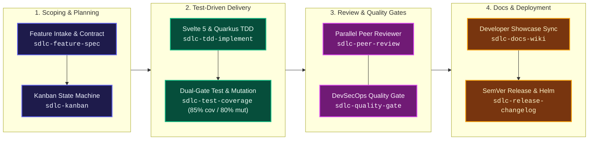
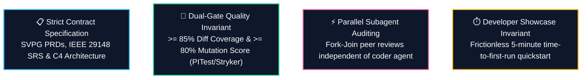

# 🚀 Welcome to the Agentic SDLC Framework Wiki

> **Autonomous Multi-Agent Software Development Lifecycle Orchestration**  
> *Transforming standard AI coding agents into an enterprise-grade, disciplined software engineering team.*

---

## 🧭 Ecosystem Overview

The **Agentic SDLC Framework** orchestrates specialized AI agents across the entire software delivery lifecycle—from initial requirements intake to production deployment.

---

## 📚 Central Wiki Navigation

| Section | Focus Area | Description |
| :--- | :--- | :--- |
| 🏛️ **[Architecture Design](Architecture)** | System Design & Flow | Deep-dive into the 8-stage lifecycle, Mermaid sequence flows, and state machines. |
| 🧠 **[Skills Reference](Skills-Reference)** | Agentic Capabilities | Complete catalog of the 12 interlocking skills, role definitions, and allowed tools. |
| 🎯 **[Traceability & Views](Traceability)** | Governance & Audit | 7-layer traceability thread, 6 standard Project v2 views, and custom fields. |
| 📋 **[Living Kanban Board](https://github.com/fmatar/agentic-sdlc-framework/blob/main/docs/KANBAN.md)** | Project Governance | Real-time GitHub Projects v2 issue states and active milestones. |
| 📖 **[Operations Guide](https://github.com/fmatar/agentic-sdlc-framework/blob/main/docs/SDLC_AGENTIC_OPERATIONS_GUIDE.md)** | Operational Playbook | Step-by-step developer and agentic recipes for everyday engineering workflows. |

---

## 💎 Core Engineering Invariants

---

## ⚡ Quick Trigger Example

To run the full end-to-end autonomous pipeline on any GitHub issue:

> *"Trigger `sdlc-flow` to execute issue #1031. Check session concurrency, create the feature branch, implement with Uncle Bob's TDD, enforce Dual-Gate test coverage (>= 85%) and mutation defense (>= 80%), sync README showcase and CHANGELOG, open a PR, and dispatch parallel peer review and quality gate subagents."*
