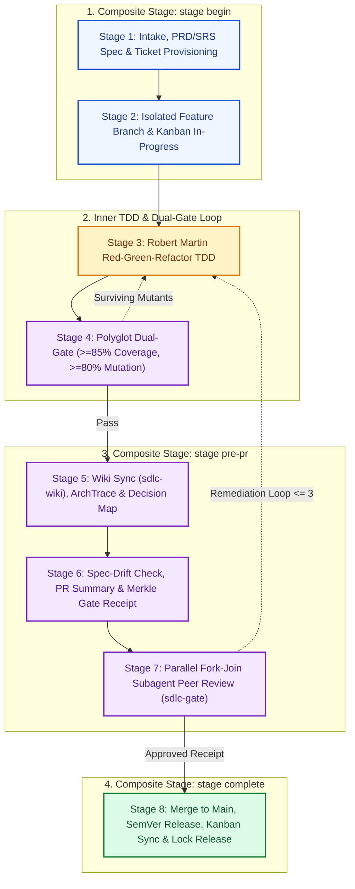

# 🏛️ Welcome to the Agentic SDLC Framework Wiki

**Autonomous Software Development Lifecycle Governance, Spec-Driven Autopilot, Archlens Concentric Ring Enforcement & Dual-Gate Verification for AI Coding Agents**

---

## 🌟 Executive Summary

The **Agentic SDLC Framework** transforms AI coding agents (**Google Antigravity / Gemini**, **Anthropic Claude Code**, **Cursor**, **Grok**, **Windsurf**, and **GitHub Copilot**) into disciplined, autonomous engineering systems. Governed by a deterministic Node.js engine (`.agent/scripts/sdlc-engine.mjs`) decomposed into **12 modular libraries** (`.agent/scripts/lib/*.mjs`) and **1 Universal Router + 9 Verb Skills** (`ADR-004` & `ADR-007`), it enforces:

- **Spec-Driven Product Autopilot (`PRODUCT.md`)**: Synthesizes product vision, hard invariants (`INV-XX`), and functional capabilities (`CAP-XX`) into two-tier PRDs (`docs/PRD.md`), IEEE 29148 SRS specifications (`docs/SRS.md`), and topological DAG execution waves.
- **Robert C. Martin Clean Architecture & TDD**: Strictly enforces the **Three Laws of TDD** (*Red-Green-Refactor*), the **Transformation Priority Premise (TPP)**, and **Archlens Concentric Ring Boundaries** (`.archlens/policy.json`).
- **Real Polyglot Dual-Gate Verification**: Requires **$\ge 85\%$ Diff Line/Branch Coverage** and **$\ge 80\%$ Mutation Kill Score** across Node.js/TypeScript, SvelteKit 5, Java (Quarkus/Maven/Gradle), Python, Go, and Rust, accelerated by a **Content-Addressable SHA-256 Gate Cache** (`.agent/sdlc-gate-cache.json`).
- **4-Layer Git Lockdown & Merkle Gate Receipts**: Zero direct commits, merges, or pushes to `main` or `develop`. Merges require a cryptographic **Stage 7 SHA-256 Merkle Gate Receipt** (`.agent/gate-receipts.jsonl`).
- **Living AST-to-Wiki Synchronization (`sdlc-wiki`)**: Deterministically maps source code AST exports, Archlens ring coupling/instability ($Ca, Ce, I$), capabilities, and ADRs to `wiki/Codebase-Map.md` and audits `wiki/*.md` on every PR gate.

---

## 🧭 Diátaxis Wiki Navigation Map

| Wiki Document | Diátaxis Quadrant | What You Will Find |
| :--- | :--- | :--- |
| **[Home.md](Home.md)** | **Overview & Quickstart** | 8-Stage lifecycle overview, 10-skill suite summary, composite stage CLI, and quickstart commands. |
| **[Architecture.md](Architecture.md)** | **Explanation & Design** | Archlens Concentric Rings (`Ring 0`–`Ring 3`), modular `.agent/scripts/lib/*.mjs` topology, 4-Layer Git Guard, SHA-256 Gate Cache, and Causal Decision Graph (`docs/DECISION_MAP.md`). |
| **[Skills-Reference.md](Skills-Reference.md)** | **Reference (Skills & CLI)** | Complete reference for `/sdlc` + 9 verb skills (`sdlc-product`, `sdlc-adr`, `sdlc-flow`, `sdlc-tdd`, `sdlc-gate`, `sdlc-status`, `sdlc-doctor`, `sdlc-release`, `sdlc-wiki`) and `sdlc-engine.mjs` subcommands. |
| **[Traceability.md](Traceability.md)** | **How-To & Operations** | Multi-provider ticket engine (`GitHub`, `Linear`, `Jira`), `.agent/scripts/project-setup.sh`, `.agent/scripts/kanban-sync.sh`, `docs/AUDIT_CHAIN.jsonl`, and `wiki audit` gates. |
| **[Codebase-Map.md](Codebase-Map.md)** | **AST & Ring Inventory** | Auto-generated AST export signatures (with line numbers), Archlens $Ca / Ce / I$ metrics, `CAP-01..CAP-11` matrix, and `ADR-001..ADR-007` ledger. |

---

## 🔄 The 8-Stage Autonomous Lifecycle & Composite Stage CLI

To eliminate bookkeeping friction while maintaining cryptographic governance, `.agent/scripts/lib/session.mjs` collapses ~15 granular lifecycle steps into **3 atomic Composite Stage transitions** (`stage begin`, `stage pre-pr`, `stage complete`) across the 8-stage pipeline:



---

## 🛠️ Canonical 10-Skill Suite (`1 Router + 9 Verb Skills`)

Per `ADR-002`, `ADR-004`, and `ADR-007`, the framework consolidates all agent capabilities into **1 Universal Router (`/sdlc`)** and **9 Verb-Driven Skills**:

| Skill | Role & Primary Responsibility | Primary Engine Entrypoint |
| :--- | :--- | :--- |
| **`/sdlc`** (`sdlc`) | **Universal Command Router**: Maps `/sdlc <subcommand>` `1:1` to `sdlc-engine.mjs`. | `node .agent/scripts/sdlc-engine.mjs <cmd>` |
| **`/sdlc-product`** (`sdlc-product`) | **Product Autopilot & IEEE 29148 SRS Architect**: Authors `PRODUCT.md`, `docs/PRD.md`, `docs/SRS.md`, `docs/specs/`, and topological DAG execution waves. | `node .agent/scripts/sdlc-engine.mjs product <init\|spec\|plan\|control>` |
| **`/sdlc-adr`** (`sdlc-adr`) | **ADR Lifecycle & Spec-Drift Sentinel**: Mints, decides, and compacts ADRs in `docs/adr/`, checks `PRODUCT.md` drift, and syncs `docs/DECISION_MAP.md`. | `node .agent/scripts/sdlc-engine.mjs adr <create\|list\|decide\|compact>` |
| **`/sdlc-flow`** (`sdlc-flow`) | **Master 8-Stage Orchestrator**: Drives end-to-end ticket delivery via `stage begin`, TDD, Dual-Gate, `stage pre-pr`, and `stage complete`. | `node .agent/scripts/sdlc-engine.mjs stage <begin\|pre-pr\|complete>` |
| **`/sdlc-tdd`** (`sdlc-tdd`) | **Robert Martin TDD & Dual-Gate Runner**: Guides Red-Green-Refactor cycles, bug reproduction harnesses, coverage ($\ge 85\%$), and mutation ($\ge 80\%$). | `node .agent/scripts/sdlc-engine.mjs <test\|coverage\|mutation\|reproduce>` |
| **`/sdlc-gate`** (`sdlc-gate`) | **Parallel Fork-Join Peer Reviewer & Gatekeeper**: Runs 9-pillar strict quality gates, Archlens ring diffing, security/CVE audits, and signs Stage 7 receipts. | `node .agent/scripts/sdlc-engine.mjs gate --strict` |
| **`/sdlc-status`** (`sdlc-status`) | **Mission Control & Telemetry Inspector**: Displays active session stage, Kanban board, ROI metrics, and embeds the live Architecture Diff UI (`http://localhost:4120`). | `node .agent/scripts/sdlc-engine.mjs <session dashboard\|stats\|ui-snapshot>` |
| **`/sdlc-doctor`** (`sdlc-doctor`) | **Environment Healer & Multi-Agent Installer**: Detects polyglot stacks, auto-heals missing assets (`--fix`), installs 4-Layer Git hooks, and provisions 6 AI agents. | `node .agent/scripts/sdlc-engine.mjs <doctor --fix\|install>` |
| **`/sdlc-release`** (`sdlc-release`) | **Release & Canary Manager**: Generates cryptographic regression proofs (`docs/proofs/`), bumps SemVer manifests/changelogs, and runs canary rollback watchdogs. | `node .agent/scripts/sdlc-engine.mjs <release\|proof\|watchdog>` |
| **`/sdlc-wiki`** (`sdlc-wiki`) | **Technical Writer & Archlens Wiki Architect**: Synchronizes `wiki/Codebase-Map.md` from AST exports and `.archlens/policy.json` rings, and audits `wiki/*.md` for zero rot. | `node .agent/scripts/sdlc-engine.mjs wiki <sync\|audit\|map>` |

---

## 🚀 Quickstart Commands

```bash
# 1. Install or update skills across Gemini, Claude Code, Cursor, Grok, Windsurf & Copilot
node .agent/scripts/sdlc-engine.mjs install --agents gemini,claude,cursor,grok,windsurf,copilot --with-archlens --with-hooks --with-ci --yes

# 2. Run Environment Healthcheck & Auto-Fix
node .agent/scripts/sdlc-engine.mjs doctor --fix

# 3. Begin an SDLC Ticket Session (Stage 1 -> Stage 2)
node .agent/scripts/sdlc-engine.mjs stage begin --issue 90 --title "Enhance Wiki & Archlens Mapping" --type feat --checkout

# 4. Synchronize & Audit Wiki Documentation against Source AST & Archlens Rings
node .agent/scripts/sdlc-engine.mjs wiki sync
node .agent/scripts/sdlc-engine.mjs wiki audit --strict

# 5. Launch the Mission Control Clearinghouse Ledger UI (http://localhost:4120)
node .agent/scripts/sdlc-engine.mjs serve --port 4120
```
