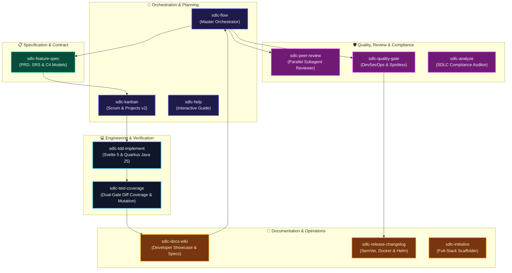

# 🧠 Agentic Skills Reference

The **Agentic SDLC Framework** is powered by 12 interlocking skills located in `.agent/skills/`. Each skill encapsulates a discrete software engineering discipline and defines an explicit **"Next Recommended Step"** for autonomous workflow chaining.

---

## 🗺️ Skills Domain Topology



---

## 📋 Comprehensive Skills Directory

| Skill | Role Persona | Primary Responsibilities | Allowed Tools | Autonomous Next Step |
| :--- | :--- | :--- | :--- | :--- |
| **`sdlc-flow`** | Master Orchestrator | Drives the 8-stage issue-to-PR pipeline, session concurrency locking (`.sdlc-session.json`), ad-hoc fast-path, and parallel fork-join subagent reviews. | `run_command`, `view_file`, `write_to_file`, `replace_file_content`, `invoke_subagent`, `manage_subagents`, `send_message`, `call_mcp_tool` | 👉 `sdlc-feature-spec` |
| **`sdlc-feature-spec`** | Product Owner / Architect | Generates SVPG PRDs, IEEE 29148 SRS, C4 architecture diagrams, ADRs, and GitHub issues. | `run_command`, `view_file`, `write_to_file`, `github-mcp` | 👉 `sdlc-kanban` & `sdlc-flow` |
| **`sdlc-tdd-implement`** | Full-Stack Engineer | Strict TDD feature implementation (Uncle Bob's 3 Laws & TPP) using Svelte 5 Runes and Quarkus Java 25. | `run_command`, `view_file`, `write_to_file`, `replace_file_content` | 👉 `sdlc-test-coverage` |
| **`sdlc-test-coverage`** | QA Automation Engineer | Enforces Dual-Gate testing: diff coverage ($\ge 85\%$) and mutation kill score ($\ge 80\%$) via PITest & Stryker. | `run_command`, `view_file`, `write_to_file`, `replace_file_content` | 👉 `sdlc-docs-wiki` |
| **`sdlc-peer-review`** | Peer Reviewer Subagent | Independently audits PR diffs, detects Uncle Bob test smells and mock abuse, verifies mutation score, and posts PR reviews. | `run_command`, `view_file`, `github-mcp` | 👉 Back to `sdlc-flow` |
| **`sdlc-kanban`** | Scrum Master / Project Lead | Manages GitHub Projects v2 views, 5-stage label transitions (`status:*`), WIP limits, and `docs/KANBAN.md`. | `run_command`, `view_file`, `write_to_file`, `github-mcp` | 👉 `sdlc-flow` |
| **`sdlc-docs-wiki`** | Technical Writer | Synchronizes root README showcase quickstart, `docs/specs/`, `CHANGELOG.md`, `docs/KANBAN.md`, and `/wiki`. | `run_command`, `view_file`, `write_to_file`, `replace_file_content` | 👉 `sdlc-quality-gate` |
| **`sdlc-quality-gate`** | DevSecOps Auditor | Enforces Spotless formatting, SvelteKit typing, test port isolation, Dual-Gate mutation defense, WCAG a11y, and SAST. | `run_command`, `view_file` | 👉 `sdlc-release-changelog` |
| **`sdlc-release-changelog`** | DevOps Engineer | Manages SemVer 2.0.0, Keep a Changelog updates, Git tagging, GitHub releases, Docker, and Helm. | `run_command`, `view_file`, `write_to_file`, `github-mcp` | 👉 Deployment Monitoring |
| **`sdlc-analyze`** | Compliance Auditor | Evaluates repo health, 5-minute quickstart validity, Dual-Gate test coverage, and mutation score compliance. | `run_command`, `view_file` | 👉 `sdlc-flow` / `sdlc-test-coverage` |
| **`sdlc-initialize`** | Bootstrap Installer | Scaffolds greenfield Svelte 5 + Quarkus projects configuring PITest, Stryker, and all 12 agentic skills. | `run_command`, `view_file`, `write_to_file` | 👉 `sdlc-feature-spec` |
| **`sdlc-help`** | Support & Diagnostics | Diagnostic CLI and prompt recipes to guide developers and agents through the ecosystem. | `run_command`, `view_file` | 👉 Skill of choice |

---

## ⚡ Autonomous Handoff Protocol

Skills do not operate in silos. Every skill returns a standardized handoff block:

```markdown
---
## ⏭️ Next Recommended Step
Once [current-phase-criteria] is satisfied:
👉 **Transition to [`sdlc-<next-skill>`](../sdlc-<next-skill>/SKILL.md)** to execute [next-phase-action].
```

This invariant allows autonomous agents to chain multi-stage engineering tasks without needing human intervention at every step.
