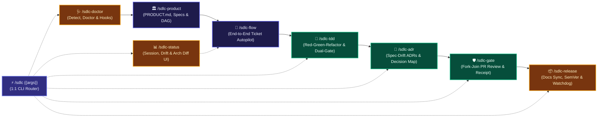

# 🧠 Agentic Skills Reference (`ADR-004`: 1 Router + 8 Verb Skills)

The **Agentic SDLC Framework** provides **1 Universal Command Router (`/sdlc`)** and **8 Verb-Driven Skills** in `.agent/skills/`. Each skill uses validated agent tools (`read_file`, `write_file`, `edit_file`, `run_command`, `invoke_subagent`) and delegates mechanical operations to `.agent/scripts/sdlc-engine.mjs`.

---

## 🗺️ Skills Topology

---

## 📋 Canonical 9-Skill Catalog (1 Router + 8 Verb Skills)

| Skill | Category | Replaces (`ADR-004`) | Primary Responsibilities | Allowed Tools |
| :--- | :--- | :--- | :--- | :--- |
| **`sdlc`** | **Universal Router** | New (`/sdlc <cmd>`) | Routes `/sdlc doctor`, `/sdlc begin #id`, `/sdlc status`, `/sdlc drift`, `/sdlc pre-pr`, `/sdlc gate`, `/sdlc kanban`, `/sdlc ui` 1:1 to `sdlc-engine.mjs`. | `read_file`, `write_file`, `edit_file`, `run_command`, `invoke_subagent` |
| **`sdlc-flow`** | **Macro Autopilot** | `sdlc-flow` | Drives end-to-end feature/bug delivery (`stage begin` → TDD → `stage pre-pr` → parallel review → `stage complete`). | `read_file`, `write_file`, `edit_file`, `run_command`, `invoke_subagent` |
| **`sdlc-product`** | **Macro Autopilot** | `sdlc-product` | Synthesizes `PRODUCT.md` (`CAP-XX`, `INV-XX`), authors `docs/specs/*.md`, C4 diagrams, and schedules topological DAG waves. | `read_file`, `write_file`, `edit_file`, `run_command`, `invoke_subagent` |
| **`sdlc-doctor`** | **Ops & Diagnostics** | `sdlc-init` | Stack discovery (`detect`), `doctor --fix`, 4-Layer Git hooks, `.archlens/policy.json`, and multi-agent installer (`install`). | `read_file`, `write_file`, `edit_file`, `run_command` |
| **`sdlc-status`** | **Ops & Diagnostics** | New verb skill | Displays active session, 8-stage progress, `drift check`, `KANBAN.md`, ROI stats, and live Architecture Diff UI (`ui-snapshot`). | `read_file`, `write_file`, `edit_file`, `run_command` |
| **`sdlc-tdd`** | **Stage Action** | `sdlc-tdd` | Enforces Robert Martin's 3 Laws of TDD, TPP, F.I.R.S.T. isolation, real coverage (≥ 85%), mutation kill score (≥ 80%), and `reproduce`. | `read_file`, `write_file`, `edit_file`, `run_command` |
| **`sdlc-gate`** | **Stage Action** | `sdlc-review-gate` | Parallel Fork-Join PR diff review (`TypeName: "research"`), strict 9-pillar quality gate (`gate --strict`), and Stage 7 Merkle receipt. | `read_file`, `write_file`, `edit_file`, `run_command`, `invoke_subagent` |
| **`sdlc-adr`** | **Stage Action** | New verb skill | Mints/lists/decides Spec-Drift ADRs (`docs/adr/ADR-00X.md`), runs `drift check`, and syncs `docs/DECISION_MAP.md`. | `read_file`, `write_file`, `edit_file`, `run_command` |
| **`sdlc-release`** | **Stage Action** | `sdlc-release` | Synchronizes `README.md`, `docs/specs/`, `CHANGELOG.md`, and `/wiki`, and executes SemVer releases, regression proofs, and canary watchdogs. | `read_file`, `write_file`, `edit_file`, `run_command` |
