# 🎯 End-to-End Traceability, Multi-Provider Kanban & Cryptographic Ledgers

The **Agentic SDLC Framework** enforces unbroken traceability from constitutional product capabilities (`PRODUCT.md`) and issue tickets (`GitHub Issues`, `Linear`, `Jira`, and `docs/KANBAN.md`) down to feature branches, Mermaid architecture diffs (`docs/ARCH_TRACE.md`), cryptographic audit records (`docs/AUDIT_CHAIN.jsonl`), Stage 7 Gate Receipts (`.agent/gate-receipts.jsonl`), and AST-verified wiki documentation (`wiki/Codebase-Map.md`).

---

## 1. End-to-End Traceability Chain

```mermaid
flowchart LR
    P["PRODUCT.md (CAP-XX / INV-XX)"] --> S["docs/specs/cap-XX-*.md (PRD + IEEE 29148 SRS)"]
    S --> T["Ticket (#ID in GitHub / Linear / Jira & docs/KANBAN.md)"]
    T --> B["Isolated Branch (feature/issue-#ID-slug)"]
    B --> C["TDD & Dual-Gate (>=85% Cov, >=80% Mut)"]
    C --> W["Wiki Sync & Audit (wiki/Codebase-Map.md)"]
    W --> R["Stage 7 Merkle Gate Receipt (.agent/gate-receipts.jsonl)"]
    R --> M["Protected Merge to main & Release Tag"]
```



| Traceability Artifact | Repository Path | Governing Engine Module |
| :--- | :--- | :--- |
| **Product Constitution** | `PRODUCT.md` | `.agent/scripts/lib/product-dag.mjs` |
| **Two-Tier PRD & IEEE 29148 SRS** | `docs/PRD.md`, `docs/SRS.md`, `docs/specs/` | `.agent/scripts/lib/product-dag.mjs` |
| **Architecture Decision Records** | `docs/adr/ADR-001..ADR-007` | `.agent/scripts/lib/adr-drift.mjs` |
| **Causal Decision Lineage Map** | `docs/DECISION_MAP.md` | `.agent/scripts/lib/decision-graph.mjs` |
| **Living Markdown Kanban Board** | `docs/KANBAN.md` | `.agent/scripts/lib/pm-provider.mjs` & `.agent/scripts/kanban-sync.sh` |
| **Canonical Issue & PR Templates** | `.github/ISSUE_TEMPLATE/*.md`, `.github/PULL_REQUEST_TEMPLATE.md` | `.agent/scripts/lib/pm-provider.mjs` |
| **Architectural Trace Ledger** | `docs/ARCH_TRACE.md`, `.agent/arch-trace.jsonl` | `.agent/scripts/lib/arch-trace.mjs` |
| **Merkle Cryptographic Audit Chain** | `docs/AUDIT_CHAIN.jsonl` | `.agent/scripts/lib/audit-chain.mjs` |
| **Stage 7 Merge Gate Receipts** | `.agent/gate-receipts.jsonl` | `.agent/scripts/lib/audit-chain.mjs` & `.agent/scripts/lib/git-guard.mjs` |
| **AST-to-Wiki Codebase Map** | `wiki/Codebase-Map.md` | `.agent/scripts/lib/wiki-sync.mjs` |

---

## 2. Unified Multi-Provider Ticket Engine (`pm-provider.mjs`)

Per `CAP-10`, `.agent/scripts/lib/pm-provider.mjs` provides a 4-operation interface (`createTicket`, `transitionPMState`, `postPMComment`, `syncKanbanBoard`) across **GitHub Projects v2**, **Linear GraphQL**, **Jira REST API v3**, and local **Markdown fallback** (`docs/KANBAN.md`), with zero shell interpolation (`execFileSync` argument arrays per `INV-04`):

```bash
# 1. Scaffold the 5 canonical issue & PR templates (.github/ISSUE_TEMPLATE/*.md)
node .agent/scripts/sdlc-engine.mjs ticket templates

# 2. Create a templated ticket (feat | bug | hotfix | spike)
node .agent/scripts/sdlc-engine.mjs ticket create --type feat --title "Add Archlens Wiki Sync" --problem "Wiki pages drift from AST" --solution "Build lib/wiki-sync.mjs"

# 3. Transition ticket state (backlog | ready | in-progress | in-review | done)
node .agent/scripts/sdlc-engine.mjs ticket transition 90 in-progress

# 4. Post a structured verification comment
node .agent/scripts/sdlc-engine.mjs ticket comment 90 --body "Dual-Gate and Wiki Audit passed."

# 5. Synchronize docs/KANBAN.md with live provider state
node .agent/scripts/sdlc-engine.mjs ticket sync
```

### GitHub Projects v2 Provisioning & Sync Scripts

For repositories using GitHub Projects v2, two executable helper scripts in `.agent/scripts/` automate custom field provisioning and local board generation:

```bash
# Provision GitHub Project v2 with Priority, Component, Estimate, Spec Link, and Quality Gate fields
.agent/scripts/project-setup.sh --title "Agentic SDLC Roadmap"

# Regenerate docs/KANBAN.md with the 5-column Board Overview and End-to-End Traceability Matrix
.agent/scripts/kanban-sync.sh
```

---

## 3. Cryptographic Audit Trail & Stage 7 Merkle Gate Receipts

Every state transition in the framework is recorded in two tamper-evident ledgers managed by `.agent/scripts/lib/audit-chain.mjs`:

1. **Sequential SHA-256 Merkle Audit Chain (`docs/AUDIT_CHAIN.jsonl`)**:
   - Each record hashes `index + timestamp + event + metadata + previousHash` starting from `GENESIS_HASH` (`0000...0000`).
   - Verify integrity at any time:
     ```bash
     node .agent/scripts/sdlc-engine.mjs audit verify
     ```
2. **Stage 7 Cryptographic Gate Receipts (`.agent/gate-receipts.jsonl`)**:
   - Issued during `node .agent/scripts/sdlc-engine.mjs stage pre-pr` (or `guard receipt`) only when **Spec-Drift (`checkSpecDrift`)** and **Wiki Audit (`auditWiki`)** pass.
   - Binds the branch `HEAD` commit SHA, ticket ID, coverage/mutation metrics, and current Merkle root into an HMAC-SHA256 signature verified by `verifyMergeGuard` before any merge into `main`.

---

## 4. Zero-Rot Wiki Auditing (`sdlc-wiki` & `lib/wiki-sync.mjs`)

To prevent documentation drift, `node .agent/scripts/sdlc-engine.mjs wiki audit --strict` runs five deterministic checks across all `wiki/*.md` pages (and is invoked automatically during `stage pre-pr` and `gate --strict`):

1. **`DEPRECATED_SKILL_REF`**: Flags any active reference to retired legacy skills (`DEPRECATED_SDLC_SKILLS`).
2. **`BROKEN_CODE_PATH`**: Verifies that every backticked repository path (`.agent/...`, `docs/...`, `wiki/...`, `tests/...`) exists on disk.
3. **`UNDOCUMENTED_SKILL`**: Ensures every skill in `CANONICAL_SDLC_SKILLS` is documented in `wiki/`.
4. **`UNMAPPED_SOURCE_MODULE`**: Ensures every `.agent/scripts/lib/*.mjs` module and `.agent/scripts/sdlc-engine.mjs` is mapped in `wiki/Codebase-Map.md` and `wiki/Architecture.md`.
5. **`INVALID_MERMAID_DIAGRAM`**: Validates Mermaid diagram headers and parses flowcharts via `parseMermaidDiagram` in `.agent/scripts/lib/arch-trace.mjs`.
