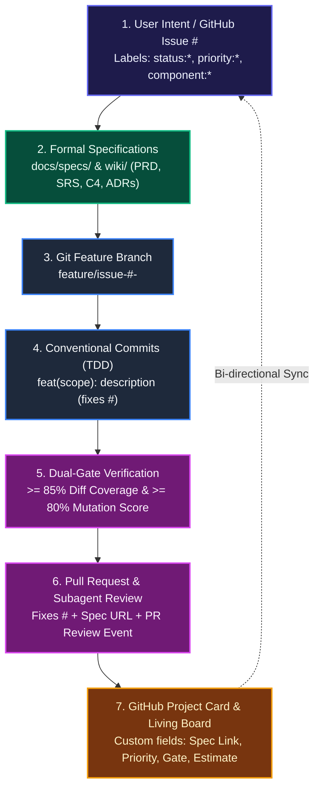

# 🎯 Project Traceability & Governance Architecture

> **Complete Auditability from Concept to Deployment**  
> How the Agentic SDLC Framework maintains a 100% unbreakable thread of custody across requirements, specifications, code, tests, reviews, and releases.

---

## 🧵 The 7-Layer Traceability Thread

Every artifact generated in an Agentic SDLC project links deterministically to its upstream parent and downstream consumers:



---

## 🎨 6 Recommended GitHub Projects v2 Views

To provide end-to-end visibility for developers, tech leads, and autonomous agents, every project is provisioned with 6 purpose-built views:

| View Name | Layout | Filter & Grouping | Displayed Fields | Purpose |
| :--- | :--- | :--- | :--- | :--- |
| **1. ⚡ Kanban Board** | `Board` | Group by `Status`<br/>WIP: In Progress (3–5), In Review (2–3) | Title, Priority, Component, Estimate, Assignee, Linked PR | Primary operational flow. Prevents agent saturation and enforces WIP limits. |
| **2. 🎯 Traceability Matrix** | `Table` | Group by `Milestone` or `Component`<br/>Sort by Issue # descending | Issue, Status, Priority, Component, **Spec Link**, Linked PR, **Quality Gate** | 100% audit trail. Instantly reveals which issues lack specs or PR links. |
| **3. 📥 Backlog & Triage** | `Table` | Filter: `Status: Backlog, Ready`<br/>Sort by `Priority` (P0 $\rightarrow$ P3), then `Estimate` | Title, Priority, Component, Estimate, Milestone | Sprint planning and backlog grooming. Identifies tickets ready for specification. |
| **4. 🏃 Active Sprint** | `Board` | Filter: `Iteration: @current`<br/>Group by `Status` | Title, Priority, Assignee, Linked PR | Focused daily standup and active execution view. |
| **5. 🛡️ Quality Gate & Review Audit** | `Table` | Filter: `Status: In Review`<br/>Sort by Updated date | Title, Assignee, Linked PR, **Quality Gate**, Subagent Review Status | Peer review tracking. Catches mutation score failures and review bottlenecks. |
| **6. 🗺️ Epics & Milestone Roadmap** | `Roadmap` | Group by `Milestone`<br/>Timeline by Target Date | Milestone, Epics, Issues, Target Completion | Strategic release forecasting for stakeholders and product owners. |

---

## ⚙️ Standardized Custom Fields

The GitHub Projects v2 board requires these custom fields for full traceability:

1. **`Status`** (Single Select): `Backlog`, `Ready`, `In Progress`, `In Review`, `Done`
2. **`Priority`** (Single Select): `P0 - Critical`, `P1 - High`, `P2 - Medium`, `P3 - Low`
3. **`Component`** (Single Select): `Backend`, `Frontend`, `DevOps`, `Documentation`, `Architecture`
4. **`Estimate`** (Number): Story points (1, 2, 3, 5, 8)
5. **`Spec Link`** (Text / URL): Direct link to `docs/specs/<file>.md` or `wiki/<Spec>.md`
6. **`Quality Gate`** (Single Select): `Pending`, `Passed`, `Failed`

---

## 🛠️ Automated Setup & CLI Operations

### Automated Provisioning Script
Run the automated project setup script to provision the project and fields:
```bash
# Ensure gh CLI has project scope
gh auth refresh -s project,read:project

# Execute automated project setup
.agent/skills/sdlc-kanban/scripts/project-setup.sh
```

### Refreshing the Living Repository Board
To synchronize GitHub issues and the Traceability Matrix into the version-controlled `docs/KANBAN.md`:
```bash
.agent/skills/sdlc-kanban/scripts/kanban-sync.sh
```
